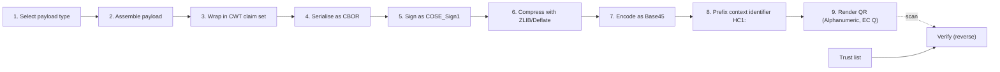

<!-- GENERATED by tools/build_kg.py from requirements/kg/*.yaml. Do not edit. -->

# SMART Trust HCERT API library requirements

Derived requirements for the Kotlin (phase 1) and Rust (phase 2) libraries that implement the HCERT QR pipeline described in the WHO SMART Trust IG, in particular the *QR Code Generation* page added by [WorldHealthOrganization/smart-trust#129](https://github.com/WorldHealthOrganization/smart-trust/pull/129).

The source of truth is the YAML under [`requirements/kg/`](../kg/). This page and the RDF graph ([`kg.ttl`](kg.ttl), [`kg.jsonld`](kg.jsonld)) are generated from it.

## How sources are referenced

Every smart-trust reference carries up to four URLs, so links work today and after PR 129 is merged and deployed:

| Tier | Meaning | Base |
|---|---|---|
| pinned (`main`) | smart-trust main at time of drafting (IG version 1.7.5 ci-build) | `e277cce5dcb8` |
| pinned (`pr129`) | smart-trust PR 129 head (QR Code Generation page) | `50bcb25b387d` |
| PR preview | IG build of the PR branch | https://worldhealthorganization.github.io/smart-trust/branches/intelligent-bell-usgxfu/ |
| CI build | continuous build of main | https://worldhealthorganization.github.io/smart-trust/ |
| published | canonical released IG | https://smart.who.int/trust/ |

Links below go to the pinned source. Content from PR 129 also links to its PR preview and to where it will be published. Section anchors are computed from headings (see OI-10).

## Summary

- **83 requirements**: 2 MAY, 75 SHALL, 2 SHALL NOT, 4 SHOULD
- by category: api 5, architecture 5, functional 48, non-functional 5, scope 2, security 11, test 7
- by derivation: derived 43, direct 36, directive 4
- **14 open issues** (11 to fix upstream in smart-trust)

## Pipeline



| Step | Source | Requirements |
|---|---|---|
| 1. Select payload type | [QR Code Generation § 2. Step 1 — Select the logical model for your use case](https://github.com/WorldHealthOrganization/smart-trust/blob/50bcb25b387d7e7113ffc9e9046452580f9d67aa/input/pagecontent/qr_code_generation.md#2-step-1--select-the-logical-model-for-your-use-case) ([PR preview](https://worldhealthorganization.github.io/smart-trust/branches/intelligent-bell-usgxfu/qr_code_generation.html#2-step-1--select-the-logical-model-for-your-use-case) · [after deploy](https://smart.who.int/trust/qr_code_generation.html#2-step-1--select-the-logical-model-for-your-use-case)) | [STT-GEN-001](#stt-gen-001), [STT-SEL-001](#stt-sel-001), [STT-SEL-002](#stt-sel-002), [STT-SEL-003](#stt-sel-003), [STT-SEL-004](#stt-sel-004), [STT-SEL-005](#stt-sel-005), [STT-SEL-006](#stt-sel-006) |
| 2. Assemble payload | [QR Code Generation § 3. Step 2 — Assemble the payload](https://github.com/WorldHealthOrganization/smart-trust/blob/50bcb25b387d7e7113ffc9e9046452580f9d67aa/input/pagecontent/qr_code_generation.md#3-step-2--assemble-the-payload) ([PR preview](https://worldhealthorganization.github.io/smart-trust/branches/intelligent-bell-usgxfu/qr_code_generation.html#3-step-2--assemble-the-payload) · [after deploy](https://smart.who.int/trust/qr_code_generation.html#3-step-2--assemble-the-payload)) | [STT-GEN-001](#stt-gen-001), [STT-PAY-001](#stt-pay-001), [STT-PAY-002](#stt-pay-002), [STT-PAY-003](#stt-pay-003), [STT-PAY-004](#stt-pay-004), [STT-PAY-005](#stt-pay-005), [STT-PAY-006](#stt-pay-006), [STT-PAY-007](#stt-pay-007), [STT-PAY-008](#stt-pay-008), [STT-PAY-009](#stt-pay-009) |
| 3. Wrap in CWT claim set | [QR Code Generation § 4. Step 3 — Build the CWT claim set](https://github.com/WorldHealthOrganization/smart-trust/blob/50bcb25b387d7e7113ffc9e9046452580f9d67aa/input/pagecontent/qr_code_generation.md#4-step-3--build-the-cwt-claim-set) ([PR preview](https://worldhealthorganization.github.io/smart-trust/branches/intelligent-bell-usgxfu/qr_code_generation.html#4-step-3--build-the-cwt-claim-set) · [after deploy](https://smart.who.int/trust/qr_code_generation.html#4-step-3--build-the-cwt-claim-set)) | [STT-GEN-001](#stt-gen-001), [STT-SEL-004](#stt-sel-004), [STT-CWT-001](#stt-cwt-001), [STT-CWT-002](#stt-cwt-002), [STT-CWT-003](#stt-cwt-003), [STT-CWT-004](#stt-cwt-004), [STT-CWT-005](#stt-cwt-005), [STT-CWT-006](#stt-cwt-006), [STT-ISS-001](#stt-iss-001) |
| 4. Serialise as CBOR | [QR Code Generation § 5. Step 4 — Serialise as CBOR](https://github.com/WorldHealthOrganization/smart-trust/blob/50bcb25b387d7e7113ffc9e9046452580f9d67aa/input/pagecontent/qr_code_generation.md#5-step-4--serialise-as-cbor) ([PR preview](https://worldhealthorganization.github.io/smart-trust/branches/intelligent-bell-usgxfu/qr_code_generation.html#5-step-4--serialise-as-cbor) · [after deploy](https://smart.who.int/trust/qr_code_generation.html#5-step-4--serialise-as-cbor)) | [STT-GEN-001](#stt-gen-001), [STT-CBR-001](#stt-cbr-001), [STT-CBR-002](#stt-cbr-002), [STT-CBR-003](#stt-cbr-003), [STT-QR-006](#stt-qr-006), [STT-ISS-001](#stt-iss-001) |
| 5. Sign as COSE_Sign1 | [QR Code Generation § 6. Step 5 — Sign as a COSE_Sign1](https://github.com/WorldHealthOrganization/smart-trust/blob/50bcb25b387d7e7113ffc9e9046452580f9d67aa/input/pagecontent/qr_code_generation.md#6-step-5--sign-as-a-cose_sign1) ([PR preview](https://worldhealthorganization.github.io/smart-trust/branches/intelligent-bell-usgxfu/qr_code_generation.html#6-step-5--sign-as-a-cose_sign1) · [after deploy](https://smart.who.int/trust/qr_code_generation.html#6-step-5--sign-as-a-cose_sign1)) | [STT-GEN-001](#stt-gen-001), [STT-GEN-009](#stt-gen-009), [STT-CWT-004](#stt-cwt-004), [STT-COS-001](#stt-cos-001), [STT-COS-002](#stt-cos-002), [STT-COS-003](#stt-cos-003), [STT-COS-004](#stt-cos-004), [STT-COS-005](#stt-cos-005), [STT-COS-006](#stt-cos-006), [STT-COS-007](#stt-cos-007), [STT-KID-001](#stt-kid-001), [STT-QR-006](#stt-qr-006), [STT-ISS-001](#stt-iss-001) |
| 6. Compress with ZLIB/Deflate | [QR Code Generation § 7. Step 6 — Compress](https://github.com/WorldHealthOrganization/smart-trust/blob/50bcb25b387d7e7113ffc9e9046452580f9d67aa/input/pagecontent/qr_code_generation.md#7-step-6--compress) ([PR preview](https://worldhealthorganization.github.io/smart-trust/branches/intelligent-bell-usgxfu/qr_code_generation.html#7-step-6--compress) · [after deploy](https://smart.who.int/trust/qr_code_generation.html#7-step-6--compress)) | [STT-GEN-001](#stt-gen-001), [STT-ZIP-001](#stt-zip-001), [STT-ZIP-002](#stt-zip-002), [STT-QR-006](#stt-qr-006), [STT-ISS-001](#stt-iss-001) |
| 7. Encode as Base45 | [QR Code Generation § 8. Step 7 — Encode as Base45](https://github.com/WorldHealthOrganization/smart-trust/blob/50bcb25b387d7e7113ffc9e9046452580f9d67aa/input/pagecontent/qr_code_generation.md#8-step-7--encode-as-base45) ([PR preview](https://worldhealthorganization.github.io/smart-trust/branches/intelligent-bell-usgxfu/qr_code_generation.html#8-step-7--encode-as-base45) · [after deploy](https://smart.who.int/trust/qr_code_generation.html#8-step-7--encode-as-base45)) | [STT-GEN-001](#stt-gen-001), [STT-B45-001](#stt-b45-001), [STT-B45-002](#stt-b45-002), [STT-QR-006](#stt-qr-006), [STT-ISS-001](#stt-iss-001) |
| 8. Prefix context identifier HC1: | [QR Code Generation § 9. Step 8 — Prefix the context identifier](https://github.com/WorldHealthOrganization/smart-trust/blob/50bcb25b387d7e7113ffc9e9046452580f9d67aa/input/pagecontent/qr_code_generation.md#9-step-8--prefix-the-context-identifier) ([PR preview](https://worldhealthorganization.github.io/smart-trust/branches/intelligent-bell-usgxfu/qr_code_generation.html#9-step-8--prefix-the-context-identifier) · [after deploy](https://smart.who.int/trust/qr_code_generation.html#9-step-8--prefix-the-context-identifier)) | [STT-GEN-001](#stt-gen-001), [STT-HC1-001](#stt-hc1-001), [STT-ISS-001](#stt-iss-001) |
| 9. Render QR (Alphanumeric, EC Q) | [QR Code Generation § 10. Step 9 — Render the QR code](https://github.com/WorldHealthOrganization/smart-trust/blob/50bcb25b387d7e7113ffc9e9046452580f9d67aa/input/pagecontent/qr_code_generation.md#10-step-9--render-the-qr-code) ([PR preview](https://worldhealthorganization.github.io/smart-trust/branches/intelligent-bell-usgxfu/qr_code_generation.html#10-step-9--render-the-qr-code) · [after deploy](https://smart.who.int/trust/qr_code_generation.html#10-step-9--render-the-qr-code)) | [STT-GEN-001](#stt-gen-001), [STT-QR-001](#stt-qr-001), [STT-QR-002](#stt-qr-002), [STT-QR-003](#stt-qr-003), [STT-QR-004](#stt-qr-004), [STT-QR-006](#stt-qr-006), [STT-ISS-001](#stt-iss-001) |
| 10. Verify (steps 9 to 1 in reverse, plus trust list lookup) | [QR Code Generation § 11. Verifying: the same steps upwards](https://github.com/WorldHealthOrganization/smart-trust/blob/50bcb25b387d7e7113ffc9e9046452580f9d67aa/input/pagecontent/qr_code_generation.md#11-verifying-the-same-steps-upwards) ([PR preview](https://worldhealthorganization.github.io/smart-trust/branches/intelligent-bell-usgxfu/qr_code_generation.html#11-verifying-the-same-steps-upwards) · [after deploy](https://smart.who.int/trust/qr_code_generation.html#11-verifying-the-same-steps-upwards)) | [STT-GEN-001](#stt-gen-001), [STT-GEN-009](#stt-gen-009), [STT-SEL-004](#stt-sel-004), [STT-PAY-008](#stt-pay-008), [STT-CWT-006](#stt-cwt-006), [STT-CBR-002](#stt-cbr-002), [STT-CBR-003](#stt-cbr-003), [STT-COS-002](#stt-cos-002), [STT-COS-003](#stt-cos-003), [STT-COS-004](#stt-cos-004), [STT-COS-005](#stt-cos-005), [STT-KID-002](#stt-kid-002), [STT-ZIP-002](#stt-zip-002), [STT-B45-002](#stt-b45-002), [STT-HC1-001](#stt-hc1-001), [STT-QR-005](#stt-qr-005), [STT-VER-001](#stt-ver-001), [STT-VER-002](#stt-ver-002), [STT-VER-003](#stt-ver-003), [STT-VER-004](#stt-ver-004), [STT-VER-005](#stt-ver-005), [STT-VER-006](#stt-ver-006), [STT-VER-007](#stt-ver-007), [STT-VER-008](#stt-ver-008), [STT-VER-009](#stt-ver-009), [STT-VER-010](#stt-ver-010), [STT-ISS-002](#stt-iss-002) |
| 11. Obtain trusted DSCs | [HCERT Specification § Appendix A - Trust Management](https://github.com/WorldHealthOrganization/smart-trust/blob/e277cce5dcb8d2134ef1625c3a38e27cdf19e835/input/pagecontent/hcert_spec.md#appendix-a---trust-management) ([published](https://smart.who.int/trust/hcert_spec.html#appendix-a---trust-management)) | [STT-SEL-006](#stt-sel-006), [STT-KID-001](#stt-kid-001), [STT-KID-002](#stt-kid-002), [STT-KID-003](#stt-kid-003), [STT-VER-006](#stt-ver-006), [STT-VER-009](#stt-ver-009), [STT-VER-010](#stt-ver-010), [STT-TRU-001](#stt-tru-001), [STT-TRU-002](#stt-tru-002), [STT-TRU-003](#stt-tru-003), [STT-TRU-004](#stt-tru-004), [STT-TRU-005](#stt-tru-005), [STT-TRU-006](#stt-tru-006) |

## Requirements

### GEN — Scope, architecture and language strategy

<a id="stt-gen-001"></a>

#### STT-GEN-001 Issuance and verification of the full HCERT QR pipeline

> The library SHALL implement issuance (steps 1 to 9) and verification (QR Code Generation section 11) of HCERT QR codes.

**SHALL** · scope · derived · targets: kotlin, rust

- Derived from:
  - [QR Code Generation § 1. The pipeline at a glance](https://github.com/WorldHealthOrganization/smart-trust/blob/50bcb25b387d7e7113ffc9e9046452580f9d67aa/input/pagecontent/qr_code_generation.md#1-the-pipeline-at-a-glance) ([PR preview](https://worldhealthorganization.github.io/smart-trust/branches/intelligent-bell-usgxfu/qr_code_generation.html#1-the-pipeline-at-a-glance) · [after deploy](https://smart.who.int/trust/qr_code_generation.html#1-the-pipeline-at-a-glance)) — “Steps 3 to 9 never vary. A verifier runs the same list upwards.”
- Steps: Select payload type, Assemble payload, Wrap in CWT claim set, Serialise as CBOR, Sign as COSE_Sign1, Compress with ZLIB/Deflate, Encode as Base45, Prefix context identifier HC1:, Render QR (Alphanumeric, EC Q), Verify (steps 9 to 1 in reverse, plus trust list lookup)
- Satisfies (smart-trust): [IssuerVDHC-generate](https://smart.who.int/trust/Requirements-IssuerVDHC.html), [IssuerVDHC-sign](https://smart.who.int/trust/Requirements-IssuerVDHC.html), [UtilizeVDHC-validate-hash](https://smart.who.int/trust/Requirements-UtilizeVDHC.html)
- API: [`HcertIssuer`](#api-issuer), [`HcertVerifier`](#api-verifier)

<a id="stt-gen-002"></a>

#### STT-GEN-002 Every step callable on its own

> Each pipeline step SHALL be exposed as a separate public operation (payload codec, CWT build, CBOR, COSE sign/parse, ZLIB, Base45, HC1 prefix, QR) as well as through the end-to-end issuer and verifier, so that integrators can substitute or inspect any stage.

**SHALL** · architecture · derived · targets: kotlin, rust

- Derived from:
  - [QR Code Generation § 1. The pipeline at a glance](https://github.com/WorldHealthOrganization/smart-trust/blob/50bcb25b387d7e7113ffc9e9046452580f9d67aa/input/pagecontent/qr_code_generation.md#1-the-pipeline-at-a-glance) ([PR preview](https://worldhealthorganization.github.io/smart-trust/branches/intelligent-bell-usgxfu/qr_code_generation.html#1-the-pipeline-at-a-glance) · [after deploy](https://smart.who.int/trust/qr_code_generation.html#1-the-pipeline-at-a-glance))
  - [QR Code Generation § Generating a QR Code](https://github.com/WorldHealthOrganization/smart-trust/blob/50bcb25b387d7e7113ffc9e9046452580f9d67aa/input/pagecontent/qr_code_generation.md#generating-a-qr-code) ([PR preview](https://worldhealthorganization.github.io/smart-trust/branches/intelligent-bell-usgxfu/qr_code_generation.html#generating-a-qr-code) · [after deploy](https://smart.who.int/trust/qr_code_generation.html#generating-a-qr-code)) — “The first step below is therefore a selection step, and everything after it is mechanical.”
- Refines: [STT-GEN-001](#stt-gen-001)
- API: [`Cbor`](#api-cbor), [`CoseSign1`](#api-sign1), [`Zlib`](#api-zlib), [`Base45`](#api-base45), [`ContextIdentifier`](#api-hc1), [`QrEncoder`](#api-qr)

<a id="stt-gen-003"></a>

#### STT-GEN-003 Payload-agnostic core

> The modules for steps 3 to 9 SHALL NOT depend on any payload logical model. Payloads SHALL be plugged in through a PayloadCodec registered against a subclaim.

**SHALL** · architecture · derived · targets: kotlin, rust

- Derived from:
  - [QR Code Generation § Generating a QR Code](https://github.com/WorldHealthOrganization/smart-trust/blob/50bcb25b387d7e7113ffc9e9046452580f9d67aa/input/pagecontent/qr_code_generation.md#generating-a-qr-code) ([PR preview](https://worldhealthorganization.github.io/smart-trust/branches/intelligent-bell-usgxfu/qr_code_generation.html#generating-a-qr-code) · [after deploy](https://smart.who.int/trust/qr_code_generation.html#generating-a-qr-code)) — “The container, the signature and the transport encoding are the same for every GDHCN trust domain ... What changes from one use case to the next is only the payload”
- Refines: [STT-GEN-001](#stt-gen-001)
- API: [`PayloadCodec`](#api-payload-codec), [`SubclaimRegistry`](#api-subclaim-registry)

<a id="stt-gen-004"></a>

#### STT-GEN-004 Kotlin first

> The first implementation SHALL be a Kotlin library. Pure steps (codec, model, payloads, pipeline logic) SHALL live in Kotlin Multiplatform common code. JVM and Android SHALL be the first supported targets. Other KMP targets MAY follow.

**SHALL** · non-functional · directive · targets: kotlin

- Derived from:
  - Stakeholder directive: Kotlin library first, Rust library second

<a id="stt-gen-005"></a>

#### STT-GEN-005 Rust second

> The second implementation SHALL be a Rust library meeting this same requirement set. The codec module SHOULD be usable without std (with alloc), so that it can be embedded and exposed over FFI or WASM.

**SHALL** · non-functional · directive · targets: rust

- Derived from:
  - Stakeholder directive: Kotlin library first, Rust library second

<a id="stt-gen-006"></a>

#### STT-GEN-006 Kotlin and Rust behave the same

> The Kotlin and Rust libraries SHALL expose the same conceptual operations, the same configuration knobs and the same failure taxonomy, with idiomatic naming in each language, and SHALL pass the same conformance vectors.

**SHALL** · architecture · directive · targets: kotlin, rust

- Derived from:
  - Stakeholder directive: Kotlin library first, Rust library second
- Refines: [STT-GEN-004](#stt-gen-004), [STT-GEN-005](#stt-gen-005)
- Verified by: [STT-TST-001](#stt-tst-001), [STT-TST-003](#stt-tst-003)

<a id="stt-gen-007"></a>

#### STT-GEN-007 HCERT Specification is authoritative

> Where the QR Code Generation walkthrough and the HCERT Specification differ, the library SHALL follow the HCERT Specification. Each release SHALL state which HCERT Specification version and which smart-trust IG version it implements (currently 1.1.1 and 1.7.5).

**SHALL** · non-functional · direct · targets: kotlin, rust

- Derived from:
  - [QR Code Generation § Generating a QR Code](https://github.com/WorldHealthOrganization/smart-trust/blob/50bcb25b387d7e7113ffc9e9046452580f9d67aa/input/pagecontent/qr_code_generation.md#generating-a-qr-code) ([PR preview](https://worldhealthorganization.github.io/smart-trust/branches/intelligent-bell-usgxfu/qr_code_generation.html#generating-a-qr-code) · [after deploy](https://smart.who.int/trust/qr_code_generation.html#generating-a-qr-code)) — “Where this page and the HCERT Specification appear to differ, the HCERT Specification is authoritative.”
  - [Change Log § v1.7.5](https://github.com/WorldHealthOrganization/smart-trust/blob/50bcb25b387d7e7113ffc9e9046452580f9d67aa/input/pagecontent/changes.md#v175) ([PR preview](https://worldhealthorganization.github.io/smart-trust/branches/intelligent-bell-usgxfu/changes.html#v175) · [after deploy](https://smart.who.int/trust/changes.html#v175))

<a id="stt-gen-008"></a>

#### STT-GEN-008 CBOR is the wire format; JSON is optional

> The library SHALL work entirely on in-memory structures and CBOR. It SHALL NOT need a JSON representation to issue or verify. A JSON view of payloads MAY be provided for display and debugging.

**SHALL** · architecture · direct · targets: kotlin, rust

- Derived from:
  - [QR Code Generation § 5. Step 4 — Serialise as CBOR](https://github.com/WorldHealthOrganization/smart-trust/blob/50bcb25b387d7e7113ffc9e9046452580f9d67aa/input/pagecontent/qr_code_generation.md#5-step-4--serialise-as-cbor) ([PR preview](https://worldhealthorganization.github.io/smart-trust/branches/intelligent-bell-usgxfu/qr_code_generation.html#5-step-4--serialise-as-cbor) · [after deploy](https://smart.who.int/trust/qr_code_generation.html#5-step-4--serialise-as-cbor)) — “the wire format is CBOR, and an implementation need never produce the JSON form at all.”
  - [HCERT Specification § 3.2.7 Health Certificate Claim](https://github.com/WorldHealthOrganization/smart-trust/blob/e277cce5dcb8d2134ef1625c3a38e27cdf19e835/input/pagecontent/hcert_spec.md#327-health-certificate-claim) ([published](https://smart.who.int/trust/hcert_spec.html#327-health-certificate-claim))

<a id="stt-gen-009"></a>

#### STT-GEN-009 Raw transport besides QR

> The issuer SHALL be able to return the signed COSE_Sign1 bytes without the barcode encodings, and the verifier SHALL accept COSE_Sign1 bytes directly, for 8-bit-safe transports (NFC, Bluetooth, app-to-app).

**SHALL** · functional · derived · targets: kotlin, rust

- Derived from:
  - [HCERT Specification § 4.1 Raw](https://github.com/WorldHealthOrganization/smart-trust/blob/e277cce5dcb8d2134ef1625c3a38e27cdf19e835/input/pagecontent/hcert_spec.md#41-raw) ([published](https://smart.who.int/trust/hcert_spec.html#41-raw)) — “the HCERT container and its payloads may be transferred as-is, utilising any underlying, 8 bit safe, reliable data transport”
- Steps: Sign as COSE_Sign1, Verify (steps 9 to 1 in reverse, plus trust list lookup)
- API: [`HcertIssuer`](#api-issuer), [`HcertVerifier`](#api-verifier)

### SEL — Step 1: select payload type

<a id="stt-sel-001"></a>

#### STT-SEL-001 Built-in subclaim registry

> The library SHALL ship a subclaim registry containing 1 (HCertDCC), 3 (DDCCCoreDataSetVS), 4 (DDCCCoreDataSetTR), 5 (VHL URI), -6 (DVCMin) and -7 (MedicationTreatmentLineMin), each with its status (Assigned, Proposed, Development range) and logical-model canonical URL.

**SHALL** · functional · direct · targets: kotlin, rust

- Derived from:
  - [QR Code Generation § 2.1 Subclaims defined in this guide](https://github.com/WorldHealthOrganization/smart-trust/blob/50bcb25b387d7e7113ffc9e9046452580f9d67aa/input/pagecontent/qr_code_generation.md#21-subclaims-defined-in-this-guide) ([PR preview](https://worldhealthorganization.github.io/smart-trust/branches/intelligent-bell-usgxfu/qr_code_generation.html#21-subclaims-defined-in-this-guide) · [after deploy](https://smart.who.int/trust/qr_code_generation.html#21-subclaims-defined-in-this-guide)) — “These are the subclaims enumerated by the HCert logical model.”
  - [HCERT Specification § 3.2.7.1 Subclaims](https://github.com/WorldHealthOrganization/smart-trust/blob/e277cce5dcb8d2134ef1625c3a38e27cdf19e835/input/pagecontent/hcert_spec.md#3271-subclaims) ([published](https://smart.who.int/trust/hcert_spec.html#3271-subclaims)) — “While the logical model enlists assigned sub claims, the ones listed in this specification are considered authoritative”
  - [HCert logical model](https://github.com/WorldHealthOrganization/smart-trust/blob/e277cce5dcb8d2134ef1625c3a38e27cdf19e835/input/fsh/models/hcert.fsh) ([published](https://smart.who.int/trust/StructureDefinition-HCert.html))
- Steps: Select payload type
- API: [`Subclaim`](#api-subclaim), [`SubclaimRegistry`](#api-subclaim-registry)
- Open issues: [OI-06](#oi-06), [OI-08](#oi-08)

<a id="stt-sel-002"></a>

#### STT-SEL-002 Registry is extensible

> Integrators SHALL be able to register more subclaims and their codecs, and override the defaults, at runtime, without forking the library.

**SHALL** · api · derived · targets: kotlin, rust

- Derived from:
  - [HCERT Specification § 3.2.7.1 Subclaims](https://github.com/WorldHealthOrganization/smart-trust/blob/e277cce5dcb8d2134ef1625c3a38e27cdf19e835/input/pagecontent/hcert_spec.md#3271-subclaims) ([published](https://smart.who.int/trust/hcert_spec.html#3271-subclaims)) — “subclaims for negative integer values are for development purposes and are free to use”
- Steps: Select payload type
- Refines: [STT-SEL-001](#stt-sel-001)
- API: [`SubclaimRegistry`](#api-subclaim-registry)

<a id="stt-sel-003"></a>

#### STT-SEL-003 Development-range subclaims need explicit opt-in

> The registry SHALL classify subclaims >= 0 as WHO-reserved and negative subclaims as development range. The issuer SHALL refuse to issue a development-range subclaim unless the issuer policy explicitly allows it. The subclaim number used for a payload type SHALL be configuration, not a constant in a codec, so that DVC can move from -6 to an assigned number without an API break.

**SHALL** · functional · derived · targets: kotlin, rust

- Derived from:
  - [QR Code Generation § 2.1 Subclaims defined in this guide](https://github.com/WorldHealthOrganization/smart-trust/blob/50bcb25b387d7e7113ffc9e9046452580f9d67aa/input/pagecontent/qr_code_generation.md#21-subclaims-defined-in-this-guide) ([PR preview](https://worldhealthorganization.github.io/smart-trust/branches/intelligent-bell-usgxfu/qr_code_generation.html#21-subclaims-defined-in-this-guide) · [after deploy](https://smart.who.int/trust/qr_code_generation.html#21-subclaims-defined-in-this-guide)) — “Do not treat a negative subclaim as a production allocation.”
  - [HCERT Specification § 3.2.7.1 Subclaims](https://github.com/WorldHealthOrganization/smart-trust/blob/e277cce5dcb8d2134ef1625c3a38e27cdf19e835/input/pagecontent/hcert_spec.md#3271-subclaims) ([published](https://smart.who.int/trust/hcert_spec.html#3271-subclaims))
- Steps: Select payload type
- API: [`SubclaimRegistry`](#api-subclaim-registry), [`HcertIssuer`](#api-issuer)
- Open issues: [OI-09](#oi-09)

<a id="stt-sel-004"></a>

#### STT-SEL-004 Exactly one payload when issuing

> The issuer SHALL emit an hcert (-260) map with exactly one entry. The verifier SHALL expose every entry present. When there is more than one entry, the verifier SHALL report it as a diagnostic, and SHALL fail verification if the policy is strict, which SHALL be the default.

**SHALL** · functional · derived · targets: kotlin, rust

- Derived from:
  - [QR Code Generation § 2. Step 1 — Select the logical model for your use case](https://github.com/WorldHealthOrganization/smart-trust/blob/50bcb25b387d7e7113ffc9e9046452580f9d67aa/input/pagecontent/qr_code_generation.md#2-step-1--select-the-logical-model-for-your-use-case) ([PR preview](https://worldhealthorganization.github.io/smart-trust/branches/intelligent-bell-usgxfu/qr_code_generation.html#2-step-1--select-the-logical-model-for-your-use-case) · [after deploy](https://smart.who.int/trust/qr_code_generation.html#2-step-1--select-the-logical-model-for-your-use-case)) — “An HCERT carries exactly one payload, identified by a subclaim inside the hcert claim”
  - [QR Code Generation § 4. Step 3 — Build the CWT claim set](https://github.com/WorldHealthOrganization/smart-trust/blob/50bcb25b387d7e7113ffc9e9046452580f9d67aa/input/pagecontent/qr_code_generation.md#4-step-3--build-the-cwt-claim-set) ([PR preview](https://worldhealthorganization.github.io/smart-trust/branches/intelligent-bell-usgxfu/qr_code_generation.html#4-step-3--build-the-cwt-claim-set) · [after deploy](https://smart.who.int/trust/qr_code_generation.html#4-step-3--build-the-cwt-claim-set)) — “Map whose single key is the subclaim chosen in Step 1”
  - [HCERT Specification § 3.2.7 Health Certificate Claim](https://github.com/WorldHealthOrganization/smart-trust/blob/e277cce5dcb8d2134ef1625c3a38e27cdf19e835/input/pagecontent/hcert_spec.md#327-health-certificate-claim) ([published](https://smart.who.int/trust/hcert_spec.html#327-health-certificate-claim)) — “Several different types of health certificate MAY exist under the same claim”
- Steps: Select payload type, Wrap in CWT claim set, Verify (steps 9 to 1 in reverse, plus trust list lookup)
- API: [`HcertClaim`](#api-hcert-claim)
- Open issues: [OI-02](#oi-02)

<a id="stt-sel-005"></a>

#### STT-SEL-005 Payload type advisor

> The library MAY provide an advisor that implements the decision summary: ICVP for IHR entry requirements; DVC (-6) when the content must verify offline and fits in a QR code; VHL (5) otherwise. It SHOULD report an estimated HC1 length so that "fits in a QR" is decided on numbers.

**MAY** · functional · derived · targets: kotlin, rust

- Derived from:
  - [QR Code Generation § 2.2 Choosing between a DVC and a VHL](https://github.com/WorldHealthOrganization/smart-trust/blob/50bcb25b387d7e7113ffc9e9046452580f9d67aa/input/pagecontent/qr_code_generation.md#22-choosing-between-a-dvc-and-a-vhl) ([PR preview](https://worldhealthorganization.github.io/smart-trust/branches/intelligent-bell-usgxfu/qr_code_generation.html#22-choosing-between-a-dvc-and-a-vhl) · [after deploy](https://smart.who.int/trust/qr_code_generation.html#22-choosing-between-a-dvc-and-a-vhl))
  - [QR Code Generation § 2.3 Choosing between a generic DVC and the ICVP](https://github.com/WorldHealthOrganization/smart-trust/blob/50bcb25b387d7e7113ffc9e9046452580f9d67aa/input/pagecontent/qr_code_generation.md#23-choosing-between-a-generic-dvc-and-the-icvp) ([PR preview](https://worldhealthorganization.github.io/smart-trust/branches/intelligent-bell-usgxfu/qr_code_generation.html#23-choosing-between-a-generic-dvc-and-the-icvp) · [after deploy](https://smart.who.int/trust/qr_code_generation.html#23-choosing-between-a-generic-dvc-and-the-icvp))
  - [QR Code Generation § 2.4 Decision summary](https://github.com/WorldHealthOrganization/smart-trust/blob/50bcb25b387d7e7113ffc9e9046452580f9d67aa/input/pagecontent/qr_code_generation.md#24-decision-summary) ([PR preview](https://worldhealthorganization.github.io/smart-trust/branches/intelligent-bell-usgxfu/qr_code_generation.html#24-decision-summary) · [after deploy](https://smart.who.int/trust/qr_code_generation.html#24-decision-summary))
- Steps: Select payload type
- API: [`PayloadTypeAdvisor`](#api-advisor)

<a id="stt-sel-006"></a>

#### STT-SEL-006 Trust domain codes come from the value set

> Trust domain codes (currently DDCC, IPS-PILGRIMAGE, PH4H, ICVP) SHALL be treated as data loaded from, or checked against, the GDHCN Trust Domain value set. They SHALL NOT be a closed enum.

**SHALL** · functional · derived · targets: kotlin, rust

- Derived from:
  - [QR Code Generation § 2.1 Subclaims defined in this guide](https://github.com/WorldHealthOrganization/smart-trust/blob/50bcb25b387d7e7113ffc9e9046452580f9d67aa/input/pagecontent/qr_code_generation.md#21-subclaims-defined-in-this-guide) ([PR preview](https://worldhealthorganization.github.io/smart-trust/branches/intelligent-bell-usgxfu/qr_code_generation.html#21-subclaims-defined-in-this-guide) · [after deploy](https://smart.who.int/trust/qr_code_generation.html#21-subclaims-defined-in-this-guide)) — “The registered production trust domains are DDCC, IPS-PILGRIMAGE, PH4H and ICVP.”
  - [Trust Domains](https://github.com/WorldHealthOrganization/smart-trust/blob/e277cce5dcb8d2134ef1625c3a38e27cdf19e835/input/pagecontent/trust_domains.md) ([published](https://smart.who.int/trust/trust_domains.html))
  - [GDHCN Trust Domain value set](https://smart.who.int/trust/ValueSet-Domains.html) ([published](https://smart.who.int/trust/ValueSet-Domains.html))
- Steps: Select payload type, Obtain trusted DSCs

### PAY — Step 2: assemble payload

<a id="stt-pay-001"></a>

#### STT-PAY-001 Typed DVCMin model

> The library SHALL provide a typed DVCMin payload with the short element names and cardinalities of the logical model: n 1..1, dob 1..1, s 1..1, nt 1..1, id 0..1, dt 0..1, gn 0..1, vx 1..1, v 1..1, and a PayloadCodec for it.

**SHALL** · functional · direct · targets: kotlin, rust

- Derived from:
  - [QR Code Generation § 3. Step 2 — Assemble the payload](https://github.com/WorldHealthOrganization/smart-trust/blob/50bcb25b387d7e7113ffc9e9046452580f9d67aa/input/pagecontent/qr_code_generation.md#3-step-2--assemble-the-payload) ([PR preview](https://worldhealthorganization.github.io/smart-trust/branches/intelligent-bell-usgxfu/qr_code_generation.html#3-step-2--assemble-the-payload) · [after deploy](https://smart.who.int/trust/qr_code_generation.html#3-step-2--assemble-the-payload)) — “The DVC payload uses short element names because every byte is paid for twice”
  - [DVCMin logical model (trust-phw)](http://smart.who.int/trust-phw/StructureDefinition-DVCMin.html)
- Steps: Assemble payload
- API: [`DvcMin`](#api-dvcmin), [`PayloadCodec`](#api-payload-codec)
- Verified by: [STT-TST-001](#stt-tst-001)

<a id="stt-pay-002"></a>

#### STT-PAY-002 Typed DVCMinVaccineDetails model

> The library SHALL provide the vx structure with vp 1..1, dv 1..1, cn 0..1, is 0..1 and bo 1..1.

**SHALL** · functional · direct · targets: kotlin, rust

- Derived from:
  - [QR Code Generation § 3. Step 2 — Assemble the payload](https://github.com/WorldHealthOrganization/smart-trust/blob/50bcb25b387d7e7113ffc9e9046452580f9d67aa/input/pagecontent/qr_code_generation.md#3-step-2--assemble-the-payload) ([PR preview](https://worldhealthorganization.github.io/smart-trust/branches/intelligent-bell-usgxfu/qr_code_generation.html#3-step-2--assemble-the-payload) · [after deploy](https://smart.who.int/trust/qr_code_generation.html#3-step-2--assemble-the-payload)) — “Populate the logical model you selected.”
  - [DVCMinVaccineDetails logical model (trust-phw)](http://smart.who.int/trust-phw/StructureDefinition-DVCMinVaccineDetails.html)
- Steps: Assemble payload
- Refines: [STT-PAY-001](#stt-pay-001)
- API: [`DvcMinVaccineDetails`](#api-dvcmin-vx)

<a id="stt-pay-003"></a>

#### STT-PAY-003 One immunization event per DVC

> A DVCMin SHALL carry exactly one vx. The library SHALL provide a helper that turns one visit with N administered vaccines into N payloads, one per vaccine, and so N certificates.

**SHALL** · functional · direct · targets: kotlin, rust

- Derived from:
  - [QR Code Generation § 3. Step 2 — Assemble the payload](https://github.com/WorldHealthOrganization/smart-trust/blob/50bcb25b387d7e7113ffc9e9046452580f9d67aa/input/pagecontent/qr_code_generation.md#3-step-2--assemble-the-payload) ([PR preview](https://worldhealthorganization.github.io/smart-trust/branches/intelligent-bell-usgxfu/qr_code_generation.html#3-step-2--assemble-the-payload) · [after deploy](https://smart.who.int/trust/qr_code_generation.html#3-step-2--assemble-the-payload)) — “vx is 1..1. One DVC documents one immunization event. A visit at which two vaccines are administered produces two certificates and two QR codes.”
  - [QR Code Generation § 12.1 Scenario](https://github.com/WorldHealthOrganization/smart-trust/blob/50bcb25b387d7e7113ffc9e9046452580f9d67aa/input/pagecontent/qr_code_generation.md#121-scenario) ([PR preview](https://worldhealthorganization.github.io/smart-trust/branches/intelligent-bell-usgxfu/qr_code_generation.html#121-scenario) · [after deploy](https://smart.who.int/trust/qr_code_generation.html#121-scenario))
- Steps: Assemble payload
- Refines: [STT-PAY-001](#stt-pay-001)
- API: [`DvcMin.perEvent`](#api-dvc-split)

<a id="stt-pay-004"></a>

#### STT-PAY-004 Issuer-or-clinician invariant

> Validation SHALL fail a DVCMin whose vx has neither is nor cn (invariant must-have-issuer-or-clinician-name). The issuer SHALL NOT sign a payload that fails validation.

**SHALL** · functional · direct · targets: kotlin, rust

- Derived from:
  - [QR Code Generation § 3. Step 2 — Assemble the payload](https://github.com/WorldHealthOrganization/smart-trust/blob/50bcb25b387d7e7113ffc9e9046452580f9d67aa/input/pagecontent/qr_code_generation.md#3-step-2--assemble-the-payload) ([PR preview](https://worldhealthorganization.github.io/smart-trust/branches/intelligent-bell-usgxfu/qr_code_generation.html#3-step-2--assemble-the-payload) · [after deploy](https://smart.who.int/trust/qr_code_generation.html#3-step-2--assemble-the-payload)) — “At least one of is or cn must be present”
- Steps: Assemble payload
- Refines: [STT-PAY-002](#stt-pay-002)
- Verified by: [STT-TST-004](#stt-tst-004)

<a id="stt-pay-005"></a>

#### STT-PAY-005 Subjects with no identity document

> The DVCMin model SHALL allow id and dt to be absent and SHALL support gn (parent or guardian) for subjects such as newborns.

**SHALL** · functional · direct · targets: kotlin, rust

- Derived from:
  - [QR Code Generation § 3. Step 2 — Assemble the payload](https://github.com/WorldHealthOrganization/smart-trust/blob/50bcb25b387d7e7113ffc9e9046452580f9d67aa/input/pagecontent/qr_code_generation.md#3-step-2--assemble-the-payload) ([PR preview](https://worldhealthorganization.github.io/smart-trust/branches/intelligent-bell-usgxfu/qr_code_generation.html#3-step-2--assemble-the-payload) · [after deploy](https://smart.who.int/trust/qr_code_generation.html#3-step-2--assemble-the-payload)) — “id is optional precisely because many certificate subjects have no identification document.”
  - [QR Code Generation § 12.1 Scenario](https://github.com/WorldHealthOrganization/smart-trust/blob/50bcb25b387d7e7113ffc9e9046452580f9d67aa/input/pagecontent/qr_code_generation.md#121-scenario) ([PR preview](https://worldhealthorganization.github.io/smart-trust/branches/intelligent-bell-usgxfu/qr_code_generation.html#121-scenario) · [after deploy](https://smart.who.int/trust/qr_code_generation.html#121-scenario))
- Steps: Assemble payload
- Refines: [STT-PAY-001](#stt-pay-001)

<a id="stt-pay-006"></a>

#### STT-PAY-006 Pluggable terminology for vp (PreQual, ICD-11)

> vp validation SHALL go through a pluggable TerminologyValidator. A DVCMinPreQual validation profile SHALL require vp to be a WHO PreQual product identifier (required binding). The unconstrained DVCMin profile SHALL accept any code. The library SHOULD bundle the DVC - Vaccines ICD-11 codes as a default validator. It SHALL NOT bundle the PreQual database.

**SHALL** · functional · derived · targets: kotlin, rust

- Derived from:
  - [QR Code Generation § 3. Step 2 — Assemble the payload](https://github.com/WorldHealthOrganization/smart-trust/blob/50bcb25b387d7e7113ffc9e9046452580f9d67aa/input/pagecontent/qr_code_generation.md#3-step-2--assemble-the-payload) ([PR preview](https://worldhealthorganization.github.io/smart-trust/branches/intelligent-bell-usgxfu/qr_code_generation.html#3-step-2--assemble-the-payload) · [after deploy](https://smart.who.int/trust/qr_code_generation.html#3-step-2--assemble-the-payload)) — “DVCMinPreQual binds vp to the WHO PreQual product identifiers (required binding)”
  - [DVCMinPreQual profile (trust-phw)](http://smart.who.int/trust-phw/StructureDefinition-DVCMinPreQual.html)
  - [DVC - Vaccines value set (trust-phw)](http://smart.who.int/trust-phw/ValueSet-DVCVaccines.html)
- Steps: Assemble payload
- Refines: [STT-PAY-002](#stt-pay-002)
- API: [`TerminologyValidator`](#api-terminology)
- Open issues: [OI-11](#oi-11)

<a id="stt-pay-007"></a>

#### STT-PAY-007 Nationality is ISO 3166-1 alpha-3

> Validation SHALL check that nt is an ISO 3166-1 alpha-3 code, including user-assigned codes such as XXA, which is used for testing.

**SHALL** · functional · direct · targets: kotlin, rust

- Derived from:
  - [QR Code Generation § 3. Step 2 — Assemble the payload](https://github.com/WorldHealthOrganization/smart-trust/blob/50bcb25b387d7e7113ffc9e9046452580f9d67aa/input/pagecontent/qr_code_generation.md#3-step-2--assemble-the-payload) ([PR preview](https://worldhealthorganization.github.io/smart-trust/branches/intelligent-bell-usgxfu/qr_code_generation.html#3-step-2--assemble-the-payload) · [after deploy](https://smart.who.int/trust/qr_code_generation.html#3-step-2--assemble-the-payload)) — “Nationality, ISO 3166-1 alpha-3”
  - [QR Code Generation § 12.3 Test issuer](https://github.com/WorldHealthOrganization/smart-trust/blob/50bcb25b387d7e7113ffc9e9046452580f9d67aa/input/pagecontent/qr_code_generation.md#123-test-issuer) ([PR preview](https://worldhealthorganization.github.io/smart-trust/branches/intelligent-bell-usgxfu/qr_code_generation.html#123-test-issuer) · [after deploy](https://smart.who.int/trust/qr_code_generation.html#123-test-issuer))
- Steps: Assemble payload
- Refines: [STT-PAY-001](#stt-pay-001)

<a id="stt-pay-008"></a>

#### STT-PAY-008 Preserve unknown payload elements

> Decoding a typed payload SHALL keep unknown elements and SHALL NOT fail because of them, so that newer template versions (v) can still be read and displayed.

**SHALL** · functional · derived · targets: kotlin, rust

- Derived from:
  - [HCERT Specification § 3.2.7 Health Certificate Claim](https://github.com/WorldHealthOrganization/smart-trust/blob/e277cce5dcb8d2134ef1625c3a38e27cdf19e835/input/pagecontent/hcert_spec.md#327-health-certificate-claim) ([published](https://smart.who.int/trust/hcert_spec.html#327-health-certificate-claim)) — “Decoding applications SHOULD however be permissive and robust in these aspects”
- Steps: Assemble payload, Verify (steps 9 to 1 in reverse, plus trust list lookup)

<a id="stt-pay-009"></a>

#### STT-PAY-009 Other payloads

> Subclaim 5 SHALL have a typed codec holding a URI string. Subclaims 1, 3, 4 and -7 SHALL at least be issuable and verifiable as raw CBOR payloads. Typed codecs for them MAY follow.

**SHALL** · functional · derived · targets: kotlin, rust

- Derived from:
  - [QR Code Generation § 2.1 Subclaims defined in this guide](https://github.com/WorldHealthOrganization/smart-trust/blob/50bcb25b387d7e7113ffc9e9046452580f9d67aa/input/pagecontent/qr_code_generation.md#21-subclaims-defined-in-this-guide) ([PR preview](https://worldhealthorganization.github.io/smart-trust/branches/intelligent-bell-usgxfu/qr_code_generation.html#21-subclaims-defined-in-this-guide) · [after deploy](https://smart.who.int/trust/qr_code_generation.html#21-subclaims-defined-in-this-guide))
  - [HCert logical model](https://github.com/WorldHealthOrganization/smart-trust/blob/e277cce5dcb8d2134ef1625c3a38e27cdf19e835/input/fsh/models/hcert.fsh) ([published](https://smart.who.int/trust/StructureDefinition-HCert.html))
  - [MedicationTreatmentLineMin logical model (ph4h)](http://smart.who.int/ph4h/StructureDefinition-MedicationTreatmentLineMin.html)
  - [DDCC Implementation Guide](https://smart.who.int/ddcc/)
- Steps: Assemble payload
- API: [`VhlPayload`](#api-vhl), [`RawPayload`](#api-raw-payload)
- Open issues: [OI-06](#oi-06)

### CWT — Step 3: CWT claim set

<a id="stt-cwt-001"></a>

#### STT-CWT-001 Integer claim keys

> The CWT claim set SHALL use the integer keys 1 (iss), 6 (iat), 4 (exp) and -260 (hcert). The hcert map SHALL use integer subclaim keys. The quoted keys in the documentation ("1", "-260", "-6") are JSON notation only and SHALL NOT be emitted as text keys.

**SHALL** · functional · direct · targets: kotlin, rust

- Derived from:
  - [QR Code Generation § 4. Step 3 — Build the CWT claim set](https://github.com/WorldHealthOrganization/smart-trust/blob/50bcb25b387d7e7113ffc9e9046452580f9d67aa/input/pagecontent/qr_code_generation.md#4-step-3--build-the-cwt-claim-set) ([PR preview](https://worldhealthorganization.github.io/smart-trust/branches/intelligent-bell-usgxfu/qr_code_generation.html#4-step-3--build-the-cwt-claim-set) · [after deploy](https://smart.who.int/trust/qr_code_generation.html#4-step-3--build-the-cwt-claim-set)) — “Place the payload under its subclaim, inside the hcert claim, inside a CWT claim set”
  - [QR Code Generation § 5. Step 4 — Serialise as CBOR](https://github.com/WorldHealthOrganization/smart-trust/blob/50bcb25b387d7e7113ffc9e9046452580f9d67aa/input/pagecontent/qr_code_generation.md#5-step-4--serialise-as-cbor) ([PR preview](https://worldhealthorganization.github.io/smart-trust/branches/intelligent-bell-usgxfu/qr_code_generation.html#5-step-4--serialise-as-cbor) · [after deploy](https://smart.who.int/trust/qr_code_generation.html#5-step-4--serialise-as-cbor)) — “The JSON shown throughout this page and in the logical models is schema notation only”
  - [QR Code Generation § 12.4 The payload](https://github.com/WorldHealthOrganization/smart-trust/blob/50bcb25b387d7e7113ffc9e9046452580f9d67aa/input/pagecontent/qr_code_generation.md#124-the-payload) ([PR preview](https://worldhealthorganization.github.io/smart-trust/branches/intelligent-bell-usgxfu/qr_code_generation.html#124-the-payload) · [after deploy](https://smart.who.int/trust/qr_code_generation.html#124-the-payload))
  - [HCERT Specification § 3.2.1 CWT Structure Overview](https://github.com/WorldHealthOrganization/smart-trust/blob/e277cce5dcb8d2134ef1625c3a38e27cdf19e835/input/pagecontent/hcert_spec.md#321-cwt-structure-overview) ([published](https://smart.who.int/trust/hcert_spec.html#321-cwt-structure-overview))
- Steps: Wrap in CWT claim set
- API: [`CwtClaims`](#api-cwt)
- Verified by: [STT-TST-001](#stt-tst-001)

<a id="stt-cwt-002"></a>

#### STT-CWT-002 NumericDate integers

> iat and exp SHALL be encoded as integer NumericDate (seconds since the epoch). The decoder SHOULD accept floating-point NumericDate and truncate it.

**SHALL** · functional · direct · targets: kotlin, rust

- Derived from:
  - [HCERT Specification § 3.2.5 Expiration Time](https://github.com/WorldHealthOrganization/smart-trust/blob/e277cce5dcb8d2134ef1625c3a38e27cdf19e835/input/pagecontent/hcert_spec.md#325-expiration-time) ([published](https://smart.who.int/trust/hcert_spec.html#325-expiration-time)) — “SHALL hold a timestamp in the integer NumericDate format”
  - [HCERT Specification § 3.2.6 Issued At](https://github.com/WorldHealthOrganization/smart-trust/blob/e277cce5dcb8d2134ef1625c3a38e27cdf19e835/input/pagecontent/hcert_spec.md#326-issued-at) ([published](https://smart.who.int/trust/hcert_spec.html#326-issued-at))
  - [RFC 8392 CBOR Web Token (CWT)](https://www.rfc-editor.org/rfc/rfc8392)
- Steps: Wrap in CWT claim set

<a id="stt-cwt-003"></a>

#### STT-CWT-003 Expiry is mandatory on issuance

> The issuer API SHALL require an explicit validity (exp, or a validity period) and SHALL have no default of "never expires". exp is the only revocation mechanism.

**SHALL** · functional · derived · targets: kotlin, rust

- Derived from:
  - [QR Code Generation § 4. Step 3 — Build the CWT claim set](https://github.com/WorldHealthOrganization/smart-trust/blob/50bcb25b387d7e7113ffc9e9046452580f9d67aa/input/pagecontent/qr_code_generation.md#4-step-3--build-the-cwt-claim-set) ([PR preview](https://worldhealthorganization.github.io/smart-trust/branches/intelligent-bell-usgxfu/qr_code_generation.html#4-step-3--build-the-cwt-claim-set) · [after deploy](https://smart.who.int/trust/qr_code_generation.html#4-step-3--build-the-cwt-claim-set)) — “exp is the only revocation mechanism this specification offers”
  - [HCERT Specification § 6.1 HCERT Signature Validity Time](https://github.com/WorldHealthOrganization/smart-trust/blob/e277cce5dcb8d2134ef1625c3a38e27cdf19e835/input/pagecontent/hcert_spec.md#61-hcert-signature-validity-time) ([published](https://smart.who.int/trust/hcert_spec.html#61-hcert-signature-validity-time))
- Steps: Wrap in CWT claim set
- API: [`HcertIssuer`](#api-issuer)

<a id="stt-cwt-004"></a>

#### STT-CWT-004 Validity inside the DSC validity

> Before signing, the issuer SHALL check that iat is not before the DSC notBefore and exp is not after the DSC notAfter, and SHALL refuse to sign otherwise.

**SHALL** · functional · direct · targets: kotlin, rust

- Derived from:
  - [QR Code Generation § 4. Step 3 — Build the CWT claim set](https://github.com/WorldHealthOrganization/smart-trust/blob/50bcb25b387d7e7113ffc9e9046452580f9d67aa/input/pagecontent/qr_code_generation.md#4-step-3--build-the-cwt-claim-set) ([PR preview](https://worldhealthorganization.github.io/smart-trust/branches/intelligent-bell-usgxfu/qr_code_generation.html#4-step-3--build-the-cwt-claim-set) · [after deploy](https://smart.who.int/trust/qr_code_generation.html#4-step-3--build-the-cwt-claim-set)) — “MUST NOT predate the DSC validity period ... MUST NOT exceed the DSC validity period”
  - [HCERT Specification § 3.2.5 Expiration Time](https://github.com/WorldHealthOrganization/smart-trust/blob/e277cce5dcb8d2134ef1625c3a38e27cdf19e835/input/pagecontent/hcert_spec.md#325-expiration-time) ([published](https://smart.who.int/trust/hcert_spec.html#325-expiration-time))
  - [HCERT Specification § 3.2.6 Issued At](https://github.com/WorldHealthOrganization/smart-trust/blob/e277cce5dcb8d2134ef1625c3a38e27cdf19e835/input/pagecontent/hcert_spec.md#326-issued-at) ([published](https://smart.who.int/trust/hcert_spec.html#326-issued-at))
- Steps: Wrap in CWT claim set, Sign as COSE_Sign1
- API: [`HcertIssuer`](#api-issuer), [`Signer`](#api-signer)
- Verified by: [STT-TST-004](#stt-tst-004)

<a id="stt-cwt-005"></a>

#### STT-CWT-005 iss is an optional alpha-2 string

> iss SHALL be optional and SHALL be encoded as a text string. The library SHALL provide a helper that maps GDHCN participant codes (alpha-3) to the alpha-2 form used in iss and in the X.509 C attribute. The mapping table SHALL be overridable.

**SHALL** · functional · derived · targets: kotlin, rust

- Derived from:
  - [HCERT Specification § 3.2.4 Issuer](https://github.com/WorldHealthOrganization/smart-trust/blob/e277cce5dcb8d2134ef1625c3a38e27cdf19e835/input/pagecontent/hcert_spec.md#324-issuer) ([published](https://smart.who.int/trust/hcert_spec.html#324-issuer))
  - [QR Code Generation § 12.3 Test issuer](https://github.com/WorldHealthOrganization/smart-trust/blob/50bcb25b387d7e7113ffc9e9046452580f9d67aa/input/pagecontent/qr_code_generation.md#123-test-issuer) ([PR preview](https://worldhealthorganization.github.io/smart-trust/branches/intelligent-bell-usgxfu/qr_code_generation.html#123-test-issuer) · [after deploy](https://smart.who.int/trust/qr_code_generation.html#123-test-issuer)) — “GDHCN participant codes are ISO 3166-1 alpha-3, while the CWT iss claim and the X.509 country attribute take the alpha-2 form”
- Steps: Wrap in CWT claim set
- Open issues: [OI-07](#oi-07), [OI-13](#oi-13)

<a id="stt-cwt-006"></a>

#### STT-CWT-006 Preserve unknown claims

> The decoder SHALL keep CWT claims it does not recognise and expose them to the caller.

**SHALL** · functional · derived · targets: kotlin, rust

- Derived from:
  - [RFC 8392 CBOR Web Token (CWT)](https://www.rfc-editor.org/rfc/rfc8392)
  - [HCERT Specification § 3.2.7 Health Certificate Claim](https://github.com/WorldHealthOrganization/smart-trust/blob/e277cce5dcb8d2134ef1625c3a38e27cdf19e835/input/pagecontent/hcert_spec.md#327-health-certificate-claim) ([published](https://smart.who.int/trust/hcert_spec.html#327-health-certificate-claim))
- Steps: Wrap in CWT claim set, Verify (steps 9 to 1 in reverse, plus trust list lookup)
- API: [`CwtClaims`](#api-cwt)

### CBR — Step 4: CBOR

<a id="stt-cbr-001"></a>

#### STT-CBR-001 Deterministic CBOR on encode

> The encoder SHALL produce deterministic CBOR (RFC 8949 section 4.2.1 core deterministic encoding). For the HCERT key sets this matches the RFC 7049 canonical ordering the reference script uses. Same input gives same bytes, in both languages.

**SHALL** · functional · derived · targets: kotlin, rust

- Derived from:
  - [QR Code Generation § 5. Step 4 — Serialise as CBOR](https://github.com/WorldHealthOrganization/smart-trust/blob/50bcb25b387d7e7113ffc9e9046452580f9d67aa/input/pagecontent/qr_code_generation.md#5-step-4--serialise-as-cbor) ([PR preview](https://worldhealthorganization.github.io/smart-trust/branches/intelligent-bell-usgxfu/qr_code_generation.html#5-step-4--serialise-as-cbor) · [after deploy](https://smart.who.int/trust/qr_code_generation.html#5-step-4--serialise-as-cbor))
  - [Reference generation script generate_dvc_qr.py](https://github.com/WorldHealthOrganization/smart-trust/blob/50bcb25b387d7e7113ffc9e9046452580f9d67aa/input/scripts/generate_dvc_qr.py) ([after merge](https://github.com/WorldHealthOrganization/smart-trust/blob/main/input/scripts/generate_dvc_qr.py))
  - [RFC 8949 CBOR (obsoletes RFC 7049)](https://www.rfc-editor.org/rfc/rfc8949)
- Steps: Serialise as CBOR
- API: [`Cbor`](#api-cbor)
- Verified by: [STT-TST-002](#stt-tst-002)
- Open issues: [OI-05](#oi-05)

<a id="stt-cbr-002"></a>

#### STT-CBR-002 NFC normalisation

> The encoder SHOULD NFC-normalise text strings. The decoder SHALL accept strings that are not normalised, and comparison helpers SHALL behave as if both sides were normalised to NFC.

**SHOULD** · functional · direct · targets: kotlin, rust

- Derived from:
  - [QR Code Generation § 5. Step 4 — Serialise as CBOR](https://github.com/WorldHealthOrganization/smart-trust/blob/50bcb25b387d7e7113ffc9e9046452580f9d67aa/input/pagecontent/qr_code_generation.md#5-step-4--serialise-as-cbor) ([PR preview](https://worldhealthorganization.github.io/smart-trust/branches/intelligent-bell-usgxfu/qr_code_generation.html#5-step-4--serialise-as-cbor) · [after deploy](https://smart.who.int/trust/qr_code_generation.html#5-step-4--serialise-as-cbor)) — “Strings SHOULD be NFC-normalised. Decoders SHOULD be permissive about input that is not.”
  - [HCERT Specification § 3.2.7 Health Certificate Claim](https://github.com/WorldHealthOrganization/smart-trust/blob/e277cce5dcb8d2134ef1625c3a38e27cdf19e835/input/pagecontent/hcert_spec.md#327-health-certificate-claim) ([published](https://smart.who.int/trust/hcert_spec.html#327-health-certificate-claim))
- Steps: Serialise as CBOR, Verify (steps 9 to 1 in reverse, plus trust list lookup)

<a id="stt-cbr-003"></a>

#### STT-CBR-003 Bounded CBOR decoding

> The CBOR decoder SHALL enforce configurable limits on nesting depth, item count and string/byte-string length, and SHALL reject malformed or truncated input with a typed error, without panicking or throwing unchecked exceptions.

**SHALL** · security · derived · targets: kotlin, rust

- Derived from:
  - [HCERT Specification § 6.3 Input Data Validation](https://github.com/WorldHealthOrganization/smart-trust/blob/e277cce5dcb8d2134ef1625c3a38e27cdf19e835/input/pagecontent/hcert_spec.md#63-input-data-validation) ([published](https://smart.who.int/trust/hcert_spec.html#63-input-data-validation)) — “all input fields MUST be properly validated by data types, lengths and contents”
- Steps: Serialise as CBOR, Verify (steps 9 to 1 in reverse, plus trust list lookup)
- API: [`Cbor`](#api-cbor), [`DecodeLimits`](#api-limits)
- Verified by: [STT-TST-004](#stt-tst-004), [STT-TST-006](#stt-tst-006)

### COS — Step 5: COSE_Sign1

<a id="stt-cos-001"></a>

#### STT-COS-001 COSE_Sign1 structure

> The issuer SHALL emit 18([protected bstr, unprotected map, payload bstr, signature bstr]). The verifier SHALL accept the tagged form and SHOULD also accept an untagged COSE_Sign1 array.

**SHALL** · functional · direct · targets: kotlin, rust

- Derived from:
  - [QR Code Generation § 6. Step 5 — Sign as a COSE_Sign1](https://github.com/WorldHealthOrganization/smart-trust/blob/50bcb25b387d7e7113ffc9e9046452580f9d67aa/input/pagecontent/qr_code_generation.md#6-step-5--sign-as-a-cose_sign1) ([PR preview](https://worldhealthorganization.github.io/smart-trust/branches/intelligent-bell-usgxfu/qr_code_generation.html#6-step-5--sign-as-a-cose_sign1) · [after deploy](https://smart.who.int/trust/qr_code_generation.html#6-step-5--sign-as-a-cose_sign1)) — “The resulting structure is 18([protected, unprotected, payload, signature]).”
  - [RFC 8152 CBOR Object Signing and Encryption (COSE)](https://www.rfc-editor.org/rfc/rfc8152)
- Steps: Sign as COSE_Sign1
- API: [`CoseSign1`](#api-sign1)

<a id="stt-cos-002"></a>

#### STT-COS-002 Both ES256 and PS256

> The library SHALL implement signing and verification for ES256 (alg -7, ECDSA P-256 with SHA-256) and PS256 (alg -37, RSASSA-PSS with SHA-256, MGF1 SHA-256, salt length 32, modulus at least 2048 bits).

**SHALL** · functional · direct · targets: kotlin, rust

- Derived from:
  - [QR Code Generation § 6. Step 5 — Sign as a COSE_Sign1](https://github.com/WorldHealthOrganization/smart-trust/blob/50bcb25b387d7e7113ffc9e9046452580f9d67aa/input/pagecontent/qr_code_generation.md#6-step-5--sign-as-a-cose_sign1) ([PR preview](https://worldhealthorganization.github.io/smart-trust/branches/intelligent-bell-usgxfu/qr_code_generation.html#6-step-5--sign-as-a-cose_sign1) · [after deploy](https://smart.who.int/trust/qr_code_generation.html#6-step-5--sign-as-a-cose_sign1)) — “Both algorithms MUST be implemented, even though only one is used to sign any given certificate”
  - [HCERT Specification § 3.2.2 Signature Algorithm](https://github.com/WorldHealthOrganization/smart-trust/blob/e277cce5dcb8d2134ef1625c3a38e27cdf19e835/input/pagecontent/hcert_spec.md#322-signature-algorithm) ([published](https://smart.who.int/trust/hcert_spec.html#322-signature-algorithm))
  - [RFC 8230 RSA algorithms with COSE (PS256)](https://www.rfc-editor.org/rfc/rfc8230)
- Steps: Sign as COSE_Sign1, Verify (steps 9 to 1 in reverse, plus trust list lookup)
- API: [`CoseAlgorithm`](#api-alg)
- Verified by: [STT-TST-003](#stt-tst-003)

<a id="stt-cos-003"></a>

#### STT-COS-003 kid placement

> The issuer SHALL put alg and kid in the protected header. The verifier SHALL accept a kid in either the protected or the unprotected header, and SHALL use the protected one when both are present.

**SHALL** · functional · direct · targets: kotlin, rust

- Derived from:
  - [QR Code Generation § 6. Step 5 — Sign as a COSE_Sign1](https://github.com/WorldHealthOrganization/smart-trust/blob/50bcb25b387d7e7113ffc9e9046452580f9d67aa/input/pagecontent/qr_code_generation.md#6-step-5--sign-as-a-cose_sign1) ([PR preview](https://worldhealthorganization.github.io/smart-trust/branches/intelligent-bell-usgxfu/qr_code_generation.html#6-step-5--sign-as-a-cose_sign1) · [after deploy](https://smart.who.int/trust/qr_code_generation.html#6-step-5--sign-as-a-cose_sign1)) — “verifiers MUST accept both placements — but when it appears in both, the protected one wins.”
  - [HCERT Specification § 3.2.3 Key Identifier](https://github.com/WorldHealthOrganization/smart-trust/blob/e277cce5dcb8d2134ef1625c3a38e27cdf19e835/input/pagecontent/hcert_spec.md#323-key-identifier) ([published](https://smart.who.int/trust/hcert_spec.html#323-key-identifier))
- Steps: Sign as COSE_Sign1, Verify (steps 9 to 1 in reverse, plus trust list lookup)
- API: [`CoseSign1`](#api-sign1), [`Kid`](#api-kid)
- Verified by: [STT-TST-004](#stt-tst-004)

<a id="stt-cos-004"></a>

#### STT-COS-004 Sig_structure

> The signature input SHALL be the CBOR encoding of ["Signature1", protected header bytes exactly as transmitted, empty external_aad, payload bytes]. The verifier SHALL use the received protected bytes and SHALL NOT re-encode the decoded header.

**SHALL** · functional · direct · targets: kotlin, rust

- Derived from:
  - [QR Code Generation § 6. Step 5 — Sign as a COSE_Sign1](https://github.com/WorldHealthOrganization/smart-trust/blob/50bcb25b387d7e7113ffc9e9046452580f9d67aa/input/pagecontent/qr_code_generation.md#6-step-5--sign-as-a-cose_sign1) ([PR preview](https://worldhealthorganization.github.io/smart-trust/branches/intelligent-bell-usgxfu/qr_code_generation.html#6-step-5--sign-as-a-cose_sign1) · [after deploy](https://smart.who.int/trust/qr_code_generation.html#6-step-5--sign-as-a-cose_sign1)) — “serialise it as CBOR, and sign those bytes.”
  - [RFC 8152 CBOR Object Signing and Encryption (COSE)](https://www.rfc-editor.org/rfc/rfc8152)
- Steps: Sign as COSE_Sign1, Verify (steps 9 to 1 in reverse, plus trust list lookup)
- API: [`CoseSign1`](#api-sign1)

<a id="stt-cos-005"></a>

#### STT-COS-005 Fixed-width r||s ECDSA signatures

> ES256 signatures SHALL be carried as 64-byte r||s. The library SHALL convert from and to the ASN.1 DER form returned or expected by platform crypto APIs (JCA, Android Keystore, PKCS#11, RustCrypto). The verifier SHALL reject an ES256 signature that is not exactly 64 bytes.

**SHALL** · functional · direct · targets: kotlin, rust

- Derived from:
  - [QR Code Generation § 6. Step 5 — Sign as a COSE_Sign1](https://github.com/WorldHealthOrganization/smart-trust/blob/50bcb25b387d7e7113ffc9e9046452580f9d67aa/input/pagecontent/qr_code_generation.md#6-step-5--sign-as-a-cose_sign1) ([PR preview](https://worldhealthorganization.github.io/smart-trust/branches/intelligent-bell-usgxfu/qr_code_generation.html#6-step-5--sign-as-a-cose_sign1) · [after deploy](https://smart.who.int/trust/qr_code_generation.html#6-step-5--sign-as-a-cose_sign1)) — “For ES256 the COSE signature value is the fixed-width concatenation r || s, 32 bytes each — not the ASN.1 DER encoding”
- Steps: Sign as COSE_Sign1, Verify (steps 9 to 1 in reverse, plus trust list lookup)
- API: [`EcdsaSignatureFormat`](#api-ecdsa-format)
- Verified by: [STT-TST-004](#stt-tst-004)

<a id="stt-cos-006"></a>

#### STT-COS-006 Signer abstraction, no private keys required in-process

> Signing SHALL go through a Signer interface (algorithm, DSC, sign(bytes)). The issuer SHALL NOT need access to private key material, so HSM, KMS, PKCS#11 and Android Keystore signers can be used. A software signer SHALL be provided for tests only, in the testkit module.

**SHALL** · security · derived · targets: kotlin, rust

- Derived from:
  - [HCERT Specification § 6.2 Key Management](https://github.com/WorldHealthOrganization/smart-trust/blob/e277cce5dcb8d2134ef1625c3a38e27cdf19e835/input/pagecontent/hcert_spec.md#62-key-management) ([published](https://smart.who.int/trust/hcert_spec.html#62-key-management)) — “Use of HSMs for signing health certificates is highly encouraged.”
  - [QR Code Generation § 13. Reference script](https://github.com/WorldHealthOrganization/smart-trust/blob/50bcb25b387d7e7113ffc9e9046452580f9d67aa/input/pagecontent/qr_code_generation.md#13-reference-script) ([PR preview](https://worldhealthorganization.github.io/smart-trust/branches/intelligent-bell-usgxfu/qr_code_generation.html#13-reference-script) · [after deploy](https://smart.who.int/trust/qr_code_generation.html#13-reference-script)) — “a real issuer holds its private keys in an HSM”
- Steps: Sign as COSE_Sign1
- API: [`Signer`](#api-signer)

<a id="stt-cos-007"></a>

#### STT-COS-007 Optional deterministic ECDSA

> The software ES256 signer in the testkit SHOULD support RFC 6979 deterministic nonces so that issued test artefacts can be reproduced byte for byte. Verifiers SHALL accept any valid ECDSA signature.

**SHOULD** · test · derived · targets: kotlin, rust

- Derived from:
  - [QR Code Generation § 13. Reference script](https://github.com/WorldHealthOrganization/smart-trust/blob/50bcb25b387d7e7113ffc9e9046452580f9d67aa/input/pagecontent/qr_code_generation.md#13-reference-script) ([PR preview](https://worldhealthorganization.github.io/smart-trust/branches/intelligent-bell-usgxfu/qr_code_generation.html#13-reference-script) · [after deploy](https://smart.who.int/trust/qr_code_generation.html#13-reference-script)) — “regenerates the example above byte for byte”
  - [RFC 6979 Deterministic ECDSA](https://www.rfc-editor.org/rfc/rfc6979)
- Steps: Sign as COSE_Sign1
- Open issues: [OI-01](#oi-01)

### KID — Key identifier

<a id="stt-kid-001"></a>

#### STT-KID-001 kid derivation

> kid SHALL be the first 8 bytes of SHA-256 over the DER-encoded DSC. The issuer SHALL derive it from the Signer's DSC, not take it from the caller.

**SHALL** · functional · direct · targets: kotlin, rust

- Derived from:
  - [QR Code Generation § 6. Step 5 — Sign as a COSE_Sign1](https://github.com/WorldHealthOrganization/smart-trust/blob/50bcb25b387d7e7113ffc9e9046452580f9d67aa/input/pagecontent/qr_code_generation.md#6-step-5--sign-as-a-cose_sign1) ([PR preview](https://worldhealthorganization.github.io/smart-trust/branches/intelligent-bell-usgxfu/qr_code_generation.html#6-step-5--sign-as-a-cose_sign1) · [after deploy](https://smart.who.int/trust/qr_code_generation.html#6-step-5--sign-as-a-cose_sign1)) — “take the DER encoding of the DSC and use the first 8 bytes of its SHA-256 fingerprint”
  - [HCERT Specification § A.1 The Key Identifier (kids)](https://github.com/WorldHealthOrganization/smart-trust/blob/e277cce5dcb8d2134ef1625c3a38e27cdf19e835/input/pagecontent/hcert_spec.md#a1-the-key-identifier-kids) ([published](https://smart.who.int/trust/hcert_spec.html#a1-the-key-identifier-kids))
- Steps: Sign as COSE_Sign1, Obtain trusted DSCs
- API: [`Kid`](#api-kid)
- Verified by: [STT-TST-001](#stt-tst-001)

<a id="stt-kid-002"></a>

#### STT-KID-002 kid is a lookup hint, not unique

> Trust-list lookup by kid SHALL return every matching DSC, and the verifier SHALL try each candidate until one verifies. A kid match alone SHALL NOT count as authentication.

**SHALL** · functional · direct · targets: kotlin, rust

- Derived from:
  - [QR Code Generation § 6. Step 5 — Sign as a COSE_Sign1](https://github.com/WorldHealthOrganization/smart-trust/blob/50bcb25b387d7e7113ffc9e9046452580f9d67aa/input/pagecontent/qr_code_generation.md#6-step-5--sign-as-a-cose_sign1) ([PR preview](https://worldhealthorganization.github.io/smart-trust/branches/intelligent-bell-usgxfu/qr_code_generation.html#6-step-5--sign-as-a-cose_sign1) · [after deploy](https://smart.who.int/trust/qr_code_generation.html#6-step-5--sign-as-a-cose_sign1)) — “a verifier that finds several DSCs with the same kid MUST try all of them”
  - [HCERT Specification § 3.2.3 Key Identifier](https://github.com/WorldHealthOrganization/smart-trust/blob/e277cce5dcb8d2134ef1625c3a38e27cdf19e835/input/pagecontent/hcert_spec.md#323-key-identifier) ([published](https://smart.who.int/trust/hcert_spec.html#323-key-identifier))
- Steps: Verify (steps 9 to 1 in reverse, plus trust list lookup), Obtain trusted DSCs
- API: [`TrustListProvider`](#api-trust-provider), [`HcertVerifier`](#api-verifier)
- Verified by: [STT-TST-004](#stt-tst-004)

<a id="stt-kid-003"></a>

#### STT-KID-003 kid text forms

> Kid SHALL convert to and from hex, standard base64 and URL-safe base64. Trust-list matching SHALL compare the kid bytes, not their text form.

**SHALL** · api · derived · targets: kotlin, rust

- Derived from:
  - [QR Code Generation § 12.6 The certificate](https://github.com/WorldHealthOrganization/smart-trust/blob/50bcb25b387d7e7113ffc9e9046452580f9d67aa/input/pagecontent/qr_code_generation.md#126-the-certificate) ([PR preview](https://worldhealthorganization.github.io/smart-trust/branches/intelligent-bell-usgxfu/qr_code_generation.html#126-the-certificate) · [after deploy](https://smart.who.int/trust/qr_code_generation.html#126-the-certificate)) — “The kid for both is WHM+BYqqZiE= (hex 58733e058aaa6621).”
  - [GDHCN Trustlists (DID) § Example DID documents](https://github.com/WorldHealthOrganization/smart-trust/blob/e277cce5dcb8d2134ef1625c3a38e27cdf19e835/input/pagecontent/concepts_did_gdhcn.md#example-did-documents) ([published](https://smart.who.int/trust/concepts_did_gdhcn.html#example-did-documents))
- Steps: Obtain trusted DSCs
- API: [`Kid`](#api-kid)
- Open issues: [OI-12](#oi-12)

### ZIP — Step 6: compression

<a id="stt-zip-001"></a>

#### STT-ZIP-001 ZLIB/Deflate after signing

> The issuer SHALL compress the COSE_Sign1 bytes with ZLIB (RFC 1950) using Deflate (RFC 1951) after signing. The verifier SHALL decompress before parsing COSE.

**SHALL** · functional · direct · targets: kotlin, rust

- Derived from:
  - [QR Code Generation § 7. Step 6 — Compress](https://github.com/WorldHealthOrganization/smart-trust/blob/50bcb25b387d7e7113ffc9e9046452580f9d67aa/input/pagecontent/qr_code_generation.md#7-step-6--compress) ([PR preview](https://worldhealthorganization.github.io/smart-trust/branches/intelligent-bell-usgxfu/qr_code_generation.html#7-step-6--compress) · [after deploy](https://smart.who.int/trust/qr_code_generation.html#7-step-6--compress)) — “Compression comes after signing, so the verifier decompresses before it verifies.”
  - [HCERT Specification § 4.2.1 Payload (CWT) Compression](https://github.com/WorldHealthOrganization/smart-trust/blob/e277cce5dcb8d2134ef1625c3a38e27cdf19e835/input/pagecontent/hcert_spec.md#421-payload-cwt-compression) ([published](https://smart.who.int/trust/hcert_spec.html#421-payload-cwt-compression))
- Steps: Compress with ZLIB/Deflate
- API: [`Zlib`](#api-zlib)

<a id="stt-zip-002"></a>

#### STT-ZIP-002 Decompression bomb protection

> Inflation SHALL stop with a typed error once the output exceeds a configurable limit (DecodeLimits.maxInflatedBytes).

**SHALL** · security · derived · targets: kotlin, rust

- Derived from:
  - [HCERT Specification § 6.3 Input Data Validation](https://github.com/WorldHealthOrganization/smart-trust/blob/e277cce5dcb8d2134ef1625c3a38e27cdf19e835/input/pagecontent/hcert_spec.md#63-input-data-validation) ([published](https://smart.who.int/trust/hcert_spec.html#63-input-data-validation))
- Steps: Compress with ZLIB/Deflate, Verify (steps 9 to 1 in reverse, plus trust list lookup)
- Refines: [STT-ZIP-001](#stt-zip-001)
- API: [`Zlib`](#api-zlib), [`DecodeLimits`](#api-limits)
- Verified by: [STT-TST-004](#stt-tst-004), [STT-TST-006](#stt-tst-006)

### B45 — Step 7: Base45

<a id="stt-b45-001"></a>

#### STT-B45-001 Base45 per RFC 9285

> Base45 encoding and decoding SHALL follow RFC 9285, the published form of the draft the IG cites.

**SHALL** · functional · direct · targets: kotlin, rust

- Derived from:
  - [QR Code Generation § 8. Step 7 — Encode as Base45](https://github.com/WorldHealthOrganization/smart-trust/blob/50bcb25b387d7e7113ffc9e9046452580f9d67aa/input/pagecontent/qr_code_generation.md#8-step-7--encode-as-base45) ([PR preview](https://worldhealthorganization.github.io/smart-trust/branches/intelligent-bell-usgxfu/qr_code_generation.html#8-step-7--encode-as-base45) · [after deploy](https://smart.who.int/trust/qr_code_generation.html#8-step-7--encode-as-base45)) — “its 45-character alphabet is exactly the QR Alphanumeric character set”
  - [HCERT Specification § 4.2.2 QR 2D Barcode](https://github.com/WorldHealthOrganization/smart-trust/blob/e277cce5dcb8d2134ef1625c3a38e27cdf19e835/input/pagecontent/hcert_spec.md#422-qr-2d-barcode) ([published](https://smart.who.int/trust/hcert_spec.html#422-qr-2d-barcode))
  - [RFC 9285 The Base45 Data Encoding](https://www.rfc-editor.org/rfc/rfc9285)
- Steps: Encode as Base45
- API: [`Base45`](#api-base45)
- Open issues: [OI-04](#oi-04)

<a id="stt-b45-002"></a>

#### STT-B45-002 Strict Base45 decoding

> The decoder SHALL reject characters outside the 45-character alphabet, a dangling single character, and triplets or pairs whose value overflows (above 65535, or above 255 for a trailing pair).

**SHALL** · security · derived · targets: kotlin, rust

- Derived from:
  - [RFC 9285 The Base45 Data Encoding](https://www.rfc-editor.org/rfc/rfc9285)
  - [HCERT Specification § 6.3 Input Data Validation](https://github.com/WorldHealthOrganization/smart-trust/blob/e277cce5dcb8d2134ef1625c3a38e27cdf19e835/input/pagecontent/hcert_spec.md#63-input-data-validation) ([published](https://smart.who.int/trust/hcert_spec.html#63-input-data-validation))
- Steps: Encode as Base45, Verify (steps 9 to 1 in reverse, plus trust list lookup)
- Refines: [STT-B45-001](#stt-b45-001)
- Verified by: [STT-TST-004](#stt-tst-004)

### HC1 — Step 8: context identifier

<a id="stt-hc1-001"></a>

#### STT-HC1-001 HC1 prefix

> The issuer SHALL prefix the Base45 string with "HC1:". The verifier SHALL require a context identifier matching HC[1-9A-Z]: and strip it. It SHALL report any identifier other than HC1 as an unsupported version, distinct from malformed input.

**SHALL** · functional · direct · targets: kotlin, rust

- Derived from:
  - [QR Code Generation § 9. Step 8 — Prefix the context identifier](https://github.com/WorldHealthOrganization/smart-trust/blob/50bcb25b387d7e7113ffc9e9046452580f9d67aa/input/pagecontent/qr_code_generation.md#9-step-8--prefix-the-context-identifier) ([PR preview](https://worldhealthorganization.github.io/smart-trust/branches/intelligent-bell-usgxfu/qr_code_generation.html#9-step-8--prefix-the-context-identifier) · [after deploy](https://smart.who.int/trust/qr_code_generation.html#9-step-8--prefix-the-context-identifier)) — “A future backwards-incompatible revision will use a new identifier, incrementing through [1-9] and then [A-Z].”
  - [HCERT Specification § 4.2.2 QR 2D Barcode](https://github.com/WorldHealthOrganization/smart-trust/blob/e277cce5dcb8d2134ef1625c3a38e27cdf19e835/input/pagecontent/hcert_spec.md#422-qr-2d-barcode) ([published](https://smart.who.int/trust/hcert_spec.html#422-qr-2d-barcode))
- Steps: Prefix context identifier HC1:, Verify (steps 9 to 1 in reverse, plus trust list lookup)
- API: [`ContextIdentifier`](#api-hc1)
- Verified by: [STT-TST-004](#stt-tst-004)

### QR — Step 9: QR code

<a id="stt-qr-001"></a>

#### STT-QR-001 ISO/IEC 18004 QR in Alphanumeric mode

> The QR encoder SHALL produce an ISO/IEC 18004:2015 symbol carrying the whole HC1 string as Alphanumeric-mode (0010) data. It SHALL NOT fall back to byte mode, and SHALL fail if the input has characters outside the alphanumeric set.

**SHALL** · functional · direct · targets: kotlin, rust

- Derived from:
  - [QR Code Generation § 10. Step 9 — Render the QR code](https://github.com/WorldHealthOrganization/smart-trust/blob/50bcb25b387d7e7113ffc9e9046452580f9d67aa/input/pagecontent/qr_code_generation.md#10-step-9--render-the-qr-code) ([PR preview](https://worldhealthorganization.github.io/smart-trust/branches/intelligent-bell-usgxfu/qr_code_generation.html#10-step-9--render-the-qr-code) · [after deploy](https://smart.who.int/trust/qr_code_generation.html#10-step-9--render-the-qr-code))
  - [HCERT Specification § 4.2.2 QR 2D Barcode](https://github.com/WorldHealthOrganization/smart-trust/blob/e277cce5dcb8d2134ef1625c3a38e27cdf19e835/input/pagecontent/hcert_spec.md#422-qr-2d-barcode) ([published](https://smart.who.int/trust/hcert_spec.html#422-qr-2d-barcode)) — “The Alphanumeric (Mode 2/QR Code symbols 0010) MUST be used in conjunction with Base45.”
  - [ISO/IEC 18004:2015 QR Code](https://www.iso.org/standard/62021.html)
- Steps: Render QR (Alphanumeric, EC Q)
- API: [`QrEncoder`](#api-qr)

<a id="stt-qr-002"></a>

#### STT-QR-002 Error correction Q by default

> Error-correction level SHALL default to Q and SHALL be configurable. Symbol version SHALL be the smallest that fits unless the caller pins one.

**SHALL** · functional · direct · targets: kotlin, rust

- Derived from:
  - [QR Code Generation § 10. Step 9 — Render the QR code](https://github.com/WorldHealthOrganization/smart-trust/blob/50bcb25b387d7e7113ffc9e9046452580f9d67aa/input/pagecontent/qr_code_generation.md#10-step-9--render-the-qr-code) ([PR preview](https://worldhealthorganization.github.io/smart-trust/branches/intelligent-bell-usgxfu/qr_code_generation.html#10-step-9--render-the-qr-code) · [after deploy](https://smart.who.int/trust/qr_code_generation.html#10-step-9--render-the-qr-code)) — “Level Q, approximately 25% — RECOMMENDED”
  - [HCERT Specification § 4.2.2 QR 2D Barcode](https://github.com/WorldHealthOrganization/smart-trust/blob/e277cce5dcb8d2134ef1625c3a38e27cdf19e835/input/pagecontent/hcert_spec.md#422-qr-2d-barcode) ([published](https://smart.who.int/trust/hcert_spec.html#422-qr-2d-barcode))
- Steps: Render QR (Alphanumeric, EC Q)
- API: [`QrEncoder`](#api-qr)

<a id="stt-qr-003"></a>

#### STT-QR-003 Rendering is optional and kept separate

> The core QR output SHALL be a module matrix with no imaging dependency. PNG and SVG rendering SHALL be optional: separate artifacts in Kotlin, cargo features in Rust.

**SHALL** · architecture · derived · targets: kotlin, rust

- Derived from:
  - [QR Code Generation § 10. Step 9 — Render the QR code](https://github.com/WorldHealthOrganization/smart-trust/blob/50bcb25b387d7e7113ffc9e9046452580f9d67aa/input/pagecontent/qr_code_generation.md#10-step-9--render-the-qr-code) ([PR preview](https://worldhealthorganization.github.io/smart-trust/branches/intelligent-bell-usgxfu/qr_code_generation.html#10-step-9--render-the-qr-code) · [after deploy](https://smart.who.int/trust/qr_code_generation.html#10-step-9--render-the-qr-code))
- Steps: Render QR (Alphanumeric, EC Q)
- API: [`QrEncoder`](#api-qr), [`QrRenderer`](#api-qr-render)

<a id="stt-qr-004"></a>

#### STT-QR-004 Print-safe rendering

> Renderers SHALL scale modules by whole numbers of device pixels so that every module is square, SHALL emit a quiet zone of at least 4 modules, and SHOULD provide a helper that picks the scale for a target diagonal of 35 to 60 mm at a given dpi.

**SHALL** · functional · direct · targets: kotlin, rust

- Derived from:
  - [QR Code Generation § 10. Step 9 — Render the QR code](https://github.com/WorldHealthOrganization/smart-trust/blob/50bcb25b387d7e7113ffc9e9046452580f9d67aa/input/pagecontent/qr_code_generation.md#10-step-9--render-the-qr-code) ([PR preview](https://worldhealthorganization.github.io/smart-trust/branches/intelligent-bell-usgxfu/qr_code_generation.html#10-step-9--render-the-qr-code) · [after deploy](https://smart.who.int/trust/qr_code_generation.html#10-step-9--render-the-qr-code)) — “make sure each module is rendered as an exact square. Non-proportional scaling turns modules into rectangles”
  - [HCERT Specification § 4.2.2 QR 2D Barcode](https://github.com/WorldHealthOrganization/smart-trust/blob/e277cce5dcb8d2134ef1625c3a38e27cdf19e835/input/pagecontent/hcert_spec.md#422-qr-2d-barcode) ([published](https://smart.who.int/trust/hcert_spec.html#422-qr-2d-barcode))
- Steps: Render QR (Alphanumeric, EC Q)
- Refines: [STT-QR-003](#stt-qr-003)
- API: [`QrRenderer`](#api-qr-render)

<a id="stt-qr-005"></a>

#### STT-QR-005 Camera scanning out of scope

> Decoding QR images from a camera or file is out of scope for the core libraries. The verifier entry point SHALL be the scanned text (HC1 string) or raw COSE bytes.

**SHALL** · scope · derived · targets: kotlin, rust

- Derived from:
  - [QR Code Generation § 11. Verifying: the same steps upwards](https://github.com/WorldHealthOrganization/smart-trust/blob/50bcb25b387d7e7113ffc9e9046452580f9d67aa/input/pagecontent/qr_code_generation.md#11-verifying-the-same-steps-upwards) ([PR preview](https://worldhealthorganization.github.io/smart-trust/branches/intelligent-bell-usgxfu/qr_code_generation.html#11-verifying-the-same-steps-upwards) · [after deploy](https://smart.who.int/trust/qr_code_generation.html#11-verifying-the-same-steps-upwards)) — “Confirm the HC1: prefix and strip it.”
- Steps: Verify (steps 9 to 1 in reverse, plus trust list lookup)
- API: [`HcertVerifier`](#api-verifier)

<a id="stt-qr-006"></a>

#### STT-QR-006 Encoding report

> The issuer SHALL return an EncodingReport with the size at every stage (CBOR, COSE, deflated, HC1 characters) and the QR version and error-correction level. It SHALL add a warning when the HC1 length is over a configurable threshold, pointing to VHL as the alternative.

**SHALL** · functional · derived · targets: kotlin, rust

- Derived from:
  - [QR Code Generation § 12.5 Size at each stage](https://github.com/WorldHealthOrganization/smart-trust/blob/50bcb25b387d7e7113ffc9e9046452580f9d67aa/input/pagecontent/qr_code_generation.md#125-size-at-each-stage) ([PR preview](https://worldhealthorganization.github.io/smart-trust/branches/intelligent-bell-usgxfu/qr_code_generation.html#125-size-at-each-stage) · [after deploy](https://smart.who.int/trust/qr_code_generation.html#125-size-at-each-stage)) — “a payload that grows much beyond this belongs behind a VHL instead”
  - [QR Code Generation § 2.2 Choosing between a DVC and a VHL](https://github.com/WorldHealthOrganization/smart-trust/blob/50bcb25b387d7e7113ffc9e9046452580f9d67aa/input/pagecontent/qr_code_generation.md#22-choosing-between-a-dvc-and-a-vhl) ([PR preview](https://worldhealthorganization.github.io/smart-trust/branches/intelligent-bell-usgxfu/qr_code_generation.html#22-choosing-between-a-dvc-and-a-vhl) · [after deploy](https://smart.who.int/trust/qr_code_generation.html#22-choosing-between-a-dvc-and-a-vhl))
- Steps: Serialise as CBOR, Sign as COSE_Sign1, Compress with ZLIB/Deflate, Encode as Base45, Render QR (Alphanumeric, EC Q)
- API: [`EncodingReport`](#api-report)

### VER — Verification

<a id="stt-ver-001"></a>

#### STT-VER-001 Verification order

> The verifier SHALL run the QR Code Generation section 11 sequence in order: prefix, Base45, inflate, COSE parse, header validation, trust lookup by kid, signature verification, EKU check, CWT decode and time checks, subclaim dispatch, business rules.

**SHALL** · functional · direct · targets: kotlin, rust

- Derived from:
  - [QR Code Generation § 1. The pipeline at a glance](https://github.com/WorldHealthOrganization/smart-trust/blob/50bcb25b387d7e7113ffc9e9046452580f9d67aa/input/pagecontent/qr_code_generation.md#1-the-pipeline-at-a-glance) ([PR preview](https://worldhealthorganization.github.io/smart-trust/branches/intelligent-bell-usgxfu/qr_code_generation.html#1-the-pipeline-at-a-glance) · [after deploy](https://smart.who.int/trust/qr_code_generation.html#1-the-pipeline-at-a-glance)) — “A verifier runs the same list upwards.”
  - [QR Code Generation § 11. Verifying: the same steps upwards](https://github.com/WorldHealthOrganization/smart-trust/blob/50bcb25b387d7e7113ffc9e9046452580f9d67aa/input/pagecontent/qr_code_generation.md#11-verifying-the-same-steps-upwards) ([PR preview](https://worldhealthorganization.github.io/smart-trust/branches/intelligent-bell-usgxfu/qr_code_generation.html#11-verifying-the-same-steps-upwards) · [after deploy](https://smart.who.int/trust/qr_code_generation.html#11-verifying-the-same-steps-upwards))
- Steps: Verify (steps 9 to 1 in reverse, plus trust list lookup)
- Satisfies (smart-trust): [UtilizeVDHC-reveive](https://smart.who.int/trust/Requirements-UtilizeVDHC.html), [UtilizeVDHC-validate-hash](https://smart.who.int/trust/Requirements-UtilizeVDHC.html)
- API: [`HcertVerifier`](#api-verifier)

<a id="stt-ver-002"></a>

#### STT-VER-002 No payload access before the signature is verified

> The API SHALL make the payload and claims reachable only through a successful verification result type. Code that inspects an unverified payload SHALL go through an explicitly named unsafe or diagnostic call.

**SHALL** · security · derived · targets: kotlin, rust

- Derived from:
  - [QR Code Generation § 11. Verifying: the same steps upwards](https://github.com/WorldHealthOrganization/smart-trust/blob/50bcb25b387d7e7113ffc9e9046452580f9d67aa/input/pagecontent/qr_code_generation.md#11-verifying-the-same-steps-upwards) ([PR preview](https://worldhealthorganization.github.io/smart-trust/branches/intelligent-bell-usgxfu/qr_code_generation.html#11-verifying-the-same-steps-upwards) · [after deploy](https://smart.who.int/trust/qr_code_generation.html#11-verifying-the-same-steps-upwards)) — “Verify the signature before processing the payload.”
  - [HCERT Specification § 6.3 Input Data Validation](https://github.com/WorldHealthOrganization/smart-trust/blob/e277cce5dcb8d2134ef1625c3a38e27cdf19e835/input/pagecontent/hcert_spec.md#63-input-data-validation) ([published](https://smart.who.int/trust/hcert_spec.html#63-input-data-validation)) — “The Issuer Signature SHALL also be verified before any processing of the contents of the HCERT takes place.”
- Steps: Verify (steps 9 to 1 in reverse, plus trust list lookup)
- Refines: [STT-VER-001](#stt-ver-001)
- API: [`VerificationResult`](#api-result)

<a id="stt-ver-003"></a>

#### STT-VER-003 Defensive protected-header parsing

> Before the signature is checked, the verifier SHALL validate the types and lengths in the protected header: alg is a supported integer, kid is a byte string of the expected length, and no duplicate labels. It SHALL fail closed on anything unexpected.

**SHALL** · security · direct · targets: kotlin, rust

- Derived from:
  - [QR Code Generation § 11. Verifying: the same steps upwards](https://github.com/WorldHealthOrganization/smart-trust/blob/50bcb25b387d7e7113ffc9e9046452580f9d67aa/input/pagecontent/qr_code_generation.md#11-verifying-the-same-steps-upwards) ([PR preview](https://worldhealthorganization.github.io/smart-trust/branches/intelligent-bell-usgxfu/qr_code_generation.html#11-verifying-the-same-steps-upwards) · [after deploy](https://smart.who.int/trust/qr_code_generation.html#11-verifying-the-same-steps-upwards)) — “Parsing the protected header necessarily happens before signature verification, which makes it an attack surface”
  - [HCERT Specification § 6.3 Input Data Validation](https://github.com/WorldHealthOrganization/smart-trust/blob/e277cce5dcb8d2134ef1625c3a38e27cdf19e835/input/pagecontent/hcert_spec.md#63-input-data-validation) ([published](https://smart.who.int/trust/hcert_spec.html#63-input-data-validation))
- Steps: Verify (steps 9 to 1 in reverse, plus trust list lookup)
- Refines: [STT-VER-001](#stt-ver-001)
- Verified by: [STT-TST-004](#stt-tst-004), [STT-TST-006](#stt-tst-006)

<a id="stt-ver-004"></a>

#### STT-VER-004 EKU check against certificate type

> If the matching DSC has an Extended Key Usage extension with any of 1.3.6.1.4.1.1847.2021.1.1 (test), .1.2 (vaccinations) or .1.3 (recovery), the verifier SHALL check it against the certificate type of the payload, using a pluggable CertificateTypeResolver. A DSC with no such extension SHALL be accepted for any type. The default resolver SHALL map DVC (-6) and DDCC VS (3) to vaccinations and DDCC TR (4) to test.

**SHALL** · functional · derived · targets: kotlin, rust

- Derived from:
  - [QR Code Generation § 11. Verifying: the same steps upwards](https://github.com/WorldHealthOrganization/smart-trust/blob/50bcb25b387d7e7113ffc9e9046452580f9d67aa/input/pagecontent/qr_code_generation.md#11-verifying-the-same-steps-upwards) ([PR preview](https://worldhealthorganization.github.io/smart-trust/branches/intelligent-bell-usgxfu/qr_code_generation.html#11-verifying-the-same-steps-upwards) · [after deploy](https://smart.who.int/trust/qr_code_generation.html#11-verifying-the-same-steps-upwards))
  - [HCERT Specification § A.2 Extended Key Usage Identifiers](https://github.com/WorldHealthOrganization/smart-trust/blob/e277cce5dcb8d2134ef1625c3a38e27cdf19e835/input/pagecontent/hcert_spec.md#a2-extended-key-usage-identifiers) ([published](https://smart.who.int/trust/hcert_spec.html#a2-extended-key-usage-identifiers)) — “If one or more are present, the verifiers SHALL verify the key usage against the stored HCERT.”
- Steps: Verify (steps 9 to 1 in reverse, plus trust list lookup)
- API: [`CertificateTypeResolver`](#api-cert-type)
- Verified by: [STT-TST-004](#stt-tst-004)
- Open issues: [OI-03](#oi-03)

<a id="stt-ver-005"></a>

#### STT-VER-005 Time checks with an injected clock

> The verifier SHALL reject a certificate whose exp is in the past. It SHALL flag an iat in the future, beyond a configurable clock-skew tolerance. Time SHALL come from an injected Clock. Extra iat-based policies (for example a maximum age) MAY be configured.

**SHALL** · functional · direct · targets: kotlin, rust

- Derived from:
  - [QR Code Generation § 11. Verifying: the same steps upwards](https://github.com/WorldHealthOrganization/smart-trust/blob/50bcb25b387d7e7113ffc9e9046452580f9d67aa/input/pagecontent/qr_code_generation.md#11-verifying-the-same-steps-upwards) ([PR preview](https://worldhealthorganization.github.io/smart-trust/branches/intelligent-bell-usgxfu/qr_code_generation.html#11-verifying-the-same-steps-upwards) · [after deploy](https://smart.who.int/trust/qr_code_generation.html#11-verifying-the-same-steps-upwards)) — “Decode the CBOR payload and check exp and iat against the current time.”
  - [HCERT Specification § 3.2.5 Expiration Time](https://github.com/WorldHealthOrganization/smart-trust/blob/e277cce5dcb8d2134ef1625c3a38e27cdf19e835/input/pagecontent/hcert_spec.md#325-expiration-time) ([published](https://smart.who.int/trust/hcert_spec.html#325-expiration-time)) — “after which a Verifier MUST reject the Payload as expired”
  - [HCERT Specification § 3.2.6 Issued At](https://github.com/WorldHealthOrganization/smart-trust/blob/e277cce5dcb8d2134ef1625c3a38e27cdf19e835/input/pagecontent/hcert_spec.md#326-issued-at) ([published](https://smart.who.int/trust/hcert_spec.html#326-issued-at))
- Steps: Verify (steps 9 to 1 in reverse, plus trust list lookup)
- API: [`Clock`](#api-clock)
- Verified by: [STT-TST-004](#stt-tst-004)

<a id="stt-ver-006"></a>

#### STT-VER-006 Trust-list presence is the DSC validity check

> The verifier SHALL NOT need CRL or OCSP access. A DSC is valid if it is on the current trust list. The verifier SHOULD also check the DSC's X.509 validity period against the injected clock.

**SHALL** · functional · direct · targets: kotlin, rust

- Derived from:
  - [HCERT Specification § 5.1 Simplified SCA/DSC](https://github.com/WorldHealthOrganization/smart-trust/blob/e277cce5dcb8d2134ef1625c3a38e27cdf19e835/input/pagecontent/hcert_spec.md#51-simplified-scadsc) ([published](https://smart.who.int/trust/hcert_spec.html#51-simplified-scadsc)) — “the primary validity mechanism is the presence of the certificate on the most recent version of that certificate list.”
- Steps: Verify (steps 9 to 1 in reverse, plus trust list lookup), Obtain trusted DSCs

<a id="stt-ver-007"></a>

#### STT-VER-007 Dispatch to logical model, then business rules

> After verification the verifier SHALL decode the hcert entry with the codec registered for its subclaim, falling back to RawPayload. It SHALL then run any registered BusinessRuleHooks and attach their outcomes to the result.

**SHALL** · functional · direct · targets: kotlin, rust

- Derived from:
  - [QR Code Generation § 11. Verifying: the same steps upwards](https://github.com/WorldHealthOrganization/smart-trust/blob/50bcb25b387d7e7113ffc9e9046452580f9d67aa/input/pagecontent/qr_code_generation.md#11-verifying-the-same-steps-upwards) ([PR preview](https://worldhealthorganization.github.io/smart-trust/branches/intelligent-bell-usgxfu/qr_code_generation.html#11-verifying-the-same-steps-upwards) · [after deploy](https://smart.who.int/trust/qr_code_generation.html#11-verifying-the-same-steps-upwards)) — “Read the hcert claim, dispatch on the subclaim to the right logical model, and only then apply business rules.”
- Steps: Verify (steps 9 to 1 in reverse, plus trust list lookup)
- Satisfies (smart-trust): [UtilizeVDHC-display-verified-content](https://smart.who.int/trust/Requirements-UtilizeVDHC.html), [UtilizeVDHC-execute-business-rule](https://smart.who.int/trust/Requirements-UtilizeVDHC.html)
- API: [`BusinessRuleHook`](#api-business-rules), [`SubclaimRegistry`](#api-subclaim-registry)

<a id="stt-ver-008"></a>

#### STT-VER-008 Typed verification result and failure taxonomy

> A certificate failing verification SHALL produce a Failed result, not an exception or panic. Failed results SHALL name the step that failed and a reason from a closed set shared by both languages: BadPrefix, UnsupportedContextVersion, Base45Invalid, InflateFailed, LimitExceeded, CoseMalformed, HeaderInvalid, UnsupportedAlgorithm, KidNotFound, SignatureInvalid, KeyUsageMismatch, Expired, NotYetValid, HcertMissing, MultipleSubclaims, PayloadInvalid. Exceptions or errors SHALL be reserved for programming errors and infrastructure failures.

**SHALL** · api · derived · targets: kotlin, rust

- Derived from:
  - [QR Code Generation § 11. Verifying: the same steps upwards](https://github.com/WorldHealthOrganization/smart-trust/blob/50bcb25b387d7e7113ffc9e9046452580f9d67aa/input/pagecontent/qr_code_generation.md#11-verifying-the-same-steps-upwards) ([PR preview](https://worldhealthorganization.github.io/smart-trust/branches/intelligent-bell-usgxfu/qr_code_generation.html#11-verifying-the-same-steps-upwards) · [after deploy](https://smart.who.int/trust/qr_code_generation.html#11-verifying-the-same-steps-upwards))
  - Stakeholder directive: Kotlin library first, Rust library second
- Steps: Verify (steps 9 to 1 in reverse, plus trust list lookup)
- Refines: [STT-GEN-006](#stt-gen-006)
- API: [`VerificationResult`](#api-result)
- Verified by: [STT-TST-004](#stt-tst-004)

<a id="stt-ver-009"></a>

#### STT-VER-009 Fully offline verification

> Given a cached or static trust list, verification SHALL need no network access.

**SHALL** · functional · derived · targets: kotlin, rust

- Derived from:
  - [QR Code Generation § 2.2 Choosing between a DVC and a VHL](https://github.com/WorldHealthOrganization/smart-trust/blob/50bcb25b387d7e7113ffc9e9046452580f9d67aa/input/pagecontent/qr_code_generation.md#22-choosing-between-a-dvc-and-a-vhl) ([PR preview](https://worldhealthorganization.github.io/smart-trust/branches/intelligent-bell-usgxfu/qr_code_generation.html#22-choosing-between-a-dvc-and-a-vhl) · [after deploy](https://smart.who.int/trust/qr_code_generation.html#22-choosing-between-a-dvc-and-a-vhl)) — “Works fully offline — Yes — verifier needs only the trust list”
  - [QR Code Generation § 12.1 Scenario](https://github.com/WorldHealthOrganization/smart-trust/blob/50bcb25b387d7e7113ffc9e9046452580f9d67aa/input/pagecontent/qr_code_generation.md#121-scenario) ([PR preview](https://worldhealthorganization.github.io/smart-trust/branches/intelligent-bell-usgxfu/qr_code_generation.html#121-scenario) · [after deploy](https://smart.who.int/trust/qr_code_generation.html#121-scenario))
- Steps: Verify (steps 9 to 1 in reverse, plus trust list lookup), Obtain trusted DSCs
- API: [`StaticTrustList`](#api-static-trust), [`TrustListProvider`](#api-trust-provider)

<a id="stt-ver-010"></a>

#### STT-VER-010 Narrow lookup by iss

> When iss is present, the verifier MAY use it to narrow trust-list lookup to that issuer's DSCs. A mismatch between iss and the DSC country SHALL be reported as a diagnostic.

**MAY** · functional · direct · targets: kotlin, rust

- Derived from:
  - [HCERT Specification § 3.2.4 Issuer](https://github.com/WorldHealthOrganization/smart-trust/blob/e277cce5dcb8d2134ef1625c3a38e27cdf19e835/input/pagecontent/hcert_spec.md#324-issuer) ([published](https://smart.who.int/trust/hcert_spec.html#324-issuer)) — “This claim can be used by a Verifier to identify which set of DSCs to use for validation.”
- Steps: Verify (steps 9 to 1 in reverse, plus trust list lookup), Obtain trusted DSCs
- Open issues: [OI-13](#oi-13)

### TRU — Trust list

<a id="stt-tru-001"></a>

#### STT-TRU-001 TrustListProvider abstraction

> Trust material SHALL be reached through a TrustListProvider that returns every trusted DSC matching a query of kid plus optional issuer, trust domain, participant and key usage.

**SHALL** · api · derived · targets: kotlin, rust

- Derived from:
  - [HCERT Specification § Appendix A - Trust Management](https://github.com/WorldHealthOrganization/smart-trust/blob/e277cce5dcb8d2134ef1625c3a38e27cdf19e835/input/pagecontent/hcert_spec.md#appendix-a---trust-management) ([published](https://smart.who.int/trust/hcert_spec.html#appendix-a---trust-management)) — “Ultimately, every Verifier needs to have a list of all public keys it is willing to trust”
  - [QR Code Generation § 11. Verifying: the same steps upwards](https://github.com/WorldHealthOrganization/smart-trust/blob/50bcb25b387d7e7113ffc9e9046452580f9d67aa/input/pagecontent/qr_code_generation.md#11-verifying-the-same-steps-upwards) ([PR preview](https://worldhealthorganization.github.io/smart-trust/branches/intelligent-bell-usgxfu/qr_code_generation.html#11-verifying-the-same-steps-upwards) · [after deploy](https://smart.who.int/trust/qr_code_generation.html#11-verifying-the-same-steps-upwards))
- Steps: Obtain trusted DSCs
- Satisfies (smart-trust): [UtilizeVDHC-retreive-keys](https://smart.who.int/trust/Requirements-UtilizeVDHC.html), [RetrievePKIMaterial](https://smart.who.int/trust/Requirements-RetrievePKIMaterial.html)
- API: [`TrustListProvider`](#api-trust-provider)

<a id="stt-tru-002"></a>

#### STT-TRU-002 GDHCN DID trustlist v2 client

> The library SHALL provide a TrustListProvider for the GDHCN DID trustlist v2. It SHALL support the embedded and reference variants, the DEV, UAT and PROD environments, and the hierarchical root/$domain/$participant/$usage paths with "-" as a wildcard. It SHALL read DSCs from verificationMethod publicKeyJwk (x5c), with the kid as the fragment.

**SHALL** · functional · direct · targets: kotlin, rust

- Derived from:
  - [GDHCN Trustlists (DID) § Trustlists 2.0.0](https://github.com/WorldHealthOrganization/smart-trust/blob/e277cce5dcb8d2134ef1625c3a38e27cdf19e835/input/pagecontent/concepts_did_gdhcn.md#trustlists-200) ([published](https://smart.who.int/trust/concepts_did_gdhcn.html#trustlists-200))
  - [GDHCN Trustlists (DID) § DID trustlists structure](https://github.com/WorldHealthOrganization/smart-trust/blob/e277cce5dcb8d2134ef1625c3a38e27cdf19e835/input/pagecontent/concepts_did_gdhcn.md#did-trustlists-structure) ([published](https://smart.who.int/trust/concepts_did_gdhcn.html#did-trustlists-structure)) — “Note that "-" character can be used as a wildcard on each sublevel of root.”
  - [GDHCN Trustlists (DID) § Example DID documents](https://github.com/WorldHealthOrganization/smart-trust/blob/e277cce5dcb8d2134ef1625c3a38e27cdf19e835/input/pagecontent/concepts_did_gdhcn.md#example-did-documents) ([published](https://smart.who.int/trust/concepts_did_gdhcn.html#example-did-documents)) — “Specific keys use base64 encoded key id (kid) as identifier, It is represented as fragments (#) in verification method id”
  - [Endpoints § Trustlist Distribution Endpoints](https://github.com/WorldHealthOrganization/smart-trust/blob/e277cce5dcb8d2134ef1625c3a38e27cdf19e835/input/pagecontent/endpoints.md#trustlist-distribution-endpoints) ([published](https://smart.who.int/trust/endpoints.html#trustlist-distribution-endpoints))
  - [W3C DID Core](https://www.w3.org/TR/did-core/)
- Steps: Obtain trusted DSCs
- Satisfies (smart-trust): [RetrievePKIMaterialDID](https://smart.who.int/trust/Requirements-RetrievePKIMaterialDID.html)
- Refines: [STT-TRU-001](#stt-tru-001)
- API: [`GdhcnDidTrustList`](#api-did-trustlist)
- Open issues: [OI-12](#oi-12)

<a id="stt-tru-003"></a>

#### STT-TRU-003 Check trust-list integrity

> The DID trustlist client SHOULD verify the JWS proof on fetched DID documents against a configured GDHCN anchor, and SHALL use HTTPS with platform certificate validation.

**SHOULD** · security · derived · targets: kotlin, rust

- Derived from:
  - [GDHCN Trustlists (DID) § Example DID documents](https://github.com/WorldHealthOrganization/smart-trust/blob/e277cce5dcb8d2134ef1625c3a38e27cdf19e835/input/pagecontent/concepts_did_gdhcn.md#example-did-documents) ([published](https://smart.who.int/trust/concepts_did_gdhcn.html#example-did-documents))
  - [HCERT Specification § Appendix A - Trust Management](https://github.com/WorldHealthOrganization/smart-trust/blob/e277cce5dcb8d2134ef1625c3a38e27cdf19e835/input/pagecontent/hcert_spec.md#appendix-a---trust-management) ([published](https://smart.who.int/trust/hcert_spec.html#appendix-a---trust-management))
- Steps: Obtain trusted DSCs
- Refines: [STT-TRU-002](#stt-tru-002)

<a id="stt-tru-004"></a>

#### STT-TRU-004 Cache and refresh

> Trust-list providers that fetch remotely SHALL cache the last good list persistently, SHALL refresh it on a configurable schedule, and SHALL expose when it was last updated so that callers can apply a staleness policy. A failed refresh SHALL keep the last good list.

**SHALL** · functional · direct · targets: kotlin, rust

- Derived from:
  - [HCERT Specification § Appendix A - Trust Management](https://github.com/WorldHealthOrganization/smart-trust/blob/e277cce5dcb8d2134ef1625c3a38e27cdf19e835/input/pagecontent/hcert_spec.md#appendix-a---trust-management) ([published](https://smart.who.int/trust/hcert_spec.html#appendix-a---trust-management)) — “Verifiers MUST fetch and update this list regularly.”
- Steps: Obtain trusted DSCs
- Refines: [STT-TRU-001](#stt-tru-001)
- API: [`TrustListProvider`](#api-trust-provider), [`GdhcnDidTrustList`](#api-did-trustlist)

<a id="stt-tru-005"></a>

#### STT-TRU-005 Static and national trust lists

> The library SHALL provide a static TrustListProvider loaded from PEM, DER or JWKS, for tests, pinned bilateral or national lists, and fully offline deployments.

**SHALL** · functional · direct · targets: kotlin, rust

- Derived from:
  - [HCERT Specification § Appendix A - Trust Management](https://github.com/WorldHealthOrganization/smart-trust/blob/e277cce5dcb8d2134ef1625c3a38e27cdf19e835/input/pagecontent/hcert_spec.md#appendix-a---trust-management) ([published](https://smart.who.int/trust/hcert_spec.html#appendix-a---trust-management)) — “the file format of this trusted list may vary, e.g., it can be a signed JWKS”
  - [RFC 7517 JSON Web Key](https://www.rfc-editor.org/rfc/rfc7517)
- Steps: Obtain trusted DSCs
- Refines: [STT-TRU-001](#stt-tru-001)
- API: [`StaticTrustList`](#api-static-trust)

<a id="stt-tru-006"></a>

#### STT-TRU-006 Optional DSC-to-SCA chain check

> When SCA certificates are available, the library SHOULD check that each DSC is signed by a listed SCA, that the DSC AKI matches the SCA SKI, and that the SCA C attribute matches the issuing country.

**SHOULD** · security · direct · targets: kotlin, rust

- Derived from:
  - [HCERT Specification § 5 Trusted List Format (DSC list)](https://github.com/WorldHealthOrganization/smart-trust/blob/e277cce5dcb8d2134ef1625c3a38e27cdf19e835/input/pagecontent/hcert_spec.md#5-trusted-list-format-dsc-list) ([published](https://smart.who.int/trust/hcert_spec.html#5-trusted-list-format-dsc-list)) — “MUST be signed with the private key corresponding to a SCA certificate published on the aforementioned list”
  - [RFC 5280 X.509 PKI Certificate Profile](https://www.rfc-editor.org/rfc/rfc5280)
- Steps: Obtain trusted DSCs

### ISS — Issuance

<a id="stt-iss-001"></a>

#### STT-ISS-001 One-call issuance

> HcertIssuer SHALL take a payload, its codec, a validity and a Signer, and return the HC1 string. On request it SHALL also return the raw COSE bytes, the QR matrix and the EncodingReport.

**SHALL** · api · derived · targets: kotlin, rust

- Derived from:
  - [QR Code Generation § 1. The pipeline at a glance](https://github.com/WorldHealthOrganization/smart-trust/blob/50bcb25b387d7e7113ffc9e9046452580f9d67aa/input/pagecontent/qr_code_generation.md#1-the-pipeline-at-a-glance) ([PR preview](https://worldhealthorganization.github.io/smart-trust/branches/intelligent-bell-usgxfu/qr_code_generation.html#1-the-pipeline-at-a-glance) · [after deploy](https://smart.who.int/trust/qr_code_generation.html#1-the-pipeline-at-a-glance))
- Steps: Wrap in CWT claim set, Serialise as CBOR, Sign as COSE_Sign1, Compress with ZLIB/Deflate, Encode as Base45, Prefix context identifier HC1:, Render QR (Alphanumeric, EC Q)
- Satisfies (smart-trust): [IssuerVDHC-generate](https://smart.who.int/trust/Requirements-IssuerVDHC.html), [IssuerVDHC-sign](https://smart.who.int/trust/Requirements-IssuerVDHC.html)
- Refines: [STT-GEN-001](#stt-gen-001)
- API: [`HcertIssuer`](#api-issuer)

<a id="stt-iss-002"></a>

#### STT-ISS-002 Optional self-verification after issuance

> The issuer SHALL offer a policy flag that decodes and verifies every certificate it has just issued against the Signer's DSC before returning it. The flag SHOULD default to on in the testkit.

**SHALL** · functional · derived · targets: kotlin, rust

- Derived from:
  - [QR Code Generation § 13. Reference script](https://github.com/WorldHealthOrganization/smart-trust/blob/50bcb25b387d7e7113ffc9e9046452580f9d67aa/input/pagecontent/qr_code_generation.md#13-reference-script) ([PR preview](https://worldhealthorganization.github.io/smart-trust/branches/intelligent-bell-usgxfu/qr_code_generation.html#13-reference-script) · [after deploy](https://smart.who.int/trust/qr_code_generation.html#13-reference-script)) — “then decodes its own output and verifies the signature, so a failed run is a failed round trip rather than a silently broken certificate”
- Steps: Verify (steps 9 to 1 in reverse, plus trust list lookup)
- API: [`HcertIssuer`](#api-issuer)

<a id="stt-iss-003"></a>

#### STT-ISS-003 Test keys never in production artifacts

> Fixed test keys and test PKI (such as the XXA SCA and DSC) SHALL only ship in the testkit module. Production modules SHALL NOT contain or accept them by default.

**SHALL NOT** · security · derived · targets: kotlin, rust

- Derived from:
  - [QR Code Generation § 12.3 Test issuer](https://github.com/WorldHealthOrganization/smart-trust/blob/50bcb25b387d7e7113ffc9e9046452580f9d67aa/input/pagecontent/qr_code_generation.md#123-test-issuer) ([PR preview](https://worldhealthorganization.github.io/smart-trust/branches/intelligent-bell-usgxfu/qr_code_generation.html#123-test-issuer) · [after deploy](https://smart.who.int/trust/qr_code_generation.html#123-test-issuer)) — “The signing keys are throw-away test keys ... They appear on no trust list”
  - [QR Code Generation § 13. Reference script](https://github.com/WorldHealthOrganization/smart-trust/blob/50bcb25b387d7e7113ffc9e9046452580f9d67aa/input/pagecontent/qr_code_generation.md#13-reference-script) ([PR preview](https://worldhealthorganization.github.io/smart-trust/branches/intelligent-bell-usgxfu/qr_code_generation.html#13-reference-script) · [after deploy](https://smart.who.int/trust/qr_code_generation.html#13-reference-script)) — “It is a documentation aid, not a production issuer: it uses fixed test keys in source”
- API: [`TestVectors`](#api-testkit)

### SEC — Security

<a id="stt-sec-001"></a>

#### STT-SEC-001 No payload content in logs

> The libraries SHALL NOT log payload content, HC1 strings or decoded claims at any default log level. A QR code holds readable personal data.

**SHALL NOT** · security · derived · targets: kotlin, rust

- Derived from:
  - [QR Code Generation § 2.2 Choosing between a DVC and a VHL](https://github.com/WorldHealthOrganization/smart-trust/blob/50bcb25b387d7e7113ffc9e9046452580f9d67aa/input/pagecontent/qr_code_generation.md#22-choosing-between-a-dvc-and-a-vhl) ([PR preview](https://worldhealthorganization.github.io/smart-trust/branches/intelligent-bell-usgxfu/qr_code_generation.html#22-choosing-between-a-dvc-and-a-vhl) · [after deploy](https://smart.who.int/trust/qr_code_generation.html#22-choosing-between-a-dvc-and-a-vhl)) — “All data is in the QR and is readable by anyone who scans it”
  - [HCERT Specification § 6.1 HCERT Signature Validity Time](https://github.com/WorldHealthOrganization/smart-trust/blob/e277cce5dcb8d2134ef1625c3a38e27cdf19e835/input/pagecontent/hcert_spec.md#61-hcert-signature-validity-time) ([published](https://smart.who.int/trust/hcert_spec.html#61-hcert-signature-validity-time))

<a id="stt-sec-002"></a>

#### STT-SEC-002 Vetted crypto backends

> Cryptography SHALL use platform or vetted libraries: JCA/BouncyCastle or Android Keystore for Kotlin JVM/Android, RustCrypto (p256, rsa, sha2) or ring/aws-lc-rs for Rust. Signature verification SHALL be constant-time where the backend allows. The libraries SHALL NOT contain their own implementations of cryptographic primitives.

**SHALL** · security · derived · targets: kotlin, rust

- Derived from:
  - [HCERT Specification § 6.2 Key Management](https://github.com/WorldHealthOrganization/smart-trust/blob/e277cce5dcb8d2134ef1625c3a38e27cdf19e835/input/pagecontent/hcert_spec.md#62-key-management) ([published](https://smart.who.int/trust/hcert_spec.html#62-key-management))

### NFR — Non-functional

<a id="stt-nfr-001"></a>

#### STT-NFR-001 Versioning and spec traceability

> Releases SHALL follow semantic versioning. A change to the wire format or to subclaim defaults SHALL be a major or minor version change, as documented in a changelog that cites the smart-trust change (changes.md entry) it implements.

**SHALL** · non-functional · derived · targets: kotlin, rust

- Derived from:
  - [Change Log § v1.7.5](https://github.com/WorldHealthOrganization/smart-trust/blob/50bcb25b387d7e7113ffc9e9046452580f9d67aa/input/pagecontent/changes.md#v175) ([PR preview](https://worldhealthorganization.github.io/smart-trust/branches/intelligent-bell-usgxfu/changes.html#v175) · [after deploy](https://smart.who.int/trust/changes.html#v175))
  - [QR Code Generation § 9. Step 8 — Prefix the context identifier](https://github.com/WorldHealthOrganization/smart-trust/blob/50bcb25b387d7e7113ffc9e9046452580f9d67aa/input/pagecontent/qr_code_generation.md#9-step-8--prefix-the-context-identifier) ([PR preview](https://worldhealthorganization.github.io/smart-trust/branches/intelligent-bell-usgxfu/qr_code_generation.html#9-step-8--prefix-the-context-identifier) · [after deploy](https://smart.who.int/trust/qr_code_generation.html#9-step-8--prefix-the-context-identifier))
- Refines: [STT-GEN-007](#stt-gen-007)

<a id="stt-nfr-002"></a>

#### STT-NFR-002 Distribution

> The Kotlin library SHALL be published to Maven Central and the Rust library to crates.io, under coordinates still to be chosen.

**SHALL** · non-functional · directive · targets: kotlin, rust

- Derived from:
  - Stakeholder directive: Kotlin library first, Rust library second
- Open issues: [OI-14](#oi-14)

### TST — Conformance testing

<a id="stt-tst-001"></a>

#### STT-TST-001 PR 129 example as a conformance vector

> Both libraries SHALL verify the two HC1 strings in dvc-qr-example-XXA.json against dvc-qr-example-XXA-dsc.pem, with the clock fixed inside 2026-09-29T08:30Z to 2027-09-29T08:30Z. Each SHALL give kid WHM+BYqqZiE=, subclaim -6, and payloads equal to those in the JSON. The committed files SHALL be used as-is; they SHALL NOT be regenerated.

**SHALL** · test · derived · targets: kotlin, rust

- Derived from:
  - [QR Code Generation § 12.6 The certificate](https://github.com/WorldHealthOrganization/smart-trust/blob/50bcb25b387d7e7113ffc9e9046452580f9d67aa/input/pagecontent/qr_code_generation.md#126-the-certificate) ([PR preview](https://worldhealthorganization.github.io/smart-trust/branches/intelligent-bell-usgxfu/qr_code_generation.html#126-the-certificate) · [after deploy](https://smart.who.int/trust/qr_code_generation.html#126-the-certificate)) — “so that a verifier implementation can be exercised against this example end to end”
  - [DVC QR example, machine-readable summary (test participant XXA)](https://github.com/WorldHealthOrganization/smart-trust/blob/50bcb25b387d7e7113ffc9e9046452580f9d67aa/input/images/dvc-qr-example-XXA.json) ([PR preview](https://worldhealthorganization.github.io/smart-trust/branches/intelligent-bell-usgxfu/dvc-qr-example-XXA.json) · [after deploy](https://smart.who.int/trust/dvc-qr-example-XXA.json))
  - [DVC QR example, test DSC and SCA (PEM)](https://github.com/WorldHealthOrganization/smart-trust/blob/50bcb25b387d7e7113ffc9e9046452580f9d67aa/input/images/dvc-qr-example-XXA-dsc.pem) ([PR preview](https://worldhealthorganization.github.io/smart-trust/branches/intelligent-bell-usgxfu/dvc-qr-example-XXA-dsc.pem) · [after deploy](https://smart.who.int/trust/dvc-qr-example-XXA-dsc.pem))
- API: [`TestVectors`](#api-testkit)
- Open issues: [OI-01](#oi-01)

<a id="stt-tst-002"></a>

#### STT-TST-002 Byte-exact CBOR vector

> Encoding the PR 129 example claim sets with deterministic CBOR SHALL give exactly the payload bytes inside the committed COSE_Sign1: 210 bytes for hepb1 and 209 for bcg. Signed, deflated and HC1 sizes SHALL NOT be asserted exactly, because signatures are randomized.

**SHALL** · test · derived · targets: kotlin, rust

- Derived from:
  - [QR Code Generation § 12.5 Size at each stage](https://github.com/WorldHealthOrganization/smart-trust/blob/50bcb25b387d7e7113ffc9e9046452580f9d67aa/input/pagecontent/qr_code_generation.md#125-size-at-each-stage) ([PR preview](https://worldhealthorganization.github.io/smart-trust/branches/intelligent-bell-usgxfu/qr_code_generation.html#125-size-at-each-stage) · [after deploy](https://smart.who.int/trust/qr_code_generation.html#125-size-at-each-stage))
  - [DVC QR example, machine-readable summary (test participant XXA)](https://github.com/WorldHealthOrganization/smart-trust/blob/50bcb25b387d7e7113ffc9e9046452580f9d67aa/input/images/dvc-qr-example-XXA.json) ([PR preview](https://worldhealthorganization.github.io/smart-trust/branches/intelligent-bell-usgxfu/dvc-qr-example-XXA.json) · [after deploy](https://smart.who.int/trust/dvc-qr-example-XXA.json))
- Open issues: [OI-01](#oi-01), [OI-05](#oi-05)

<a id="stt-tst-003"></a>

#### STT-TST-003 Cross-implementation interoperability

> Certificates issued by each library (ES256 and PS256) SHALL verify in the other library and in the smart-trust reference script's verify routine. Certificates issued by the reference script SHALL verify in both libraries.

**SHALL** · test · derived · targets: kotlin, rust

- Derived from:
  - [QR Code Generation § 13. Reference script](https://github.com/WorldHealthOrganization/smart-trust/blob/50bcb25b387d7e7113ffc9e9046452580f9d67aa/input/pagecontent/qr_code_generation.md#13-reference-script) ([PR preview](https://worldhealthorganization.github.io/smart-trust/branches/intelligent-bell-usgxfu/qr_code_generation.html#13-reference-script) · [after deploy](https://smart.who.int/trust/qr_code_generation.html#13-reference-script))
  - Stakeholder directive: Kotlin library first, Rust library second
- Refines: [STT-GEN-006](#stt-gen-006)

<a id="stt-tst-004"></a>

#### STT-TST-004 Negative vectors

> The shared vector set SHALL include failing cases with the expected failure reason for each: tampered payload, tampered protected header, wrong or unknown kid, duplicate kid with only the second DSC valid, a DER-encoded ES256 signature, expired, iat before the DSC validity, EKU mismatch, missing or unsupported prefix (HC2:), invalid Base45, decompression bomb, deeply nested CBOR, multiple subclaims, and a DVC without is or cn.

**SHALL** · test · derived · targets: kotlin, rust

- Derived from:
  - [QR Code Generation § 11. Verifying: the same steps upwards](https://github.com/WorldHealthOrganization/smart-trust/blob/50bcb25b387d7e7113ffc9e9046452580f9d67aa/input/pagecontent/qr_code_generation.md#11-verifying-the-same-steps-upwards) ([PR preview](https://worldhealthorganization.github.io/smart-trust/branches/intelligent-bell-usgxfu/qr_code_generation.html#11-verifying-the-same-steps-upwards) · [after deploy](https://smart.who.int/trust/qr_code_generation.html#11-verifying-the-same-steps-upwards))
  - [HCERT Specification § 6.3 Input Data Validation](https://github.com/WorldHealthOrganization/smart-trust/blob/e277cce5dcb8d2134ef1625c3a38e27cdf19e835/input/pagecontent/hcert_spec.md#63-input-data-validation) ([published](https://smart.who.int/trust/hcert_spec.html#63-input-data-validation))
- API: [`TestVectors`](#api-testkit)

<a id="stt-tst-005"></a>

#### STT-TST-005 Language-neutral vector format

> Conformance vectors SHALL be stored once, in a language-neutral format (JSON plus PEM), in this repository, and loaded by both test suites.

**SHALL** · test · derived · targets: kotlin, rust

- Derived from:
  - [DVC QR example, machine-readable summary (test participant XXA)](https://github.com/WorldHealthOrganization/smart-trust/blob/50bcb25b387d7e7113ffc9e9046452580f9d67aa/input/images/dvc-qr-example-XXA.json) ([PR preview](https://worldhealthorganization.github.io/smart-trust/branches/intelligent-bell-usgxfu/dvc-qr-example-XXA.json) · [after deploy](https://smart.who.int/trust/dvc-qr-example-XXA.json))
  - Stakeholder directive: Kotlin library first, Rust library second
- Refines: [STT-GEN-006](#stt-gen-006)
- API: [`TestVectors`](#api-testkit)

<a id="stt-tst-006"></a>

#### STT-TST-006 Fuzzing of decoders

> The Base45, ZLIB, CBOR, COSE and full verifier entry points SHALL be fuzzed in CI (cargo-fuzz for Rust, Jazzer or kotlinx-fuzz for Kotlin). No input may crash them, hang them, or exceed DecodeLimits.

**SHALL** · test · derived · targets: kotlin, rust

- Derived from:
  - [HCERT Specification § 6.3 Input Data Validation](https://github.com/WorldHealthOrganization/smart-trust/blob/e277cce5dcb8d2134ef1625c3a38e27cdf19e835/input/pagecontent/hcert_spec.md#63-input-data-validation) ([published](https://smart.who.int/trust/hcert_spec.html#63-input-data-validation)) — “a potential attacker may attempt to inject carefully crafted information designed to compromise the security of the system”

## Traceability to smart-trust requirements

| smart-trust statement | Library requirements |
|---|---|
| [IssuerVDHC-generate](https://smart.who.int/trust/Requirements-IssuerVDHC.html) | [STT-GEN-001](#stt-gen-001), [STT-ISS-001](#stt-iss-001) |
| [IssuerVDHC-sign](https://smart.who.int/trust/Requirements-IssuerVDHC.html) | [STT-GEN-001](#stt-gen-001), [STT-ISS-001](#stt-iss-001) |
| [UtilizeVDHC-reveive](https://smart.who.int/trust/Requirements-UtilizeVDHC.html) | [STT-VER-001](#stt-ver-001) |
| [UtilizeVDHC-retreive-keys](https://smart.who.int/trust/Requirements-UtilizeVDHC.html) | [STT-TRU-001](#stt-tru-001) |
| [UtilizeVDHC-validate-hash](https://smart.who.int/trust/Requirements-UtilizeVDHC.html) | [STT-GEN-001](#stt-gen-001), [STT-VER-001](#stt-ver-001) |
| [UtilizeVDHC-display-verified-content](https://smart.who.int/trust/Requirements-UtilizeVDHC.html) | [STT-VER-007](#stt-ver-007) |
| [UtilizeVDHC-execute-business-rule](https://smart.who.int/trust/Requirements-UtilizeVDHC.html) | [STT-VER-007](#stt-ver-007) |
| [ProvideVDHC](https://smart.who.int/trust/Requirements-ProvideVDHC.html) | — |
| [RetrievePKIMaterial](https://smart.who.int/trust/Requirements-RetrievePKIMaterial.html) | [STT-TRU-001](#stt-tru-001) |
| [RetrievePKIMaterialDID](https://smart.who.int/trust/Requirements-RetrievePKIMaterialDID.html) | [STT-TRU-002](#stt-tru-002) |

## Source coverage

| Source | Requirements |
|---|---|
| [QR Code Generation § Generating a QR Code](https://github.com/WorldHealthOrganization/smart-trust/blob/50bcb25b387d7e7113ffc9e9046452580f9d67aa/input/pagecontent/qr_code_generation.md#generating-a-qr-code) ([PR preview](https://worldhealthorganization.github.io/smart-trust/branches/intelligent-bell-usgxfu/qr_code_generation.html#generating-a-qr-code) · [after deploy](https://smart.who.int/trust/qr_code_generation.html#generating-a-qr-code)) | [STT-GEN-002](#stt-gen-002), [STT-GEN-003](#stt-gen-003), [STT-GEN-007](#stt-gen-007) |
| [QR Code Generation § 1. The pipeline at a glance](https://github.com/WorldHealthOrganization/smart-trust/blob/50bcb25b387d7e7113ffc9e9046452580f9d67aa/input/pagecontent/qr_code_generation.md#1-the-pipeline-at-a-glance) ([PR preview](https://worldhealthorganization.github.io/smart-trust/branches/intelligent-bell-usgxfu/qr_code_generation.html#1-the-pipeline-at-a-glance) · [after deploy](https://smart.who.int/trust/qr_code_generation.html#1-the-pipeline-at-a-glance)) | [STT-GEN-001](#stt-gen-001), [STT-GEN-002](#stt-gen-002), [STT-VER-001](#stt-ver-001), [STT-ISS-001](#stt-iss-001) |
| [QR Code Generation § 2. Step 1 — Select the logical model for your use case](https://github.com/WorldHealthOrganization/smart-trust/blob/50bcb25b387d7e7113ffc9e9046452580f9d67aa/input/pagecontent/qr_code_generation.md#2-step-1--select-the-logical-model-for-your-use-case) ([PR preview](https://worldhealthorganization.github.io/smart-trust/branches/intelligent-bell-usgxfu/qr_code_generation.html#2-step-1--select-the-logical-model-for-your-use-case) · [after deploy](https://smart.who.int/trust/qr_code_generation.html#2-step-1--select-the-logical-model-for-your-use-case)) | [STT-SEL-004](#stt-sel-004) |
| [QR Code Generation § 2.1 Subclaims defined in this guide](https://github.com/WorldHealthOrganization/smart-trust/blob/50bcb25b387d7e7113ffc9e9046452580f9d67aa/input/pagecontent/qr_code_generation.md#21-subclaims-defined-in-this-guide) ([PR preview](https://worldhealthorganization.github.io/smart-trust/branches/intelligent-bell-usgxfu/qr_code_generation.html#21-subclaims-defined-in-this-guide) · [after deploy](https://smart.who.int/trust/qr_code_generation.html#21-subclaims-defined-in-this-guide)) | [STT-SEL-001](#stt-sel-001), [STT-SEL-003](#stt-sel-003), [STT-SEL-006](#stt-sel-006), [STT-PAY-009](#stt-pay-009) |
| [QR Code Generation § 2.2 Choosing between a DVC and a VHL](https://github.com/WorldHealthOrganization/smart-trust/blob/50bcb25b387d7e7113ffc9e9046452580f9d67aa/input/pagecontent/qr_code_generation.md#22-choosing-between-a-dvc-and-a-vhl) ([PR preview](https://worldhealthorganization.github.io/smart-trust/branches/intelligent-bell-usgxfu/qr_code_generation.html#22-choosing-between-a-dvc-and-a-vhl) · [after deploy](https://smart.who.int/trust/qr_code_generation.html#22-choosing-between-a-dvc-and-a-vhl)) | [STT-SEL-005](#stt-sel-005), [STT-QR-006](#stt-qr-006), [STT-VER-009](#stt-ver-009), [STT-SEC-001](#stt-sec-001) |
| [QR Code Generation § 2.3 Choosing between a generic DVC and the ICVP](https://github.com/WorldHealthOrganization/smart-trust/blob/50bcb25b387d7e7113ffc9e9046452580f9d67aa/input/pagecontent/qr_code_generation.md#23-choosing-between-a-generic-dvc-and-the-icvp) ([PR preview](https://worldhealthorganization.github.io/smart-trust/branches/intelligent-bell-usgxfu/qr_code_generation.html#23-choosing-between-a-generic-dvc-and-the-icvp) · [after deploy](https://smart.who.int/trust/qr_code_generation.html#23-choosing-between-a-generic-dvc-and-the-icvp)) | [STT-SEL-005](#stt-sel-005) |
| [QR Code Generation § 2.4 Decision summary](https://github.com/WorldHealthOrganization/smart-trust/blob/50bcb25b387d7e7113ffc9e9046452580f9d67aa/input/pagecontent/qr_code_generation.md#24-decision-summary) ([PR preview](https://worldhealthorganization.github.io/smart-trust/branches/intelligent-bell-usgxfu/qr_code_generation.html#24-decision-summary) · [after deploy](https://smart.who.int/trust/qr_code_generation.html#24-decision-summary)) | [STT-SEL-005](#stt-sel-005) |
| [QR Code Generation § 3. Step 2 — Assemble the payload](https://github.com/WorldHealthOrganization/smart-trust/blob/50bcb25b387d7e7113ffc9e9046452580f9d67aa/input/pagecontent/qr_code_generation.md#3-step-2--assemble-the-payload) ([PR preview](https://worldhealthorganization.github.io/smart-trust/branches/intelligent-bell-usgxfu/qr_code_generation.html#3-step-2--assemble-the-payload) · [after deploy](https://smart.who.int/trust/qr_code_generation.html#3-step-2--assemble-the-payload)) | [STT-PAY-001](#stt-pay-001), [STT-PAY-002](#stt-pay-002), [STT-PAY-003](#stt-pay-003), [STT-PAY-004](#stt-pay-004), [STT-PAY-005](#stt-pay-005), [STT-PAY-006](#stt-pay-006), [STT-PAY-007](#stt-pay-007) |
| [QR Code Generation § 4. Step 3 — Build the CWT claim set](https://github.com/WorldHealthOrganization/smart-trust/blob/50bcb25b387d7e7113ffc9e9046452580f9d67aa/input/pagecontent/qr_code_generation.md#4-step-3--build-the-cwt-claim-set) ([PR preview](https://worldhealthorganization.github.io/smart-trust/branches/intelligent-bell-usgxfu/qr_code_generation.html#4-step-3--build-the-cwt-claim-set) · [after deploy](https://smart.who.int/trust/qr_code_generation.html#4-step-3--build-the-cwt-claim-set)) | [STT-SEL-004](#stt-sel-004), [STT-CWT-001](#stt-cwt-001), [STT-CWT-003](#stt-cwt-003), [STT-CWT-004](#stt-cwt-004) |
| [QR Code Generation § 5. Step 4 — Serialise as CBOR](https://github.com/WorldHealthOrganization/smart-trust/blob/50bcb25b387d7e7113ffc9e9046452580f9d67aa/input/pagecontent/qr_code_generation.md#5-step-4--serialise-as-cbor) ([PR preview](https://worldhealthorganization.github.io/smart-trust/branches/intelligent-bell-usgxfu/qr_code_generation.html#5-step-4--serialise-as-cbor) · [after deploy](https://smart.who.int/trust/qr_code_generation.html#5-step-4--serialise-as-cbor)) | [STT-GEN-008](#stt-gen-008), [STT-CWT-001](#stt-cwt-001), [STT-CBR-001](#stt-cbr-001), [STT-CBR-002](#stt-cbr-002) |
| [QR Code Generation § 6. Step 5 — Sign as a COSE_Sign1](https://github.com/WorldHealthOrganization/smart-trust/blob/50bcb25b387d7e7113ffc9e9046452580f9d67aa/input/pagecontent/qr_code_generation.md#6-step-5--sign-as-a-cose_sign1) ([PR preview](https://worldhealthorganization.github.io/smart-trust/branches/intelligent-bell-usgxfu/qr_code_generation.html#6-step-5--sign-as-a-cose_sign1) · [after deploy](https://smart.who.int/trust/qr_code_generation.html#6-step-5--sign-as-a-cose_sign1)) | [STT-COS-001](#stt-cos-001), [STT-COS-002](#stt-cos-002), [STT-COS-003](#stt-cos-003), [STT-COS-004](#stt-cos-004), [STT-COS-005](#stt-cos-005), [STT-KID-001](#stt-kid-001), [STT-KID-002](#stt-kid-002) |
| [QR Code Generation § 7. Step 6 — Compress](https://github.com/WorldHealthOrganization/smart-trust/blob/50bcb25b387d7e7113ffc9e9046452580f9d67aa/input/pagecontent/qr_code_generation.md#7-step-6--compress) ([PR preview](https://worldhealthorganization.github.io/smart-trust/branches/intelligent-bell-usgxfu/qr_code_generation.html#7-step-6--compress) · [after deploy](https://smart.who.int/trust/qr_code_generation.html#7-step-6--compress)) | [STT-ZIP-001](#stt-zip-001) |
| [QR Code Generation § 8. Step 7 — Encode as Base45](https://github.com/WorldHealthOrganization/smart-trust/blob/50bcb25b387d7e7113ffc9e9046452580f9d67aa/input/pagecontent/qr_code_generation.md#8-step-7--encode-as-base45) ([PR preview](https://worldhealthorganization.github.io/smart-trust/branches/intelligent-bell-usgxfu/qr_code_generation.html#8-step-7--encode-as-base45) · [after deploy](https://smart.who.int/trust/qr_code_generation.html#8-step-7--encode-as-base45)) | [STT-B45-001](#stt-b45-001) |
| [QR Code Generation § 9. Step 8 — Prefix the context identifier](https://github.com/WorldHealthOrganization/smart-trust/blob/50bcb25b387d7e7113ffc9e9046452580f9d67aa/input/pagecontent/qr_code_generation.md#9-step-8--prefix-the-context-identifier) ([PR preview](https://worldhealthorganization.github.io/smart-trust/branches/intelligent-bell-usgxfu/qr_code_generation.html#9-step-8--prefix-the-context-identifier) · [after deploy](https://smart.who.int/trust/qr_code_generation.html#9-step-8--prefix-the-context-identifier)) | [STT-HC1-001](#stt-hc1-001), [STT-NFR-001](#stt-nfr-001) |
| [QR Code Generation § 10. Step 9 — Render the QR code](https://github.com/WorldHealthOrganization/smart-trust/blob/50bcb25b387d7e7113ffc9e9046452580f9d67aa/input/pagecontent/qr_code_generation.md#10-step-9--render-the-qr-code) ([PR preview](https://worldhealthorganization.github.io/smart-trust/branches/intelligent-bell-usgxfu/qr_code_generation.html#10-step-9--render-the-qr-code) · [after deploy](https://smart.who.int/trust/qr_code_generation.html#10-step-9--render-the-qr-code)) | [STT-QR-001](#stt-qr-001), [STT-QR-002](#stt-qr-002), [STT-QR-003](#stt-qr-003), [STT-QR-004](#stt-qr-004) |
| [QR Code Generation § 11. Verifying: the same steps upwards](https://github.com/WorldHealthOrganization/smart-trust/blob/50bcb25b387d7e7113ffc9e9046452580f9d67aa/input/pagecontent/qr_code_generation.md#11-verifying-the-same-steps-upwards) ([PR preview](https://worldhealthorganization.github.io/smart-trust/branches/intelligent-bell-usgxfu/qr_code_generation.html#11-verifying-the-same-steps-upwards) · [after deploy](https://smart.who.int/trust/qr_code_generation.html#11-verifying-the-same-steps-upwards)) | [STT-QR-005](#stt-qr-005), [STT-VER-001](#stt-ver-001), [STT-VER-002](#stt-ver-002), [STT-VER-003](#stt-ver-003), [STT-VER-004](#stt-ver-004), [STT-VER-005](#stt-ver-005), [STT-VER-007](#stt-ver-007), [STT-VER-008](#stt-ver-008), [STT-TRU-001](#stt-tru-001), [STT-TST-004](#stt-tst-004) |
| [QR Code Generation § 12.1 Scenario](https://github.com/WorldHealthOrganization/smart-trust/blob/50bcb25b387d7e7113ffc9e9046452580f9d67aa/input/pagecontent/qr_code_generation.md#121-scenario) ([PR preview](https://worldhealthorganization.github.io/smart-trust/branches/intelligent-bell-usgxfu/qr_code_generation.html#121-scenario) · [after deploy](https://smart.who.int/trust/qr_code_generation.html#121-scenario)) | [STT-PAY-003](#stt-pay-003), [STT-PAY-005](#stt-pay-005), [STT-VER-009](#stt-ver-009) |
| [QR Code Generation § 12.3 Test issuer](https://github.com/WorldHealthOrganization/smart-trust/blob/50bcb25b387d7e7113ffc9e9046452580f9d67aa/input/pagecontent/qr_code_generation.md#123-test-issuer) ([PR preview](https://worldhealthorganization.github.io/smart-trust/branches/intelligent-bell-usgxfu/qr_code_generation.html#123-test-issuer) · [after deploy](https://smart.who.int/trust/qr_code_generation.html#123-test-issuer)) | [STT-PAY-007](#stt-pay-007), [STT-CWT-005](#stt-cwt-005), [STT-ISS-003](#stt-iss-003) |
| [QR Code Generation § 12.4 The payload](https://github.com/WorldHealthOrganization/smart-trust/blob/50bcb25b387d7e7113ffc9e9046452580f9d67aa/input/pagecontent/qr_code_generation.md#124-the-payload) ([PR preview](https://worldhealthorganization.github.io/smart-trust/branches/intelligent-bell-usgxfu/qr_code_generation.html#124-the-payload) · [after deploy](https://smart.who.int/trust/qr_code_generation.html#124-the-payload)) | [STT-CWT-001](#stt-cwt-001) |
| [QR Code Generation § 12.5 Size at each stage](https://github.com/WorldHealthOrganization/smart-trust/blob/50bcb25b387d7e7113ffc9e9046452580f9d67aa/input/pagecontent/qr_code_generation.md#125-size-at-each-stage) ([PR preview](https://worldhealthorganization.github.io/smart-trust/branches/intelligent-bell-usgxfu/qr_code_generation.html#125-size-at-each-stage) · [after deploy](https://smart.who.int/trust/qr_code_generation.html#125-size-at-each-stage)) | [STT-QR-006](#stt-qr-006), [STT-TST-002](#stt-tst-002) |
| [QR Code Generation § 12.6 The certificate](https://github.com/WorldHealthOrganization/smart-trust/blob/50bcb25b387d7e7113ffc9e9046452580f9d67aa/input/pagecontent/qr_code_generation.md#126-the-certificate) ([PR preview](https://worldhealthorganization.github.io/smart-trust/branches/intelligent-bell-usgxfu/qr_code_generation.html#126-the-certificate) · [after deploy](https://smart.who.int/trust/qr_code_generation.html#126-the-certificate)) | [STT-KID-003](#stt-kid-003), [STT-TST-001](#stt-tst-001) |
| [QR Code Generation § 13. Reference script](https://github.com/WorldHealthOrganization/smart-trust/blob/50bcb25b387d7e7113ffc9e9046452580f9d67aa/input/pagecontent/qr_code_generation.md#13-reference-script) ([PR preview](https://worldhealthorganization.github.io/smart-trust/branches/intelligent-bell-usgxfu/qr_code_generation.html#13-reference-script) · [after deploy](https://smart.who.int/trust/qr_code_generation.html#13-reference-script)) | [STT-COS-006](#stt-cos-006), [STT-COS-007](#stt-cos-007), [STT-ISS-002](#stt-iss-002), [STT-ISS-003](#stt-iss-003), [STT-TST-003](#stt-tst-003) |
| [Change Log § v1.7.5](https://github.com/WorldHealthOrganization/smart-trust/blob/50bcb25b387d7e7113ffc9e9046452580f9d67aa/input/pagecontent/changes.md#v175) ([PR preview](https://worldhealthorganization.github.io/smart-trust/branches/intelligent-bell-usgxfu/changes.html#v175) · [after deploy](https://smart.who.int/trust/changes.html#v175)) | [STT-GEN-007](#stt-gen-007), [STT-NFR-001](#stt-nfr-001) |
| [HCERT Specification § 3.2.1 CWT Structure Overview](https://github.com/WorldHealthOrganization/smart-trust/blob/e277cce5dcb8d2134ef1625c3a38e27cdf19e835/input/pagecontent/hcert_spec.md#321-cwt-structure-overview) ([published](https://smart.who.int/trust/hcert_spec.html#321-cwt-structure-overview)) | [STT-CWT-001](#stt-cwt-001) |
| [HCERT Specification § 3.2.2 Signature Algorithm](https://github.com/WorldHealthOrganization/smart-trust/blob/e277cce5dcb8d2134ef1625c3a38e27cdf19e835/input/pagecontent/hcert_spec.md#322-signature-algorithm) ([published](https://smart.who.int/trust/hcert_spec.html#322-signature-algorithm)) | [STT-COS-002](#stt-cos-002) |
| [HCERT Specification § 3.2.3 Key Identifier](https://github.com/WorldHealthOrganization/smart-trust/blob/e277cce5dcb8d2134ef1625c3a38e27cdf19e835/input/pagecontent/hcert_spec.md#323-key-identifier) ([published](https://smart.who.int/trust/hcert_spec.html#323-key-identifier)) | [STT-COS-003](#stt-cos-003), [STT-KID-002](#stt-kid-002) |
| [HCERT Specification § 3.2.4 Issuer](https://github.com/WorldHealthOrganization/smart-trust/blob/e277cce5dcb8d2134ef1625c3a38e27cdf19e835/input/pagecontent/hcert_spec.md#324-issuer) ([published](https://smart.who.int/trust/hcert_spec.html#324-issuer)) | [STT-CWT-005](#stt-cwt-005), [STT-VER-010](#stt-ver-010) |
| [HCERT Specification § 3.2.5 Expiration Time](https://github.com/WorldHealthOrganization/smart-trust/blob/e277cce5dcb8d2134ef1625c3a38e27cdf19e835/input/pagecontent/hcert_spec.md#325-expiration-time) ([published](https://smart.who.int/trust/hcert_spec.html#325-expiration-time)) | [STT-CWT-002](#stt-cwt-002), [STT-CWT-004](#stt-cwt-004), [STT-VER-005](#stt-ver-005) |
| [HCERT Specification § 3.2.6 Issued At](https://github.com/WorldHealthOrganization/smart-trust/blob/e277cce5dcb8d2134ef1625c3a38e27cdf19e835/input/pagecontent/hcert_spec.md#326-issued-at) ([published](https://smart.who.int/trust/hcert_spec.html#326-issued-at)) | [STT-CWT-002](#stt-cwt-002), [STT-CWT-004](#stt-cwt-004), [STT-VER-005](#stt-ver-005) |
| [HCERT Specification § 3.2.7 Health Certificate Claim](https://github.com/WorldHealthOrganization/smart-trust/blob/e277cce5dcb8d2134ef1625c3a38e27cdf19e835/input/pagecontent/hcert_spec.md#327-health-certificate-claim) ([published](https://smart.who.int/trust/hcert_spec.html#327-health-certificate-claim)) | [STT-GEN-008](#stt-gen-008), [STT-SEL-004](#stt-sel-004), [STT-PAY-008](#stt-pay-008), [STT-CWT-006](#stt-cwt-006), [STT-CBR-002](#stt-cbr-002) |
| [HCERT Specification § 3.2.7.1 Subclaims](https://github.com/WorldHealthOrganization/smart-trust/blob/e277cce5dcb8d2134ef1625c3a38e27cdf19e835/input/pagecontent/hcert_spec.md#3271-subclaims) ([published](https://smart.who.int/trust/hcert_spec.html#3271-subclaims)) | [STT-SEL-001](#stt-sel-001), [STT-SEL-002](#stt-sel-002), [STT-SEL-003](#stt-sel-003) |
| [HCERT Specification § 4.1 Raw](https://github.com/WorldHealthOrganization/smart-trust/blob/e277cce5dcb8d2134ef1625c3a38e27cdf19e835/input/pagecontent/hcert_spec.md#41-raw) ([published](https://smart.who.int/trust/hcert_spec.html#41-raw)) | [STT-GEN-009](#stt-gen-009) |
| [HCERT Specification § 4.2.1 Payload (CWT) Compression](https://github.com/WorldHealthOrganization/smart-trust/blob/e277cce5dcb8d2134ef1625c3a38e27cdf19e835/input/pagecontent/hcert_spec.md#421-payload-cwt-compression) ([published](https://smart.who.int/trust/hcert_spec.html#421-payload-cwt-compression)) | [STT-ZIP-001](#stt-zip-001) |
| [HCERT Specification § 4.2.2 QR 2D Barcode](https://github.com/WorldHealthOrganization/smart-trust/blob/e277cce5dcb8d2134ef1625c3a38e27cdf19e835/input/pagecontent/hcert_spec.md#422-qr-2d-barcode) ([published](https://smart.who.int/trust/hcert_spec.html#422-qr-2d-barcode)) | [STT-B45-001](#stt-b45-001), [STT-HC1-001](#stt-hc1-001), [STT-QR-001](#stt-qr-001), [STT-QR-002](#stt-qr-002), [STT-QR-004](#stt-qr-004) |
| [HCERT Specification § 5 Trusted List Format (DSC list)](https://github.com/WorldHealthOrganization/smart-trust/blob/e277cce5dcb8d2134ef1625c3a38e27cdf19e835/input/pagecontent/hcert_spec.md#5-trusted-list-format-dsc-list) ([published](https://smart.who.int/trust/hcert_spec.html#5-trusted-list-format-dsc-list)) | [STT-TRU-006](#stt-tru-006) |
| [HCERT Specification § 5.1 Simplified SCA/DSC](https://github.com/WorldHealthOrganization/smart-trust/blob/e277cce5dcb8d2134ef1625c3a38e27cdf19e835/input/pagecontent/hcert_spec.md#51-simplified-scadsc) ([published](https://smart.who.int/trust/hcert_spec.html#51-simplified-scadsc)) | [STT-VER-006](#stt-ver-006) |
| [HCERT Specification § 6.1 HCERT Signature Validity Time](https://github.com/WorldHealthOrganization/smart-trust/blob/e277cce5dcb8d2134ef1625c3a38e27cdf19e835/input/pagecontent/hcert_spec.md#61-hcert-signature-validity-time) ([published](https://smart.who.int/trust/hcert_spec.html#61-hcert-signature-validity-time)) | [STT-CWT-003](#stt-cwt-003), [STT-SEC-001](#stt-sec-001) |
| [HCERT Specification § 6.2 Key Management](https://github.com/WorldHealthOrganization/smart-trust/blob/e277cce5dcb8d2134ef1625c3a38e27cdf19e835/input/pagecontent/hcert_spec.md#62-key-management) ([published](https://smart.who.int/trust/hcert_spec.html#62-key-management)) | [STT-COS-006](#stt-cos-006), [STT-SEC-002](#stt-sec-002) |
| [HCERT Specification § 6.3 Input Data Validation](https://github.com/WorldHealthOrganization/smart-trust/blob/e277cce5dcb8d2134ef1625c3a38e27cdf19e835/input/pagecontent/hcert_spec.md#63-input-data-validation) ([published](https://smart.who.int/trust/hcert_spec.html#63-input-data-validation)) | [STT-CBR-003](#stt-cbr-003), [STT-ZIP-002](#stt-zip-002), [STT-B45-002](#stt-b45-002), [STT-VER-002](#stt-ver-002), [STT-VER-003](#stt-ver-003), [STT-TST-004](#stt-tst-004), [STT-TST-006](#stt-tst-006) |
| [HCERT Specification § Appendix A - Trust Management](https://github.com/WorldHealthOrganization/smart-trust/blob/e277cce5dcb8d2134ef1625c3a38e27cdf19e835/input/pagecontent/hcert_spec.md#appendix-a---trust-management) ([published](https://smart.who.int/trust/hcert_spec.html#appendix-a---trust-management)) | [STT-TRU-001](#stt-tru-001), [STT-TRU-003](#stt-tru-003), [STT-TRU-004](#stt-tru-004), [STT-TRU-005](#stt-tru-005) |
| [HCERT Specification § A.1 The Key Identifier (kids)](https://github.com/WorldHealthOrganization/smart-trust/blob/e277cce5dcb8d2134ef1625c3a38e27cdf19e835/input/pagecontent/hcert_spec.md#a1-the-key-identifier-kids) ([published](https://smart.who.int/trust/hcert_spec.html#a1-the-key-identifier-kids)) | [STT-KID-001](#stt-kid-001) |
| [HCERT Specification § A.2 Extended Key Usage Identifiers](https://github.com/WorldHealthOrganization/smart-trust/blob/e277cce5dcb8d2134ef1625c3a38e27cdf19e835/input/pagecontent/hcert_spec.md#a2-extended-key-usage-identifiers) ([published](https://smart.who.int/trust/hcert_spec.html#a2-extended-key-usage-identifiers)) | [STT-VER-004](#stt-ver-004) |
| [GDHCN Trustlists (DID) § Trustlists 2.0.0](https://github.com/WorldHealthOrganization/smart-trust/blob/e277cce5dcb8d2134ef1625c3a38e27cdf19e835/input/pagecontent/concepts_did_gdhcn.md#trustlists-200) ([published](https://smart.who.int/trust/concepts_did_gdhcn.html#trustlists-200)) | [STT-TRU-002](#stt-tru-002) |
| [GDHCN Trustlists (DID) § DID trustlists structure](https://github.com/WorldHealthOrganization/smart-trust/blob/e277cce5dcb8d2134ef1625c3a38e27cdf19e835/input/pagecontent/concepts_did_gdhcn.md#did-trustlists-structure) ([published](https://smart.who.int/trust/concepts_did_gdhcn.html#did-trustlists-structure)) | [STT-TRU-002](#stt-tru-002) |
| [GDHCN Trustlists (DID) § Example DID documents](https://github.com/WorldHealthOrganization/smart-trust/blob/e277cce5dcb8d2134ef1625c3a38e27cdf19e835/input/pagecontent/concepts_did_gdhcn.md#example-did-documents) ([published](https://smart.who.int/trust/concepts_did_gdhcn.html#example-did-documents)) | [STT-KID-003](#stt-kid-003), [STT-TRU-002](#stt-tru-002), [STT-TRU-003](#stt-tru-003) |
| [Endpoints § Trustlist Distribution Endpoints](https://github.com/WorldHealthOrganization/smart-trust/blob/e277cce5dcb8d2134ef1625c3a38e27cdf19e835/input/pagecontent/endpoints.md#trustlist-distribution-endpoints) ([published](https://smart.who.int/trust/endpoints.html#trustlist-distribution-endpoints)) | [STT-TRU-002](#stt-tru-002) |
| [DVC QR example, machine-readable summary (test participant XXA)](https://github.com/WorldHealthOrganization/smart-trust/blob/50bcb25b387d7e7113ffc9e9046452580f9d67aa/input/images/dvc-qr-example-XXA.json) ([PR preview](https://worldhealthorganization.github.io/smart-trust/branches/intelligent-bell-usgxfu/dvc-qr-example-XXA.json) · [after deploy](https://smart.who.int/trust/dvc-qr-example-XXA.json)) | [STT-TST-001](#stt-tst-001), [STT-TST-002](#stt-tst-002), [STT-TST-005](#stt-tst-005) |
| [DVC QR example, test DSC and SCA (PEM)](https://github.com/WorldHealthOrganization/smart-trust/blob/50bcb25b387d7e7113ffc9e9046452580f9d67aa/input/images/dvc-qr-example-XXA-dsc.pem) ([PR preview](https://worldhealthorganization.github.io/smart-trust/branches/intelligent-bell-usgxfu/dvc-qr-example-XXA-dsc.pem) · [after deploy](https://smart.who.int/trust/dvc-qr-example-XXA-dsc.pem)) | [STT-TST-001](#stt-tst-001) |
| [Reference generation script generate_dvc_qr.py](https://github.com/WorldHealthOrganization/smart-trust/blob/50bcb25b387d7e7113ffc9e9046452580f9d67aa/input/scripts/generate_dvc_qr.py) ([after merge](https://github.com/WorldHealthOrganization/smart-trust/blob/main/input/scripts/generate_dvc_qr.py)) | [STT-CBR-001](#stt-cbr-001) |
| [Trust Domains](https://github.com/WorldHealthOrganization/smart-trust/blob/e277cce5dcb8d2134ef1625c3a38e27cdf19e835/input/pagecontent/trust_domains.md) ([published](https://smart.who.int/trust/trust_domains.html)) | [STT-SEL-006](#stt-sel-006) |
| [HCert logical model](https://github.com/WorldHealthOrganization/smart-trust/blob/e277cce5dcb8d2134ef1625c3a38e27cdf19e835/input/fsh/models/hcert.fsh) ([published](https://smart.who.int/trust/StructureDefinition-HCert.html)) | [STT-SEL-001](#stt-sel-001), [STT-PAY-009](#stt-pay-009) |
| [GDHCN Trust Domain value set](https://smart.who.int/trust/ValueSet-Domains.html) ([published](https://smart.who.int/trust/ValueSet-Domains.html)) | [STT-SEL-006](#stt-sel-006) |
| [DVCMin logical model (trust-phw)](http://smart.who.int/trust-phw/StructureDefinition-DVCMin.html) | [STT-PAY-001](#stt-pay-001) |
| [DVCMinVaccineDetails logical model (trust-phw)](http://smart.who.int/trust-phw/StructureDefinition-DVCMinVaccineDetails.html) | [STT-PAY-002](#stt-pay-002) |
| [DVCMinPreQual profile (trust-phw)](http://smart.who.int/trust-phw/StructureDefinition-DVCMinPreQual.html) | [STT-PAY-006](#stt-pay-006) |
| [DVC - Vaccines value set (trust-phw)](http://smart.who.int/trust-phw/ValueSet-DVCVaccines.html) | [STT-PAY-006](#stt-pay-006) |
| [MedicationTreatmentLineMin logical model (ph4h)](http://smart.who.int/ph4h/StructureDefinition-MedicationTreatmentLineMin.html) | [STT-PAY-009](#stt-pay-009) |
| [DDCC Implementation Guide](https://smart.who.int/ddcc/) | [STT-PAY-009](#stt-pay-009) |
| [RFC 8392 CBOR Web Token (CWT)](https://www.rfc-editor.org/rfc/rfc8392) | [STT-CWT-002](#stt-cwt-002), [STT-CWT-006](#stt-cwt-006) |
| [RFC 8152 CBOR Object Signing and Encryption (COSE)](https://www.rfc-editor.org/rfc/rfc8152) | [STT-COS-001](#stt-cos-001), [STT-COS-004](#stt-cos-004) |
| [RFC 8949 CBOR (obsoletes RFC 7049)](https://www.rfc-editor.org/rfc/rfc8949) | [STT-CBR-001](#stt-cbr-001) |
| [RFC 8230 RSA algorithms with COSE (PS256)](https://www.rfc-editor.org/rfc/rfc8230) | [STT-COS-002](#stt-cos-002) |
| [RFC 6979 Deterministic ECDSA](https://www.rfc-editor.org/rfc/rfc6979) | [STT-COS-007](#stt-cos-007) |
| [RFC 9285 The Base45 Data Encoding](https://www.rfc-editor.org/rfc/rfc9285) | [STT-B45-001](#stt-b45-001), [STT-B45-002](#stt-b45-002) |
| [ISO/IEC 18004:2015 QR Code](https://www.iso.org/standard/62021.html) | [STT-QR-001](#stt-qr-001) |
| [RFC 5280 X.509 PKI Certificate Profile](https://www.rfc-editor.org/rfc/rfc5280) | [STT-TRU-006](#stt-tru-006) |
| [RFC 7517 JSON Web Key](https://www.rfc-editor.org/rfc/rfc7517) | [STT-TRU-005](#stt-tru-005) |
| [W3C DID Core](https://www.w3.org/TR/did-core/) | [STT-TRU-002](#stt-tru-002) |
| Stakeholder directive: Kotlin library first, Rust library second | [STT-GEN-004](#stt-gen-004), [STT-GEN-005](#stt-gen-005), [STT-GEN-006](#stt-gen-006), [STT-VER-008](#stt-ver-008), [STT-NFR-002](#stt-nfr-002), [STT-TST-003](#stt-tst-003), [STT-TST-005](#stt-tst-005) |

## Open issues

<a id="oi-01"></a>

### OI-01 Reference script output is not reproducible byte for byte *(fix upstream)*

QR Code Generation 12 and 13 say the script "regenerates the example above byte for byte". It does not. The DSC is signed by the SCA, and the COSE_Sign1 by the DSC, using randomized ECDSA, so every run produces a different DSC, a different kid and different HC1 strings. Running the script at PR head 50bcb25 twice produced kids ZfzK2Csfpsk= and 2sMkNOHFctA=, against WHM+BYqqZiE= in the PR, and different HC1 strings on every run. The committed artefacts are internally consistent: both committed HC1 strings verify against the committed DSC and the kid matches. The sizes in 12.5 are not stable either: the deflated size came out as 283 bytes instead of 282, and the HC1 length as 429 characters instead of 427.

*Suggested resolution:* Either use RFC 6979 deterministic ECDSA for both signatures, or reword the claim to "regenerates an equivalent example" and treat the committed JSON and PEM as the normative test vector. The library requirements assume the committed artefacts are the vector (STT-TST-001).

Sources: [QR Code Generation § 12. Worked example — a newborn birth dose DVC](https://github.com/WorldHealthOrganization/smart-trust/blob/50bcb25b387d7e7113ffc9e9046452580f9d67aa/input/pagecontent/qr_code_generation.md#12-worked-example--a-newborn-birth-dose-dvc) ([PR preview](https://worldhealthorganization.github.io/smart-trust/branches/intelligent-bell-usgxfu/qr_code_generation.html#12-worked-example--a-newborn-birth-dose-dvc) · [after deploy](https://smart.who.int/trust/qr_code_generation.html#12-worked-example--a-newborn-birth-dose-dvc)); [QR Code Generation § 13. Reference script](https://github.com/WorldHealthOrganization/smart-trust/blob/50bcb25b387d7e7113ffc9e9046452580f9d67aa/input/pagecontent/qr_code_generation.md#13-reference-script) ([PR preview](https://worldhealthorganization.github.io/smart-trust/branches/intelligent-bell-usgxfu/qr_code_generation.html#13-reference-script) · [after deploy](https://smart.who.int/trust/qr_code_generation.html#13-reference-script)); [Reference generation script generate_dvc_qr.py](https://github.com/WorldHealthOrganization/smart-trust/blob/50bcb25b387d7e7113ffc9e9046452580f9d67aa/input/scripts/generate_dvc_qr.py) ([after merge](https://github.com/WorldHealthOrganization/smart-trust/blob/main/input/scripts/generate_dvc_qr.py))

Affects: [STT-COS-007](#stt-cos-007), [STT-TST-001](#stt-tst-001), [STT-TST-002](#stt-tst-002)

<a id="oi-02"></a>

### OI-02 One payload per hcert, or several? *(fix upstream)*

QR Code Generation 2 and 4 say an HCERT carries exactly one payload and that -260 is a "map whose single key is the subclaim". HCERT Specification 3.2.7 says "Several different types of health certificate MAY exist under the same claim", and the HCert logical model makes every subclaim 0..1, so it does not rule out more than one. The verifier behaviour for several entries is not specified.

*Suggested resolution:* State in hcert_spec 3.2.7 whether more than one subclaim per hcert is allowed and how a verifier treats it.

Sources: [QR Code Generation § 2. Step 1 — Select the logical model for your use case](https://github.com/WorldHealthOrganization/smart-trust/blob/50bcb25b387d7e7113ffc9e9046452580f9d67aa/input/pagecontent/qr_code_generation.md#2-step-1--select-the-logical-model-for-your-use-case) ([PR preview](https://worldhealthorganization.github.io/smart-trust/branches/intelligent-bell-usgxfu/qr_code_generation.html#2-step-1--select-the-logical-model-for-your-use-case) · [after deploy](https://smart.who.int/trust/qr_code_generation.html#2-step-1--select-the-logical-model-for-your-use-case)); [QR Code Generation § 4. Step 3 — Build the CWT claim set](https://github.com/WorldHealthOrganization/smart-trust/blob/50bcb25b387d7e7113ffc9e9046452580f9d67aa/input/pagecontent/qr_code_generation.md#4-step-3--build-the-cwt-claim-set) ([PR preview](https://worldhealthorganization.github.io/smart-trust/branches/intelligent-bell-usgxfu/qr_code_generation.html#4-step-3--build-the-cwt-claim-set) · [after deploy](https://smart.who.int/trust/qr_code_generation.html#4-step-3--build-the-cwt-claim-set)); [HCERT Specification § 3.2.7 Health Certificate Claim](https://github.com/WorldHealthOrganization/smart-trust/blob/e277cce5dcb8d2134ef1625c3a38e27cdf19e835/input/pagecontent/hcert_spec.md#327-health-certificate-claim) ([published](https://smart.who.int/trust/hcert_spec.html#327-health-certificate-claim)); [HCert logical model](https://github.com/WorldHealthOrganization/smart-trust/blob/e277cce5dcb8d2134ef1625c3a38e27cdf19e835/input/fsh/models/hcert.fsh) ([published](https://smart.who.int/trust/StructureDefinition-HCert.html))

Affects: [STT-SEL-004](#stt-sel-004)

<a id="oi-03"></a>

### OI-03 EKU certificate type for non-DCC payloads is undefined *(fix upstream)*

Appendix A.2 defines EKU OIDs for test, vaccinations and recovery, and QR Code Generation 11 step 7 says to check the EKU "against the certificate type". There is no mapping from subclaims 3, 4, 5, -6 or -7 to a certificate type. DVC (-6) is presumably "vaccinations". VHL (5) has no obvious type.

*Suggested resolution:* Add a subclaim-to-certificate-type table, or use the GDHCN Key Usage value set.

Sources: [QR Code Generation § 11. Verifying: the same steps upwards](https://github.com/WorldHealthOrganization/smart-trust/blob/50bcb25b387d7e7113ffc9e9046452580f9d67aa/input/pagecontent/qr_code_generation.md#11-verifying-the-same-steps-upwards) ([PR preview](https://worldhealthorganization.github.io/smart-trust/branches/intelligent-bell-usgxfu/qr_code_generation.html#11-verifying-the-same-steps-upwards) · [after deploy](https://smart.who.int/trust/qr_code_generation.html#11-verifying-the-same-steps-upwards)); [HCERT Specification § A.2 Extended Key Usage Identifiers](https://github.com/WorldHealthOrganization/smart-trust/blob/e277cce5dcb8d2134ef1625c3a38e27cdf19e835/input/pagecontent/hcert_spec.md#a2-extended-key-usage-identifiers) ([published](https://smart.who.int/trust/hcert_spec.html#a2-extended-key-usage-identifiers))

Affects: [STT-VER-004](#stt-ver-004)

<a id="oi-04"></a>

### OI-04 Base45 reference points at an expired Internet-Draft *(fix upstream)*

Both pages cite draft-faltstrom-base45. That draft was published as RFC 9285, which should be the reference.

Sources: [QR Code Generation § 8. Step 7 — Encode as Base45](https://github.com/WorldHealthOrganization/smart-trust/blob/50bcb25b387d7e7113ffc9e9046452580f9d67aa/input/pagecontent/qr_code_generation.md#8-step-7--encode-as-base45) ([PR preview](https://worldhealthorganization.github.io/smart-trust/branches/intelligent-bell-usgxfu/qr_code_generation.html#8-step-7--encode-as-base45) · [after deploy](https://smart.who.int/trust/qr_code_generation.html#8-step-7--encode-as-base45)); [HCERT Specification § 4.2.2 QR 2D Barcode](https://github.com/WorldHealthOrganization/smart-trust/blob/e277cce5dcb8d2134ef1625c3a38e27cdf19e835/input/pagecontent/hcert_spec.md#422-qr-2d-barcode) ([published](https://smart.who.int/trust/hcert_spec.html#422-qr-2d-barcode)); [draft-faltstrom-base45 (cited by the IG)](https://datatracker.ietf.org/doc/draft-faltstrom-base45); [RFC 9285 The Base45 Data Encoding](https://www.rfc-editor.org/rfc/rfc9285)

Affects: [STT-B45-001](#stt-b45-001)

<a id="oi-05"></a>

### OI-05 CBOR reference RFC 7049 is obsoleted by RFC 8949 *(fix upstream)*

Neither page says whether issuers should use deterministic encoding, or which rules. The reference script uses length-first canonical ordering (RFC 7049 section 3.9). For the integer and short text keys used here that gives the same order as RFC 8949 core deterministic encoding, but that is luck, not a rule.

Sources: [QR Code Generation § 5. Step 4 — Serialise as CBOR](https://github.com/WorldHealthOrganization/smart-trust/blob/50bcb25b387d7e7113ffc9e9046452580f9d67aa/input/pagecontent/qr_code_generation.md#5-step-4--serialise-as-cbor) ([PR preview](https://worldhealthorganization.github.io/smart-trust/branches/intelligent-bell-usgxfu/qr_code_generation.html#5-step-4--serialise-as-cbor) · [after deploy](https://smart.who.int/trust/qr_code_generation.html#5-step-4--serialise-as-cbor)); [HCERT Specification § 3.2.7 Health Certificate Claim](https://github.com/WorldHealthOrganization/smart-trust/blob/e277cce5dcb8d2134ef1625c3a38e27cdf19e835/input/pagecontent/hcert_spec.md#327-health-certificate-claim) ([published](https://smart.who.int/trust/hcert_spec.html#327-health-certificate-claim)); [RFC 7049 CBOR (cited by the IG)](https://www.rfc-editor.org/rfc/rfc7049); [RFC 8949 CBOR (obsoletes RFC 7049)](https://www.rfc-editor.org/rfc/rfc8949)

Affects: [STT-CBR-001](#stt-cbr-001), [STT-TST-002](#stt-tst-002)

<a id="oi-06"></a>

### OI-06 Subclaim 5 is called VHL in one place and SHL in another *(fix upstream)*

QR Code Generation 2.1 and the HCert logical model describe subclaim 5 as the URI of a Verifiable Health Link. HCERT Specification 3.2.7.1.5, which is the authoritative list, describes it as Smart Health Link (SHL) and links the SMART Health Links spec. The two define different URI schemes and payloads.

Sources: [QR Code Generation § 2.1 Subclaims defined in this guide](https://github.com/WorldHealthOrganization/smart-trust/blob/50bcb25b387d7e7113ffc9e9046452580f9d67aa/input/pagecontent/qr_code_generation.md#21-subclaims-defined-in-this-guide) ([PR preview](https://worldhealthorganization.github.io/smart-trust/branches/intelligent-bell-usgxfu/qr_code_generation.html#21-subclaims-defined-in-this-guide) · [after deploy](https://smart.who.int/trust/qr_code_generation.html#21-subclaims-defined-in-this-guide)); [HCERT Specification § 3.2.7.1.5 Smart Health Link (SHL)](https://github.com/WorldHealthOrganization/smart-trust/blob/e277cce5dcb8d2134ef1625c3a38e27cdf19e835/input/pagecontent/hcert_spec.md#32715-smart-health-link-shl) ([published](https://smart.who.int/trust/hcert_spec.html#32715-smart-health-link-shl)); [HCert logical model](https://github.com/WorldHealthOrganization/smart-trust/blob/e277cce5dcb8d2134ef1625c3a38e27cdf19e835/input/fsh/models/hcert.fsh) ([published](https://smart.who.int/trust/StructureDefinition-HCert.html))

Affects: [STT-SEL-001](#stt-sel-001), [STT-PAY-009](#stt-pay-009)

<a id="oi-07"></a>

### OI-07 iss is a string in the spec but a Coding in the logical model *(fix upstream)*

The CWTPayload logical model types claim 1 as Coding. HCERT 3.2.4 and RFC 8392 type it as a string.

Sources: [HCERT Specification § 3.2.4 Issuer](https://github.com/WorldHealthOrganization/smart-trust/blob/e277cce5dcb8d2134ef1625c3a38e27cdf19e835/input/pagecontent/hcert_spec.md#324-issuer) ([published](https://smart.who.int/trust/hcert_spec.html#324-issuer)); [CWTPayload logical model](https://github.com/WorldHealthOrganization/smart-trust/blob/e277cce5dcb8d2134ef1625c3a38e27cdf19e835/input/fsh/models/cwt_payload.fsh) ([published](https://smart.who.int/trust/StructureDefinition-CWTPayload.html))

Affects: [STT-CWT-005](#stt-cwt-005)

<a id="oi-08"></a>

### OI-08 Logical model link in hcert_spec uses a different case *(fix upstream)*

hcert_spec.md links StructureDefinition-hcert.html. The resource id is HCert, so the page is StructureDefinition-HCert.html, which is the link QR Code Generation 2.1 uses. On case-sensitive hosting the lowercase link breaks.

Sources: [HCERT Specification § 3.2.1 CWT Structure Overview](https://github.com/WorldHealthOrganization/smart-trust/blob/e277cce5dcb8d2134ef1625c3a38e27cdf19e835/input/pagecontent/hcert_spec.md#321-cwt-structure-overview) ([published](https://smart.who.int/trust/hcert_spec.html#321-cwt-structure-overview)); [HCERT Specification § 3.2.7.1 Subclaims](https://github.com/WorldHealthOrganization/smart-trust/blob/e277cce5dcb8d2134ef1625c3a38e27cdf19e835/input/pagecontent/hcert_spec.md#3271-subclaims) ([published](https://smart.who.int/trust/hcert_spec.html#3271-subclaims)); [HCert logical model](https://github.com/WorldHealthOrganization/smart-trust/blob/e277cce5dcb8d2134ef1625c3a38e27cdf19e835/input/fsh/models/hcert.fsh) ([published](https://smart.who.int/trust/StructureDefinition-HCert.html))

Affects: [STT-SEL-001](#stt-sel-001)

<a id="oi-09"></a>

### OI-09 DVC subclaim -6 is in the development range

The number "is not guaranteed to be stable". The library must not bake -6 into its wire format, and has to be able to move DVC to a WHO-assigned number without a breaking API change.

Sources: [QR Code Generation § 2.1 Subclaims defined in this guide](https://github.com/WorldHealthOrganization/smart-trust/blob/50bcb25b387d7e7113ffc9e9046452580f9d67aa/input/pagecontent/qr_code_generation.md#21-subclaims-defined-in-this-guide) ([PR preview](https://worldhealthorganization.github.io/smart-trust/branches/intelligent-bell-usgxfu/qr_code_generation.html#21-subclaims-defined-in-this-guide) · [after deploy](https://smart.who.int/trust/qr_code_generation.html#21-subclaims-defined-in-this-guide))

Affects: [STT-SEL-003](#stt-sel-003)

<a id="oi-10"></a>

### OI-10 Deployed section anchors and preview paths need checking

The ci and published URLs for PR 129 content, and every section anchor, are computed (see sources.yaml) and cannot be checked until the PR is merged and deployed. Re-run tools/build_kg.py --check-links after deployment.

Sources: [QR Code Generation](https://github.com/WorldHealthOrganization/smart-trust/blob/50bcb25b387d7e7113ffc9e9046452580f9d67aa/input/pagecontent/qr_code_generation.md) ([PR preview](https://worldhealthorganization.github.io/smart-trust/branches/intelligent-bell-usgxfu/qr_code_generation.html) · [after deploy](https://smart.who.int/trust/qr_code_generation.html))

<a id="oi-11"></a>

### OI-11 No access route is specified for the WHO PreQual vaccine database *(fix upstream)*

DVCMinPreQual binds vp to PreQual product identifiers (required binding) but there is no FHIR ValueSet, URL or API to resolve them. The library can only offer a pluggable validator.

Sources: [QR Code Generation § 3. Step 2 — Assemble the payload](https://github.com/WorldHealthOrganization/smart-trust/blob/50bcb25b387d7e7113ffc9e9046452580f9d67aa/input/pagecontent/qr_code_generation.md#3-step-2--assemble-the-payload) ([PR preview](https://worldhealthorganization.github.io/smart-trust/branches/intelligent-bell-usgxfu/qr_code_generation.html#3-step-2--assemble-the-payload) · [after deploy](https://smart.who.int/trust/qr_code_generation.html#3-step-2--assemble-the-payload)); [DVCMinPreQual profile (trust-phw)](http://smart.who.int/trust-phw/StructureDefinition-DVCMinPreQual.html)

Affects: [STT-PAY-006](#stt-pay-006)

<a id="oi-12"></a>

### OI-12 Base64 variant of kid in the DID trustlist is unspecified *(fix upstream)*

The DID trustlist uses a "base64 encoded key id" as the verification method fragment and as JWK kid. It does not say whether that is standard or URL-safe base64, or whether padding is kept. Standard and URL-safe base64 differ on '+' and '/', and the PR example kid WHM+BYqqZiE= contains '+'.

Sources: [GDHCN Trustlists (DID) § Example DID documents](https://github.com/WorldHealthOrganization/smart-trust/blob/e277cce5dcb8d2134ef1625c3a38e27cdf19e835/input/pagecontent/concepts_did_gdhcn.md#example-did-documents) ([published](https://smart.who.int/trust/concepts_did_gdhcn.html#example-did-documents)); [HCERT Specification § A.1 The Key Identifier (kids)](https://github.com/WorldHealthOrganization/smart-trust/blob/e277cce5dcb8d2134ef1625c3a38e27cdf19e835/input/pagecontent/hcert_spec.md#a1-the-key-identifier-kids) ([published](https://smart.who.int/trust/hcert_spec.html#a1-the-key-identifier-kids))

Affects: [STT-KID-003](#stt-kid-003), [STT-TRU-002](#stt-tru-002)

<a id="oi-13"></a>

### OI-13 Mapping between GDHCN participant codes (alpha-3) and iss (alpha-2) *(fix upstream)*

Participant codes are ISO 3166-1 alpha-3, while iss and the X.509 C attribute use alpha-2. The test pair XXA/XX is user-assigned and not a formal ISO mapping. A verifier narrowing trust-list lookups by iss needs an authoritative mapping.

Sources: [QR Code Generation § 12.3 Test issuer](https://github.com/WorldHealthOrganization/smart-trust/blob/50bcb25b387d7e7113ffc9e9046452580f9d67aa/input/pagecontent/qr_code_generation.md#123-test-issuer) ([PR preview](https://worldhealthorganization.github.io/smart-trust/branches/intelligent-bell-usgxfu/qr_code_generation.html#123-test-issuer) · [after deploy](https://smart.who.int/trust/qr_code_generation.html#123-test-issuer)); [HCERT Specification § 3.2.4 Issuer](https://github.com/WorldHealthOrganization/smart-trust/blob/e277cce5dcb8d2134ef1625c3a38e27cdf19e835/input/pagecontent/hcert_spec.md#324-issuer) ([published](https://smart.who.int/trust/hcert_spec.html#324-issuer)); [GDHCN Participants value set](https://smart.who.int/trust/ValueSet-Participants.html) ([published](https://smart.who.int/trust/ValueSet-Participants.html))

Affects: [STT-CWT-005](#stt-cwt-005), [STT-VER-010](#stt-ver-010)

<a id="oi-14"></a>

### OI-14 Package coordinates and licence for the libraries

Maven group / Kotlin package root and crate names are placeholders. The natural reverse-DNS root, int.who, cannot be used because `int` is a reserved Java keyword. The licence has not been chosen.

Sources: Stakeholder directive: Kotlin library first, Rust library second

Affects: [STT-NFR-002](#stt-nfr-002)

## API sketch

Language-neutral elements with intended Kotlin and Rust shapes. Names are placeholders (OI-14).

### `model` — Subclaim registry, CWT and hcert claim types, payload codec SPI

Kotlin `who.smart.trust.model` · Rust `smart-trust-model`

<a id="api-subclaim"></a>

**`Subclaim`** (type): An hcert subclaim number with its status (ASSIGNED, PROPOSED, DEVELOPMENT) and logical-model canonical URL.
Constrained by [STT-SEL-001](#stt-sel-001).

```kotlin
data class Subclaim(val key: Int, val status: SubclaimStatus, val logicalModel: String?)
```
```rust
pub struct Subclaim { pub key: i64, pub status: SubclaimStatus, pub logical_model: Option<String> }
```

<a id="api-subclaim-registry"></a>

**`SubclaimRegistry`** (interface): Lookup and registration of subclaims and their PayloadCodecs. Ships with the IG defaults.
Constrained by [STT-GEN-003](#stt-gen-003), [STT-SEL-001](#stt-sel-001), [STT-SEL-002](#stt-sel-002), [STT-SEL-003](#stt-sel-003), [STT-VER-007](#stt-ver-007).

```kotlin
interface SubclaimRegistry { fun lookup(key: Int): Subclaim?; fun codec(key: Int): PayloadCodec<*>?; fun register(subclaim: Subclaim, codec: PayloadCodec<*>) }
```
```rust
pub trait SubclaimRegistry { fn lookup(&self, key: i64) -> Option<&Subclaim>; fn codec(&self, key: i64) -> Option<&dyn ErasedPayloadCodec>; }
```

<a id="api-payload-codec"></a>

**`PayloadCodec`** (interface): Converts a typed payload to and from a CBOR data item and validates it against its logical model.
Constrained by [STT-GEN-003](#stt-gen-003), [STT-PAY-001](#stt-pay-001).

```kotlin
interface PayloadCodec<T> { val subclaim: Int; fun toCbor(p: T): CborItem; fun fromCbor(i: CborItem): T; fun validate(p: T): List<ValidationIssue> }
```
```rust
pub trait PayloadCodec { type Payload; const SUBCLAIM: i64; fn to_cbor(&self, p: &Self::Payload) -> CborValue; fn from_cbor(&self, v: &CborValue) -> Result<Self::Payload, PayloadError>; fn validate(&self, p: &Self::Payload) -> Vec<ValidationIssue>; }
```

<a id="api-raw-payload"></a>

**`RawPayload`** (type): Opaque CBOR payload for subclaims without a typed codec (DCC 1, DDCC 3/4, MTL -7 in v1).
Constrained by [STT-PAY-009](#stt-pay-009).

```kotlin
data class RawPayload(val subclaim: Int, val item: CborItem)
```
```rust
pub struct RawPayload { pub subclaim: i64, pub item: CborValue }
```

<a id="api-vhl"></a>

**`VhlPayload`** (type): Subclaim 5: URI of a Verifiable Health Link.
Constrained by [STT-PAY-009](#stt-pay-009).

```kotlin
@JvmInline value class VhlPayload(val uri: String)
```
```rust
pub struct VhlPayload(pub String);
```

<a id="api-cwt"></a>

**`CwtClaims`** (type): CWT claim set: iss (1), iat (6), exp (4), hcert (-260), plus preserved unknown claims.
Constrained by [STT-CWT-001](#stt-cwt-001), [STT-CWT-006](#stt-cwt-006).

```kotlin
data class CwtClaims(val iss: String?, val iat: Instant, val exp: Instant, val hcert: HcertClaim, val other: Map<CborItem, CborItem> = emptyMap())
```
```rust
pub struct CwtClaims { pub iss: Option<String>, pub iat: NumericDate, pub exp: NumericDate, pub hcert: HcertClaim, pub other: BTreeMap<CborValue, CborValue> }
```

<a id="api-hcert-claim"></a>

**`HcertClaim`** (type): The -260 map. Issuance holds exactly one entry; decoding exposes every entry present.
Constrained by [STT-SEL-004](#stt-sel-004).

```kotlin
class HcertClaim(val entries: Map<Int, CborItem>) { val single: Pair<Int, CborItem>? }
```
```rust
pub struct HcertClaim { pub entries: BTreeMap<i64, CborValue> }
```

<a id="api-advisor"></a>

**`PayloadTypeAdvisor`** (function): Implements the QR Code Generation 2.4 decision tree, plus a size estimate.
Constrained by [STT-SEL-005](#stt-sel-005).

```kotlin
fun advisePayloadType(facts: UseCaseFacts): PayloadAdvice
```
```rust
pub fn advise_payload_type(facts: &UseCaseFacts) -> PayloadAdvice
```

<a id="api-terminology"></a>

**`TerminologyValidator`** (interface): Pluggable value-set membership check (PreQual product IDs, ICD-11 DVC vaccines, ISO 3166).
Constrained by [STT-PAY-006](#stt-pay-006).

```kotlin
fun interface TerminologyValidator { fun isMember(valueSet: String, code: String): Membership }
```
```rust
pub trait TerminologyValidator { fn is_member(&self, value_set: &str, code: &str) -> Membership; }
```

### `payload-dvc` — DVCMin / DVCMinPreQual typed payloads

Kotlin `who.smart.trust.payload.dvc` · Rust `smart-trust-payload-dvc`

<a id="api-dvcmin"></a>

**`DvcMin`** (type): DVCMin with short element names n, dob, s, nt, id, dt, gn, vx, v.
Constrained by [STT-PAY-001](#stt-pay-001).

```kotlin
data class DvcMin(val n: String, val dob: String, val s: String, val nt: String, val id: String? = null, val dt: String? = null, val gn: String? = null, val vx: DvcMinVaccineDetails, val v: String)
```
```rust
pub struct DvcMin { pub n: String, pub dob: String, pub s: String, pub nt: String, pub id: Option<String>, pub dt: Option<String>, pub gn: Option<String>, pub vx: DvcMinVaccineDetails, pub v: String }
```

<a id="api-dvcmin-vx"></a>

**`DvcMinVaccineDetails`** (type): vp, dv, cn, is, bo.
Constrained by [STT-PAY-002](#stt-pay-002).

```kotlin
data class DvcMinVaccineDetails(val vp: String, val dv: String, val cn: String? = null, val `is`: String? = null, val bo: String)
```
```rust
pub struct DvcMinVaccineDetails { pub vp: String, pub dv: String, pub cn: Option<String>, pub is: Option<String>, pub bo: String }
```

<a id="api-dvc-split"></a>

**`DvcMin.perEvent`** (function): Splits one visit with N administered vaccines into N DvcMin payloads (vx is 1..1).
Constrained by [STT-PAY-003](#stt-pay-003).

```kotlin
fun DvcMin.Companion.perEvent(subject: DvcSubject, events: List<DvcMinVaccineDetails>): List<DvcMin>
```
```rust
pub fn per_event(subject: &DvcSubject, events: &[DvcMinVaccineDetails]) -> Vec<DvcMin>
```

### `codec` — CBOR, ZLIB, Base45, HC1 prefix (pure, no crypto, no I/O)

Kotlin `who.smart.trust.codec` · Rust `smart-trust-codec`

<a id="api-cbor"></a>

**`Cbor`** (function): Deterministic CBOR encode; bounded decode.
Constrained by [STT-GEN-002](#stt-gen-002), [STT-CBR-001](#stt-cbr-001), [STT-CBR-003](#stt-cbr-003).

```kotlin
object Cbor { fun encode(item: CborItem): ByteArray; fun decode(bytes: ByteArray, limits: DecodeLimits = DecodeLimits.DEFAULT): CborItem }
```
```rust
pub fn encode(v: &CborValue) -> Vec<u8>; pub fn decode(b: &[u8], limits: &DecodeLimits) -> Result<CborValue, CodecError>
```

<a id="api-limits"></a>

**`DecodeLimits`** (type): Upper bounds applied while decoding untrusted input: input length, inflated size, CBOR nesting depth, item count, string length.
Constrained by [STT-CBR-003](#stt-cbr-003), [STT-ZIP-002](#stt-zip-002).

```kotlin
data class DecodeLimits(val maxInputChars: Int, val maxInflatedBytes: Int, val maxDepth: Int, val maxItems: Int, val maxStringBytes: Int)
```
```rust
pub struct DecodeLimits { pub max_input_chars: usize, pub max_inflated_bytes: usize, pub max_depth: usize, pub max_items: usize, pub max_string_bytes: usize }
```

<a id="api-zlib"></a>

**`Zlib`** (function): ZLIB (RFC 1950) wrapping DEFLATE (RFC 1951).
Constrained by [STT-GEN-002](#stt-gen-002), [STT-ZIP-001](#stt-zip-001), [STT-ZIP-002](#stt-zip-002).

```kotlin
object Zlib { fun compress(b: ByteArray, level: Int = 9): ByteArray; fun inflate(b: ByteArray, maxOut: Int): ByteArray }
```
```rust
pub fn compress(b: &[u8], level: u32) -> Vec<u8>; pub fn inflate(b: &[u8], max_out: usize) -> Result<Vec<u8>, CodecError>
```

<a id="api-base45"></a>

**`Base45`** (function): RFC 9285 Base45, strict decode.
Constrained by [STT-GEN-002](#stt-gen-002), [STT-B45-001](#stt-b45-001).

```kotlin
object Base45 { fun encode(b: ByteArray): String; fun decode(s: String): ByteArray }
```
```rust
pub fn encode(b: &[u8]) -> String; pub fn decode(s: &str) -> Result<Vec<u8>, CodecError>
```

<a id="api-hc1"></a>

**`ContextIdentifier`** (function): HC1: prefixing and detection of HC[1-9A-Z]: context identifiers.
Constrained by [STT-GEN-002](#stt-gen-002), [STT-HC1-001](#stt-hc1-001).

```kotlin
object ContextIdentifier { const val HC1 = "HC1:"; fun detect(s: String): ContextId?; fun prefix(b45: String): String }
```
```rust
pub const HC1: &str = "HC1:"; pub fn detect(s: &str) -> Option<ContextId>
```

### `cose` — COSE_Sign1, algorithms, kid, Signer SPI

Kotlin `who.smart.trust.cose` · Rust `smart-trust-cose`

<a id="api-alg"></a>

**`CoseAlgorithm`** (enum): ES256 (-7), PS256 (-37).
Constrained by [STT-COS-002](#stt-cos-002).

```kotlin
enum class CoseAlgorithm(val id: Int) { ES256(-7), PS256(-37) }
```
```rust
pub enum CoseAlgorithm { Es256 = -7, Ps256 = -37 }
```

<a id="api-kid"></a>

**`Kid`** (type): 8-byte key identifier with derivation from a DER DSC and base64/hex forms.
Constrained by [STT-COS-003](#stt-cos-003), [STT-KID-001](#stt-kid-001), [STT-KID-003](#stt-kid-003).

```kotlin
@JvmInline value class Kid(val bytes: ByteArray) { companion object { fun fromDsc(der: ByteArray): Kid; fun fromBase64(s: String): Kid }; fun toBase64(): String }
```
```rust
pub struct Kid([u8; 8]); impl Kid { pub fn from_dsc(der: &[u8]) -> Kid; pub fn from_base64(s: &str) -> Result<Kid, KidError>; pub fn to_base64(&self) -> String }
```

<a id="api-signer"></a>

**`Signer`** (interface): Signs Sig_structure bytes. Implementations may wrap an HSM, a KMS, Android Keystore, PKCS#11 or a software key.
Constrained by [STT-CWT-004](#stt-cwt-004), [STT-COS-006](#stt-cos-006).

```kotlin
interface Signer { val algorithm: CoseAlgorithm; val dsc: X509Certificate; suspend fun sign(toBeSigned: ByteArray): ByteArray }
```
```rust
pub trait Signer { fn algorithm(&self) -> CoseAlgorithm; fn dsc_der(&self) -> &[u8]; fn sign(&self, tbs: &[u8]) -> Result<Vec<u8>, SignError>; }
```

<a id="api-sign1"></a>

**`CoseSign1`** (type): Parsed or built COSE_Sign1: protected bytes, unprotected map, payload, signature.
Constrained by [STT-GEN-002](#stt-gen-002), [STT-COS-001](#stt-cos-001), [STT-COS-003](#stt-cos-003), [STT-COS-004](#stt-cos-004).

```kotlin
class CoseSign1(val protectedBytes: ByteArray, val unprotected: Map<Int, CborItem>, val payload: ByteArray, val signature: ByteArray) { fun sigStructure(): ByteArray; val alg: CoseAlgorithm?; val kid: Kid? }
```
```rust
pub struct CoseSign1 { pub protected: Vec<u8>, pub unprotected: BTreeMap<i64, CborValue>, pub payload: Vec<u8>, pub signature: Vec<u8> }
```

<a id="api-ecdsa-format"></a>

**`EcdsaSignatureFormat`** (function): Conversion between ASN.1 DER ECDSA-Sig-Value and fixed-width r||s.
Constrained by [STT-COS-005](#stt-cos-005).

```kotlin
object EcdsaSignatureFormat { fun derToRaw(der: ByteArray, n: Int = 32): ByteArray; fun rawToDer(raw: ByteArray): ByteArray }
```
```rust
pub fn der_to_raw(der: &[u8], n: usize) -> Result<Vec<u8>, SigFormatError>; pub fn raw_to_der(raw: &[u8]) -> Result<Vec<u8>, SigFormatError>
```

### `qr` — QR symbol generation (module matrix), optional raster/SVG rendering

Kotlin `who.smart.trust.qr` · Rust `smart-trust-qr`

<a id="api-qr"></a>

**`QrEncoder`** (function): Encodes an HC1 string as a single Alphanumeric-mode QR segment and returns the module matrix.
Constrained by [STT-GEN-002](#stt-gen-002), [STT-QR-001](#stt-qr-001), [STT-QR-002](#stt-qr-002), [STT-QR-003](#stt-qr-003).

```kotlin
object QrEncoder { fun encode(hc1: String, ec: ErrorCorrection = ErrorCorrection.Q): QrMatrix }
```
```rust
pub fn encode(hc1: &str, ec: ErrorCorrection) -> Result<QrMatrix, QrError>
```

<a id="api-qr-render"></a>

**`QrRenderer`** (function): Optional: PNG/SVG rendering with integer module scaling, quiet zone, and physical-size helper.
Constrained by [STT-QR-003](#stt-qr-003), [STT-QR-004](#stt-qr-004).

```kotlin
fun QrMatrix.toSvg(opts: RenderOptions): String; fun QrMatrix.toPng(opts: RenderOptions): ByteArray; fun RenderOptions.Companion.forDiagonal(mm: Double, dpi: Int, matrix: QrMatrix): RenderOptions
```
```rust
#[cfg(feature = "svg")] pub fn to_svg(m: &QrMatrix, o: &RenderOptions) -> String; #[cfg(feature = "png")] pub fn to_png(m: &QrMatrix, o: &RenderOptions) -> Vec<u8>
```

### `trust` — Trust list SPI, GDHCN DID trustlist v2 client, static lists

Kotlin `who.smart.trust.trustlist` · Rust `smart-trust-trustlist`

<a id="api-trust-provider"></a>

**`TrustListProvider`** (interface): Returns every trusted DSC that matches a kid, optionally narrowed by issuer, trust domain, participant and key usage.
Constrained by [STT-KID-002](#stt-kid-002), [STT-VER-009](#stt-ver-009), [STT-TRU-001](#stt-tru-001), [STT-TRU-004](#stt-tru-004).

```kotlin
interface TrustListProvider { suspend fun candidates(query: KeyQuery): List<TrustedDsc>; val lastUpdated: Instant? }
```
```rust
pub trait TrustListProvider { fn candidates(&self, q: &KeyQuery) -> Result<Vec<TrustedDsc>, TrustError>; fn last_updated(&self) -> Option<SystemTime>; }
```

<a id="api-did-trustlist"></a>

**`GdhcnDidTrustList`** (type): Client for GDHCN DID trustlist v2 (embedded and reference variants; DEV, UAT, PROD; domain/participant/usage path levels).
Constrained by [STT-TRU-002](#stt-tru-002), [STT-TRU-004](#stt-tru-004).

```kotlin
class GdhcnDidTrustList(val environment: GdhcnEnvironment, val variant: Variant, val http: HttpFetcher, val cache: TrustListCache) : TrustListProvider
```
```rust
pub struct GdhcnDidTrustList<F: HttpFetcher, C: TrustListCache> { .. } impl TrustListProvider for GdhcnDidTrustList<F, C>
```

<a id="api-static-trust"></a>

**`StaticTrustList`** (type): In-memory list of DSCs (PEM/DER/JWKS), for tests, pinned national lists and fully offline deployments.
Constrained by [STT-VER-009](#stt-ver-009), [STT-TRU-005](#stt-tru-005).

```kotlin
class StaticTrustList(dscs: List<X509Certificate>) : TrustListProvider { companion object { fun fromPem(pem: String): StaticTrustList; fun fromJwks(json: String): StaticTrustList } }
```
```rust
pub struct StaticTrustList { .. } impl StaticTrustList { pub fn from_pem(pem: &str) -> Result<Self, TrustError>; pub fn from_jwks(json: &str) -> Result<Self, TrustError> }
```

### `pipeline` — End-to-end HcertIssuer and HcertVerifier

Kotlin `who.smart.trust.hcert` · Rust `smart-trust-hcert`

<a id="api-clock"></a>

**`Clock`** (interface): Injected time source with configurable skew tolerance.
Constrained by [STT-VER-005](#stt-ver-005).

```kotlin
kotlinx.datetime.Clock (injected), plus VerifierPolicy.clockSkew: Duration
```
```rust
pub trait Clock { fn now(&self) -> SystemTime; }
```

<a id="api-issuer"></a>

**`HcertIssuer`** (function): Runs steps 3 to 9 for a payload and returns the HC1 string, optional QR matrix and an EncodingReport.
Constrained by [STT-GEN-001](#stt-gen-001), [STT-GEN-009](#stt-gen-009), [STT-SEL-003](#stt-sel-003), [STT-CWT-003](#stt-cwt-003), [STT-CWT-004](#stt-cwt-004), [STT-ISS-001](#stt-iss-001), [STT-ISS-002](#stt-iss-002).

```kotlin
class HcertIssuer(val signer: Signer, val registry: SubclaimRegistry, val policy: IssuerPolicy) { suspend fun <T> issue(payload: T, codec: PayloadCodec<T>, validity: Validity): IssuedHcert }
```
```rust
impl<S: Signer> HcertIssuer<S> { pub fn issue<C: PayloadCodec>(&self, p: &C::Payload, codec: &C, validity: Validity) -> Result<IssuedHcert, IssueError> }
```

<a id="api-report"></a>

**`EncodingReport`** (type): Sizes at every stage (CBOR, COSE, deflated, HC1 chars) plus QR version and error-correction level.
Constrained by [STT-QR-006](#stt-qr-006).

```kotlin
data class EncodingReport(val cborBytes: Int, val coseBytes: Int, val deflatedBytes: Int, val hc1Chars: Int, val qrVersion: Int?, val ec: ErrorCorrection?, val warnings: List<String>)
```
```rust
pub struct EncodingReport { pub cbor_bytes: usize, pub cose_bytes: usize, pub deflated_bytes: usize, pub hc1_chars: usize, pub qr_version: Option<u8>, pub warnings: Vec<String> }
```

<a id="api-verifier"></a>

**`HcertVerifier`** (function): Runs QR Code Generation section 11 over an HC1 string and returns a VerificationResult.
Constrained by [STT-GEN-001](#stt-gen-001), [STT-GEN-009](#stt-gen-009), [STT-KID-002](#stt-kid-002), [STT-QR-005](#stt-qr-005), [STT-VER-001](#stt-ver-001).

```kotlin
class HcertVerifier(val trust: TrustListProvider, val registry: SubclaimRegistry, val clock: Clock, val policy: VerifierPolicy) { suspend fun verify(hc1: String): VerificationResult }
```
```rust
impl HcertVerifier { pub fn verify(&self, hc1: &str) -> VerificationResult }
```

<a id="api-result"></a>

**`VerificationResult`** (type): Either Verified(claims, payload, dsc, diagnostics) or Failed(step, reason, diagnostics). Payload content is only reachable from Verified.
Constrained by [STT-VER-002](#stt-ver-002), [STT-VER-008](#stt-ver-008).

```kotlin
sealed interface VerificationResult { data class Verified(...) : VerificationResult; data class Failed(val step: Step, val reason: FailureReason, ...) : VerificationResult }
```
```rust
pub enum VerificationResult { Verified(VerifiedHcert), Failed(VerificationFailure) }
```

<a id="api-cert-type"></a>

**`CertificateTypeResolver`** (interface): Maps a decoded hcert entry to the EKU certificate type (test, vaccination, recovery, or unknown).
Constrained by [STT-VER-004](#stt-ver-004).

```kotlin
fun interface CertificateTypeResolver { fun resolve(subclaim: Int, payload: CborItem): CertificateType? }
```
```rust
pub trait CertificateTypeResolver { fn resolve(&self, subclaim: i64, payload: &CborValue) -> Option<CertificateType>; }
```

<a id="api-business-rules"></a>

**`BusinessRuleHook`** (interface): Called with a verified payload. Its results are attached to the VerificationResult.
Constrained by [STT-VER-007](#stt-ver-007).

```kotlin
fun interface BusinessRuleHook { suspend fun evaluate(v: VerificationResult.Verified): List<RuleOutcome> }
```
```rust
pub trait BusinessRuleHook { fn evaluate(&self, v: &VerifiedHcert) -> Vec<RuleOutcome>; }
```

### `testkit` — Test vectors, test PKI, fixed clocks. Never a production dependency.

Kotlin `who.smart.trust.testkit` · Rust `smart-trust-testkit`

<a id="api-testkit"></a>

**`TestVectors`** (type): Shared, language-neutral conformance vectors (JSON + PEM) and loaders in both languages.
Constrained by [STT-ISS-003](#stt-iss-003), [STT-TST-001](#stt-tst-001), [STT-TST-004](#stt-tst-004), [STT-TST-005](#stt-tst-005).

```kotlin
object TestVectors { val dvcXxa: List<HcertVector> }
```
```rust
pub fn dvc_xxa() -> Vec<HcertVector>
```
